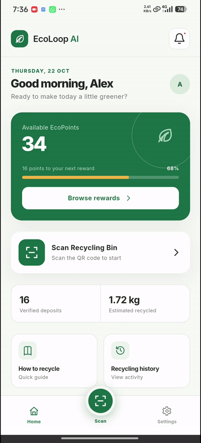
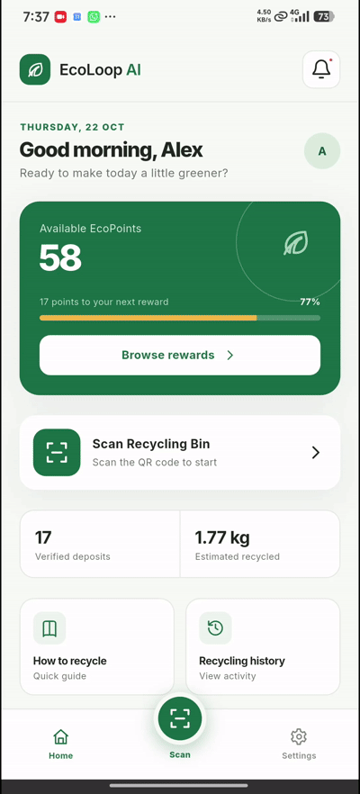
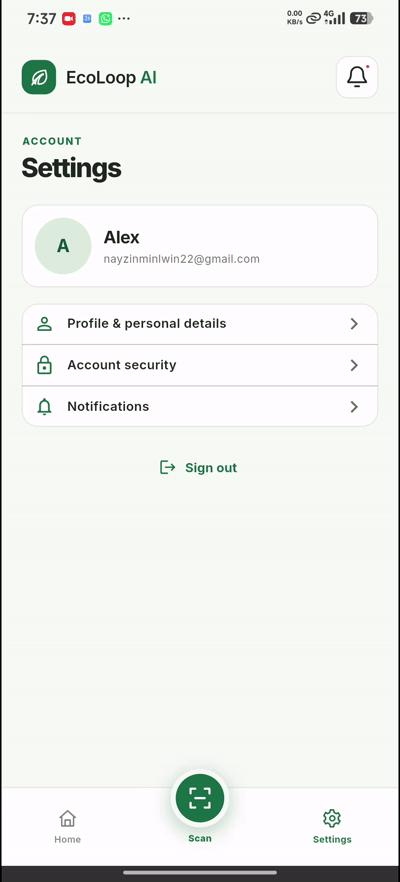
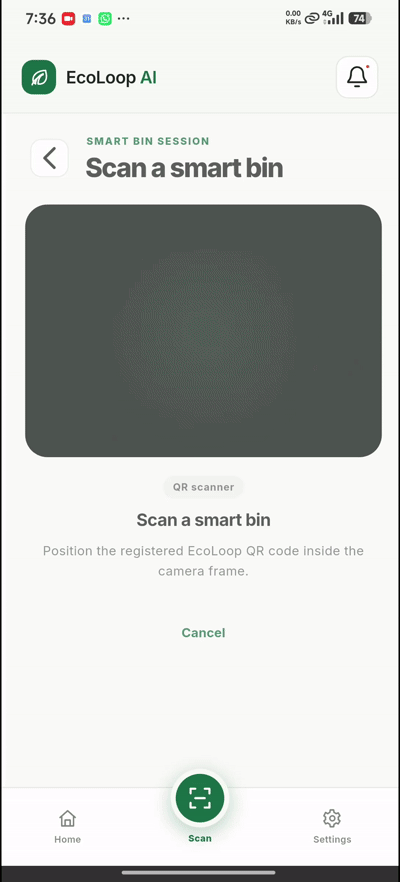
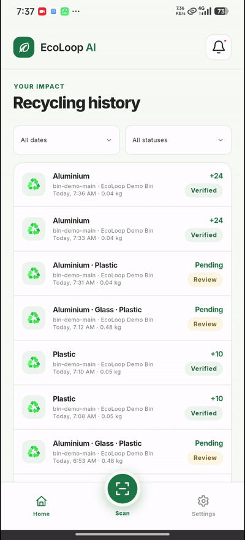
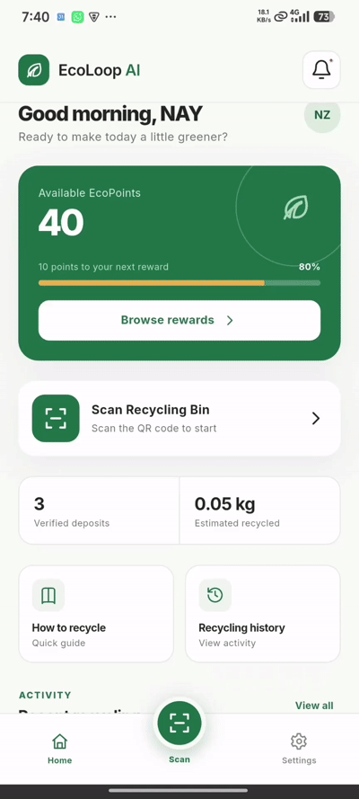
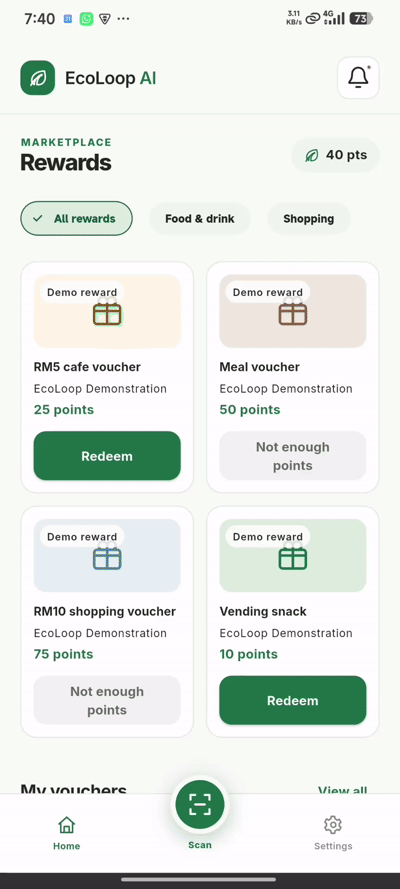
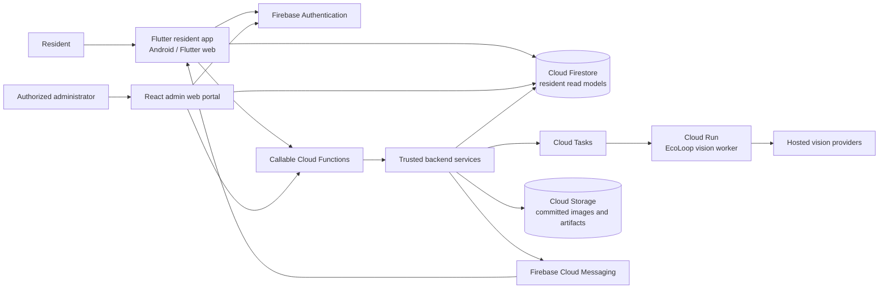
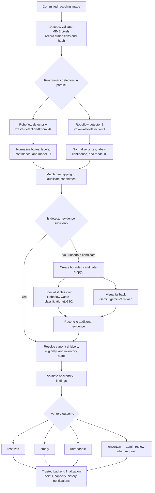

<p align="center">
  
</p>

<h1 align="center">EcoLoop - The Smart Recycling</h1>

<p align="center">
  <strong>Smart Recycling. Sustainable Communities. Rewarding Actions.</strong>
</p>

<p align="center">
  A smart recycling platform that connects residents, recycling operations, image inspection, and EcoPoints rewards.
</p>

<p align="center">
  
  
  
  
</p>

EcoLoop AI is a proof-of-concept smart recycling platform for residents and
community recycling administrators. Residents can learn what to recycle,
scan an enabled bin, submit a prepared image for inspection, track their
recycling activity, and redeem demonstration rewards. Administrators can
monitor operational workflows such as bins, capacity alerts, deposit review,
rewards, and program settings.

The platform is designed around a traceable journey:

> **Identify a bin → submit a batch → inspect items → settle EcoPoints → record impact → redeem a reward**

> **Project status:** The resident application, administrative web portal,
> backend services, and computer-vision worker are implemented as a
> proof-of-concept baseline. Live integration, deployment, provider
> availability, and device-specific behavior still require environment-specific
> acceptance evidence.

## Table of Contents

- [Project Overview](#project-overview)
- [Problem and Vision](#problem-and-vision)
- [Core Features](#core-features)
  - [Resident Application](#resident-application)
  - [Administrative Web Portal](#administrative-web-portal)
- [Demo and Screenshots](#demo-and-screenshots)
- [Architecture](#architecture)
  - [System Boundary](#system-boundary)
  - [Trash Classification Engine](#trash-classification-engine)
- [Technology Stack](#technology-stack)
- [Getting Started](#getting-started)
  - [Resident Flutter Application](#resident-flutter-application)
  - [Administrative Web Portal](#administrative-web-portal-1)
  - [Computer-Vision Service](#computer-vision-service)
- [Mock and Demo Scenarios](#mock-and-demo-scenarios)
- [Testing and Verification](#testing-and-verification)
- [Current Development Status](#current-development-status)
- [Known Limitations](#known-limitations)
- [Documentation](#documentation)
- [Project Vision](#project-vision)

## Project Overview

EcoLoop AI brings the resident recycling experience and the operational
management experience into one product boundary:

| Product area | Purpose |
| --- | --- |
| Resident application | Guides recycling participation, scanning, image submission, history, rewards, and account management. |
| Administrative web portal | Gives authorized operators visibility and controlled workflows for bins, alerts, reviews, rewards, and policies. |
| Trusted backend services | Own identity checks, reservations, durable jobs, settlement, wallet and capacity accounting, recovery, and notifications. |
| Computer-vision engine | Inspects a committed image and returns structured evidence for backend decisions and possible admin review. |

EcoLoop is software-only in this proof of concept. A phone or browser camera
scans a real QR code, while a prepared image simulates the capture that a
future smart bin could provide.

## Problem and Vision

Residents need a clear way to identify eligible recyclable items, participate
in a recycling program, understand what happened to their submission, and
receive a consistent incentive. Administrators need visibility into bin
availability, estimated capacity, deposits requiring review, collection needs,
and reward configuration.

EcoLoop addresses both sides by connecting:

- **Guidance:** accepted-object information, preparation instructions, and
  recycling steps.
- **Participation:** QR-based bin identification and a guided recycling
  session.
- **Evidence:** image inspection produces structured object findings and
  uncertainty states instead of pretending every image is certain.
- **Trust:** the backend remains authoritative for eligibility, settlement,
  EcoPoints, wallet balances, and capacity accounting.
- **Motivation:** residents can follow verified impact, browse rewards, and
  manage demonstration vouchers.

The project does not claim a measured increase in recycling participation or
environmental impact. Those outcomes require a separate field study.

## Core Features

| Feature | What it does | Value |
| --- | --- | --- |
| Guided recycling journey | Takes a resident from bin identification through submission and result. | Makes participation understandable and repeatable. |
| QR bin scanning | Validates a real QR code against an enabled smart-bin record. | Connects the resident session to the intended bin. |
| Image inspection | Processes committed image pixels through multiple hosted vision models. | Provides evidence for resolved, empty, unreadable, or uncertain outcomes. |
| Trusted settlement | Applies policy-controlled eligibility, points, reservations, and capacity changes on the backend. | Prevents the client from becoming the accounting authority. |
| Recycling history | Shows a resident's own deposits, statuses, filters, and receipts. | Makes outcomes recoverable and transparent. |
| EcoPoints and rewards | Tracks verified points and supports demonstration voucher redemption. | Encourages continued participation without implying real merchant fulfillment. |
| Operations portal | Supports bin management, capacity workflows, deposit review, rewards, and settings. | Gives authorized operators a structured operational view. |
| Mock, emulator, and live modes | Supports local demonstrations, Firebase emulator use, and configured Firebase operation. | Keeps development and testing reproducible. |

### Resident Application

The Flutter resident application includes:

- Google sign-in, account provisioning, profile, security information, and
  notification preferences.
- Home dashboard with wallet balance, reward progress, verified recycling
  summary, recent activity, and active-work recovery.
- Recycling guide with accepted-object information, preparation instructions,
  recycling steps, and item-based points rates.
- QR scanner, registered-bin validation, session exclusivity, scan progress,
  prepared-image selection, explicit submission, processing status, and final
  or review outcomes.
- Recycling history with resident-owned records, filters, timestamps, item
  findings, statuses, and receipts where available.
- Rewards and vouchers with catalog browsing, point redemption, voucher
  details, copy-code behavior, and demonstration consumption.
- Account settings, profile editing, notification preferences, and sign-out.

The resident client does not call Roboflow or Gemini directly and does not
calculate wallet credit. It observes backend-owned results and projections.

### Administrative Web Portal

The responsive React and TypeScript portal is designed for authorized
administrators and operators. Its feature areas include:

- Overview analytics and operational visibility.
- Smart-bin search, creation, editing, QR display, capacity, and collection
  workflows.
- Capacity alerts and collection lifecycle handling.
- Deposit verification and review decisions with supporting image findings.
- Rewards and voucher catalog management.
- Program settings such as material categories and points-rate policy.

The current portal includes mock repositories and Firebase-oriented repository
boundaries. Shared live integration and deployment authorization still require
the acceptance work described in the design documents.

## Demo and Screenshots

The following demonstrations show the main resident journeys. The GIFs are
stored in [`Demo_Screenshots/`](./Demo_Screenshots/).

### Home and Recycling Guide

| Home page |
| --- |
|  |
| Dashboard, EcoPoints, impact summary, recent activity, and quick actions. |

### Guide and Account

<table>
  <tr>
    <th>How to recycle</th>
    <th>Settings page</th>
  </tr>
  <tr>
    <td align="center"></td>
    <td align="center"></td>
  </tr>
  <tr>
    <td>Accepted materials, preparation instructions, and recycling steps.</td>
    <td>Manage profile, security, notifications, and account settings.</td>
  </tr>
</table>

### Recycling and Activity

<table>
  <tr>
    <th>Recycle flow</th>
    <th>Recent transactions</th>
  </tr>
  <tr>
    <td align="center"></td>
    <td align="center"></td>
  </tr>
  <tr>
    <td>Complete recycling workflow, from scanning the QR code and preparing to recycle through item detection and EcoPoints deposit.</td>
    <td>Review recycling history, filters, statuses, and transaction details.</td>
  </tr>
</table>

### Rewards

<table>
  <tr>
    <th>Rewards page</th>
    <th>Redeem reward</th>
  </tr>
  <tr>
    <td align="center"></td>
    <td align="center"></td>
  </tr>
  <tr>
    <td>Browse rewards, point requirements, and voucher details.</td>
    <td>Select a reward, confirm redemption, and view the issued voucher.</td>
  </tr>
</table>

### Admin Panel Demo Screenshots

The administrative web portal will be documented with static screenshots.
Each screenshot will appear in its own row so the operational workflows are
easy to review.

| Overview page |
| --- |
| *Placeholder: `Admin_Overview.png`* |

| Smart Bins page |
| --- |
| *Placeholder: `Admin_Smart_Bins.png`* |

| Capacity Alerts page |
| --- |
| *Placeholder: `Admin_Capacity_Alerts.png`* |

| Deposit Verification page |
| --- |
| *Placeholder: `Admin_Deposit_Verification.png`* |

| Rewards & Vouchers page |
| --- |
| *Placeholder: `Admin_Rewards_Vouchers.png`* |

| Settings page |
| --- |
| *Placeholder: `Admin_Settings.png`* |

The repository currently also contains static design and implementation
comparisons in [`Demo_Screenshots/`](./Demo_Screenshots/), including:

- Figma and Flutter home pages
- How-to-recycle pages
- Recycling history
- Recycling process stages
- Rewards
- Settings and personal details

## Architecture

### System Boundary



The resident and admin clients are sibling clients, not two views of a single
role-switching application. Clients request operations and observe committed
read models; trusted services own authorization, settlement, accounting,
capacity, durable job processing, and recovery.

### Trash Classification Engine

The classification engine receives the committed image selected for a
submitted recycling batch. It validates the pixels, runs the two primary
detectors in parallel, merges and matches their findings, and invokes
specialist or visual fallback analysis only when additional evidence is
needed.



The two detector branches process the same committed image concurrently.
Their outputs are normalized before duplicate candidates are matched.
`waste-classification-rjo28/2` and `gemini-3.8-flash` provide specialist or
fallback evidence for candidates that need more analysis; their output is
still evidence, not an automatic wallet award. Recognition, eligibility, and
reward settlement remain separate decisions.

## Technology Stack

| Area | Technology | Purpose |
| --- | --- | --- |
| Resident UI | Flutter and Dart | Android and Flutter web resident application. |
| Resident state | `flutter_riverpod` | Provider composition, dependency injection, and feature state. |
| Resident routing | `go_router` | Authentication redirects and resident navigation. |
| Authentication | Firebase Authentication and Google Sign-In | Resident and operator identity entry points. |
| Data and commands | Cloud Firestore and callable Cloud Functions | Read models, trusted commands, settlement, and recovery boundaries. |
| Files and messaging | Cloud Storage and Firebase Cloud Messaging | Image/artifact storage and resident notifications. |
| Admin UI | React 19, TypeScript, Vite | Responsive administrative web portal. |
| Admin routing | `react-router-dom` | Portal route tree and guards. |
| Computer vision | Python 3.12 on Google Cloud Run | Hosted image-inspection worker. |
| Vision providers | Roboflow and Google Gemini | Detector, classifier, and structured visual fallback evidence. |
| Queueing | Cloud Tasks | Durable vision-job dispatch and retry boundary. |
| Testing | Flutter tests, Dart analysis, Node tests, Playwright, Python tests | Unit, contract, integration, UI, and service verification. |

The resident package versions and admin package scripts are maintained in
[`pubspec.yaml`](./pubspec.yaml) and
[`apps/admin-web/package.json`](./apps/admin-web/package.json).

## Getting Started

### Prerequisites

- Flutter SDK with Dart support compatible with the repository constraint
  (`Dart ^3.13.0`).
- Android SDK and/or Google Chrome for resident application execution.
- Node.js `>=22.14.0 <25` and npm `>=10.9.2 <12` for the admin portal.
- Python 3.12 and the service dependencies for local vision-engine work.
- Firebase/Google Cloud resources and server-held provider credentials for
  live operation.

Do not commit Firebase credentials, model-provider keys, or local environment
files.

### Resident Flutter Application

From the repository root:

```bash
flutter pub get
flutter run -d chrome --dart-define=ECOLOOP_FIREBASE_MODE=mock
```

The default resident runtime mode is `mock`. To select a mock scenario:

```bash
flutter run -d chrome \
  --dart-define=ECOLOOP_FIREBASE_MODE=mock \
  --dart-define=MOCK_SCENARIO=normal
```

The application also supports `emulator` and `firebase` modes through
`ECOLOOP_FIREBASE_MODE`. Emulator hosts and ports are configured through the
runtime inputs documented in the
[resident SDD](./docs/ECOLOOP_SDD_USER_APP.md).

### Administrative Web Portal

From [`apps/admin-web/`](./apps/admin-web/):

```bash
npm install
npm run dev
```

The development server uses port `5174`. Useful verification commands are:

```bash
npm run check:all
npm test
npm run build
```

The portal supports `mock`, `emulator`, and `firebase` runtime boundaries.
Live Firebase use requires the appropriate environment configuration and
authorization setup.

### Computer-Vision Service

The vision worker is located in [`services/vision/`](./services/vision/). Its
deployed design targets Python 3.12 on Cloud Run, with Cloud Tasks dispatch
and hosted provider APIs. Local provider probes and service tests require
the service's documented Python environment and configured credentials.

The deployment configuration is maintained in
[`infra/cloudbuild.vision.yaml`](./infra/cloudbuild.vision.yaml) and
[`infra/cloudrun.vision.yaml`](./infra/cloudrun.vision.yaml).

## Mock and Demo Scenarios

EcoLoop explicitly separates demonstration behavior from live operation:

| Mode or scenario | Purpose |
| --- | --- |
| `ECOLOOP_FIREBASE_MODE=mock` | Runs the resident app with bundled fixtures and mock repositories. |
| `ECOLOOP_FIREBASE_MODE=emulator` | Uses Firebase adapters against configured local emulators. |
| `ECOLOOP_FIREBASE_MODE=firebase` | Uses configured Firebase services for live integration rehearsal. |
| `MOCK_SCENARIO=normal` | Normal resident mock journey. |
| `MOCK_SCENARIO=readFailureOnce` | Simulates one read failure and recovery behavior. |
| `MOCK_SCENARIO=classificationFailureOnce` | Simulates one classification failure. |
| `MOCK_SCENARIO=profileSaveFailureOnce` | Simulates one profile-save failure. |
| `MOCK_SCENARIO=emptyActivity` | Exercises an empty activity state. |
| `MOCK_SCENARIO=redemptionFailureOnce` | Simulates one reward-redemption failure. |

Scenario names are development and testing controls. A successful mock
journey is not evidence that the cloud deployment, hosted model providers,
notifications, or physical recycling hardware are working.

## Testing and Verification

### Resident application

```bash
dart format --output=none --set-exit-if-changed lib test integration_test
flutter analyze
flutter test
flutter build web
```

For a connected-device journey:

```bash
flutter test integration_test/resident_journey_test.dart -d <device-id>
```

### Administrative portal

```bash
cd apps/admin-web
npm run check:all
npm test
npm run build
```

### Broader services

The repository also contains tests for Cloud Functions, backend contracts,
Firebase rules, and the vision worker. Use the service-specific commands and
environment requirements documented in the relevant project folders and
design documents. Live provider tests require configured credentials and must
not write secrets to source or committed output.

## Current Development Status

| Area | Status |
| --- | --- |
| Resident Flutter application | Implemented with mock, emulator, and Firebase-oriented paths. |
| Resident recycling journey | Implemented, including QR flow, prepared-image submission, progress, recovery, and result states. |
| Rewards and vouchers | Implemented as demonstration flows; concrete redemption policy requires integrated acceptance alignment. |
| Administrative web portal | Implemented as a responsive operational demonstration with mock repository support. |
| Shared live admin integration | Integration and authorization alignment remain acceptance work. |
| Backend settlement and accounting | Designed and implemented across trusted service boundaries; live deployment evidence is environment-dependent. |
| Computer-vision worker | Implemented as a Cloud Run-oriented hosted-provider worker with structured findings and recovery states. |
| Physical smart-bin hardware | Out of scope for this proof of concept. |
| Quantified environmental impact | Not established; requires a separate field study. |

## Known Limitations

- The proof of concept does not connect to physical bin cameras, lid
  actuators, weighing scales, fill sensors, or hardware protocols.
- Prepared images simulate bin-camera capture. A camera scan identifies the
  logical bin but does not prove physical presence at that bin.
- Hosted Roboflow and Gemini availability, model-version stability, response
  behavior, quotas, pricing, and latency require deployment-time verification.
- Vision confidence is bounded evidence, not a calibrated probability or
  guarantee of correctness.
- Uncertain or technically exhausted inspections require bounded recovery or
  review; the system must not silently treat missing detections as an empty
  image.
- The admin portal's live shared-service integration, claims provisioning,
  and authorization alignment require integrated acceptance.
- Demonstration vouchers do not represent real merchant point-of-sale
  integration, cash payment, or guaranteed monetary fulfillment.
- Reward limits, policy-version behavior, collection semantics, and some
  technical-failure capacity rules require final integrated agreement before
  they should be presented as production policy.
- Notifications, camera permissions, browser behavior, cold starts, and
  emulator/device networking vary by platform and environment.

## Documentation

The detailed project baselines are:

- [Software Requirements Specification](./docs/ECOLOOP_SRS.md)
- [Resident Application SDD](./docs/ECOLOOP_SDD_USER_APP.md)
- [Administrative Panel SDD](./docs/ECOLOOP_SDD_ADMIN_PANEL.md)
- [Computer Vision SDD](./docs/ECOLOOP_SDD_COMPUTER_VISION.md)
- [Backend and Computer Vision Specification](./docs/ECOLOOP_BACKEND_AND_CV_SPECIFICATION.md)
- [Admin Web Acceptance](./docs/ADMIN_WEB_ACCEPTANCE.md)
- [README restructuring plan](./README_RESTRUCTURE_PLAN.md)

These documents contain the detailed requirements, architecture, contracts,
acceptance conditions, qualifications, and source traceability that are
intentionally summarized here.

## Project Vision

EcoLoop AI aims to make recycling easier to understand, easier to verify, and
more rewarding to repeat. By connecting residents, trusted recycling
operations, image-based inspection, and transparent EcoPoints, the platform
helps communities move toward more responsible everyday recycling.

> **Recycle responsibly. Earn rewards. Build greener communities.**
