# EcoLoop AI — Software Design Document
## Administrative Web Panel

| Document control | Value |
| --- | --- |
| Document ID | ECOLOOP-SDD-ADMIN-001 |
| Version | 1.0 |
| Prepared | 17 October 2026 |
| Design baseline | Approved design for EcoLoop AI PoC administrative web-panel development; implementation followed this document |
| Status | Approved design baseline; integration qualifications recorded in Section 16 |
| Platforms | Desktop and mobile web browsers |
| Requirements baseline | [EcoLoop SRS](ECOLOOP_SRS.md) |
| Primary source | [`../apps/admin-web`](../apps/admin-web), with relevant Firebase configuration and tests |

> **Reading guide:** Start with Sections 2–6 for the structural blueprint.
> Section 7 follows the administrator's operational journeys. Sections 8–12
> explain state, data, integration, failure handling, and security. Sections
> 13–16 cover presentation, deployment, verification, and the boundaries that
> still need alignment.

This document defines the administrative web panel as an approved design
baseline for EcoLoop AI PoC development. It is not a proposal created after
implementation. The implementation in [`../apps/admin-web`](../apps/admin-web)
was developed against this design, and the final section records integration
qualifications where the implemented client depends on shared backend or
Firebase deployment decisions.

Where the design supports both a stateful mock and Firebase adapters, both
paths are documented. A statement marked **live boundary** belongs to the
shared backend or Firebase security configuration, not to browser trust.

## Contents

1. [Purpose, scope, and design responsibilities](#1-purpose-scope-and-design-responsibilities)
2. [Architecture at a glance](#2-architecture-at-a-glance)
3. [Source organization and responsibilities](#3-source-organization-and-responsibilities)
4. [Bootstrap and runtime modes](#4-bootstrap-and-runtime-modes)
5. [Authentication and route protection](#5-authentication-and-route-protection)
6. [Navigation and responsive shell](#6-navigation-and-responsive-shell)
7. [Feature designs](#7-feature-designs)
8. [State, queries, and mutation behavior](#8-state-queries-and-mutation-behavior)
9. [Data contracts and persistence](#9-data-contracts-and-persistence)
10. [Firebase integration and command recovery](#10-firebase-integration-and-command-recovery)
11. [Validation, errors, and concurrency](#11-validation-errors-and-concurrency)
12. [Security and privacy](#12-security-and-privacy)
13. [Presentation and accessibility](#13-presentation-and-accessibility)
14. [Deployment and operating environments](#14-deployment-and-operating-environments)
15. [Verification and traceability](#15-verification-and-traceability)
16. [Design decisions and current qualifications](#16-design-decisions-and-current-qualifications)
17. [Source reference index](#17-source-reference-index)

## 1. Purpose, scope, and design responsibilities

The admin panel is a browser client for authorized EcoLoop operators. It
provides operational visibility and controlled administrative commands; it is
not a resident-facing recycling experience and does not replace the Flutter
application.

The design owns:

- admin sign-in, sign-out, redirect handling, and authorization gating;
- the responsive shell and six administrative modules;
- query/filter/pagination state and presentation-level validation;
- repository contracts and mapping between UI models and backend views;
- admin commands such as bin changes, collection actions, review decisions,
  reward publication, and policy updates;
- loading, empty, error, conflict, and retry behavior.

The shared backend owns authoritative settlement, points, policy versions,
capacity-cycle consistency, audit records, and authorization enforcement. The
browser may request these operations but must never be treated as the source of
truth for them.

### 1.1 Requirement and design relationship

The feature inventory is derived from SRS requirements `FR-ADM-01` through
`FR-ADM-16`. The resident app uses the same shared wire concepts (`SmartBin`,
`DepositTransaction`, `Reward`, material types, and wallet projections), while
the admin panel adds admin-only records and views in
[`admin.ts`](../apps/admin-web/src/contracts/admin.ts).

## 2. Architecture at a glance

### 2.1 Admin panel in its environment

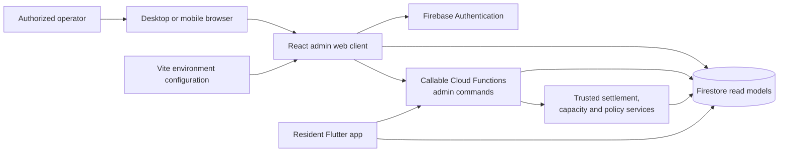

Reads are represented by repository observables so the shell and active page
can react to committed changes. Writes use repository methods; Firebase
implementations prefer callable functions for privileged operations and map
backend failures into a stable `RepositoryError`.

### 2.2 Layered structure

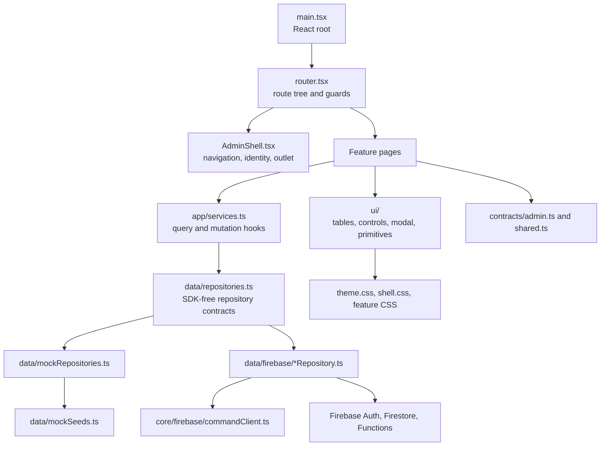

The UI does not import Firebase SDK objects directly. Repository contracts
keep the page layer testable and permit the mock, emulator, and hosted
implementations to share the same behavior.

### 2.3 Technology choices

| Concern | Implemented choice |
| --- | --- |
| UI | React 19 with TypeScript |
| Build and local server | Vite; development port 5174 and preview port 4174 |
| Routing | `react-router-dom` browser router |
| Backend SDK | Firebase Auth, Firestore, Functions, and App Check integration |
| Validation | Explicit page validation plus typed contracts and codecs |
| Styling | CSS files and shared design tokens/primitives |
| QR output | `qrcode` package; generated bin QR payloads can be displayed/downloaded |
| Tests | Node contract/unit tests and Playwright end-to-end tests |
| Runtime modes | `mock`, `emulator`, and `firebase` |

## 3. Source organization and responsibilities

| Area | Responsibility | Representative files |
| --- | --- | --- |
| `src/app` | Composition, routes, shell, auth entry, service hooks | [`router.tsx`](../apps/admin-web/src/app/router.tsx), [`AdminShell.tsx`](../apps/admin-web/src/app/AdminShell.tsx) |
| `src/features/fleet` | Overview analytics and smart-bin management | `OverviewPage.tsx`, `SmartBinsPage.tsx` |
| `src/features/operations` | Capacity operations and AI review decisions | `CapacityAlertsPage.tsx`, `DepositVerificationPage.tsx` |
| `src/features/program` | Rewards/vouchers and policy settings | `RewardsVouchersPage.tsx`, `SettingsPage.tsx` |
| `src/ui` | Shared tables, list controls, modal, primitives | `DataTable.tsx`, `ListControls.tsx`, `Modal.tsx` |
| `src/contracts` | Shared and admin wire models, codecs, query types | `shared.ts`, `admin.ts`, `adminViewCodecs.ts` |
| `src/data` | Repository ports, mock state, Firebase adapters | `repositories.ts`, `mockRepositories.ts` |
| `src/core/firebase` | Firebase initialization, App Check, command envelope | `config.ts`, `app.ts`, `commandClient.ts` |

Feature pages own screen composition and local form/dialog state. Repositories
own reads, mapping, mutations, and backend error conversion. Shared UI
components do not own business transactions.

## 4. Bootstrap and runtime modes

### 4.1 Startup sequence

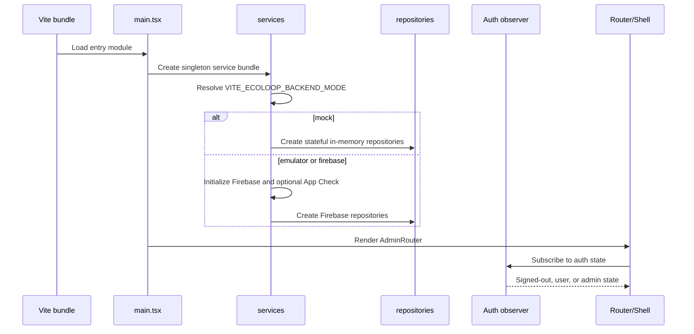

The default is mock outside production. Production resolves to Firebase and
fails fast when the required API key is missing. Emulator mode uses the
configured Auth, Firestore, and Functions endpoints.

### 4.2 Service bundle and observables

[`services.ts`](../apps/admin-web/src/app/services.ts) exposes:

- `services.repositories`, the `AdminRepositories` implementation;
- `services.mode`, used to identify mock/demo behavior;
- `useQuery` for one-shot asynchronous reads;
- `useObservableQuery` for subscriptions with loading/error/reload state;
- `useMutation` for pending/error/result state;
- revision/auth-generation signals used to refresh dependent views.

The mock bundle delays reads and writes, publishes a revision after commits,
and allows tests to inject a single operation failure. This makes loading,
failure, and recovery behavior observable without a backend.

## 5. Authentication and route protection

### 5.1 Route inventory

| Path | Screen | Access |
| --- | --- | --- |
| `/` | Redirect based on auth state | Public entry |
| `/login` | Admin sign-in and sign-out intent | Public |
| `/overview` | Operational dashboard | Admin |
| `/bins` | Smart-bin list and management | Admin |
| `/alerts` | Capacity alert queue and collection cycle | Admin |
| `/verification` | Deposit review queue and decision workflow | Admin |
| `/vouchers` | Rewards and resident voucher administration | Admin |
| `/settings` | Global capacity/material/rate policy | Admin |
| `*` | Recoverable not-found page | Public |

### 5.2 Authorization algorithm

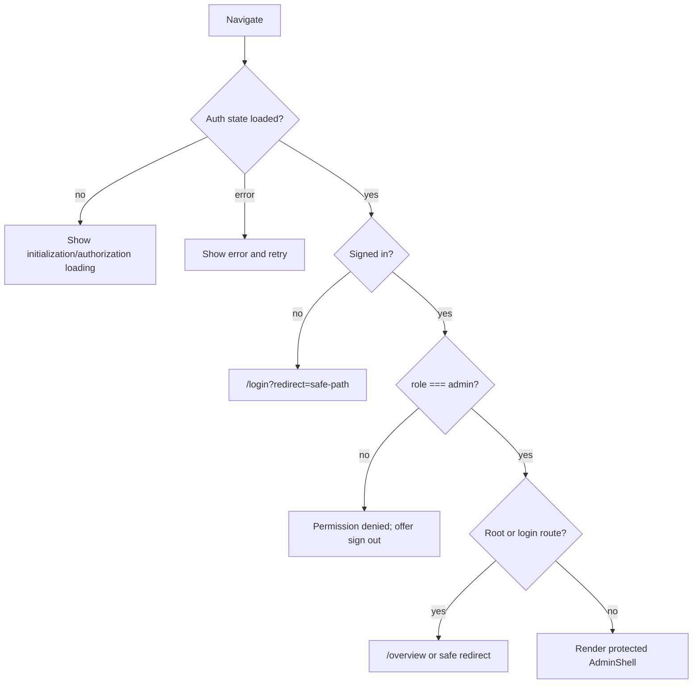

`LoginPage` validates the email format and password presence before calling
`auth.login`. Redirects are allowlisted to known admin paths and reject
protocol-relative or external URLs. Logout is represented by a login intent so
the UI can show pending and failure states while the session is terminated.

## 6. Navigation and responsive shell

`AdminShell` provides a persistent sidebar on larger screens and an overlay
drawer on narrow screens. It subscribes to the admin identity and dashboard
summary so the user identity and active-alert badge update without a full
navigation.

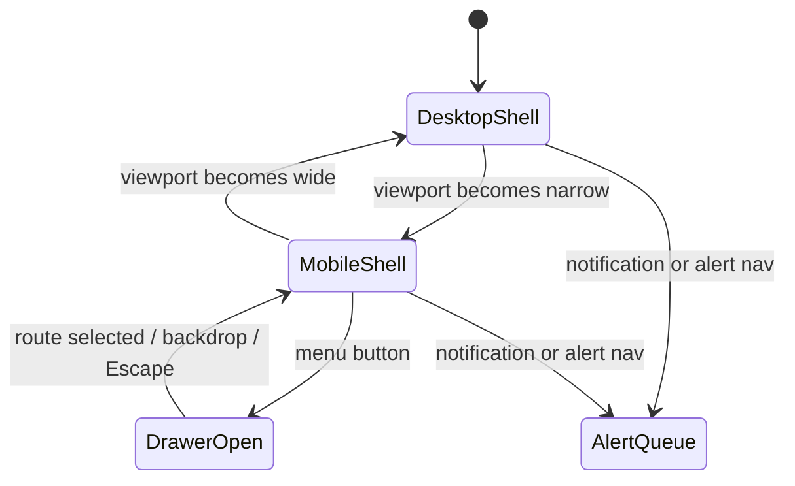

Navigation links are the single route vocabulary used by the router and shell.
Route changes close the mobile drawer. Active alert count is shown in the
sidebar and notification control; it is a projection, not a client-side
counter maintained independently from the repository.

## 7. Feature designs

### 7.1 Overview

The dashboard reads `DashboardSummary` and renders:

- registered bins;
- active alerts;
- verified deposits and EcoPoints issued;
- estimated total recycling weight;
- weekly verified activity;
- material mix;
- bins needing attention with collection status.

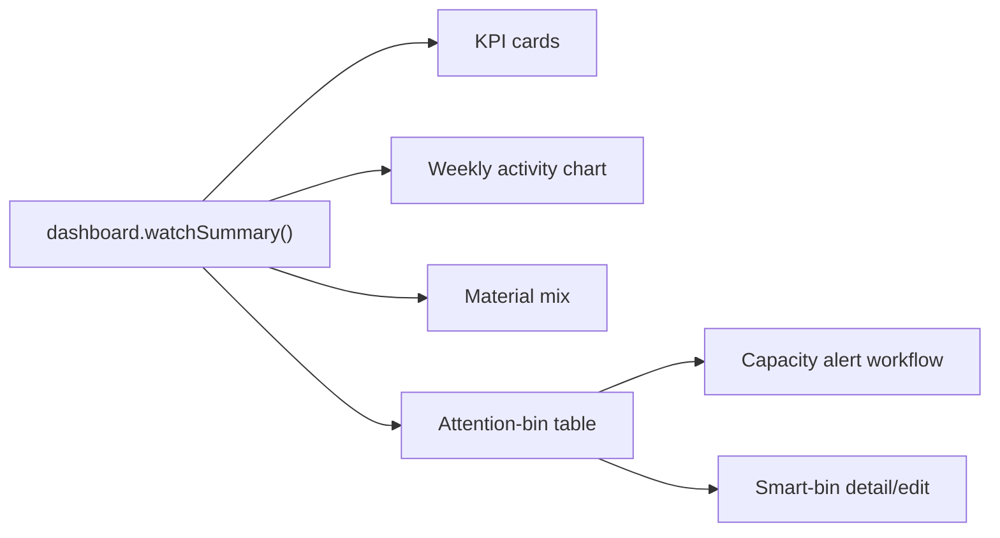

The dashboard is a read projection. It does not calculate authoritative points
or rewrite bin state from chart interactions.

### 7.2 Smart bins

The bin list supports search, page size, pagination, sorting, capacity-band
filtering, collection-status filtering, and online/offline filtering. A bin
row combines `SmartBin` data with `BinOperations`.

Supported actions:

1. register a bin with a unique ID;
2. edit location, accepted materials, and operational fields;
3. generate/display/download its QR code;
4. simulate capacity in the demo/mock path;
5. delete after confirmation, subject to referential-integrity checks.

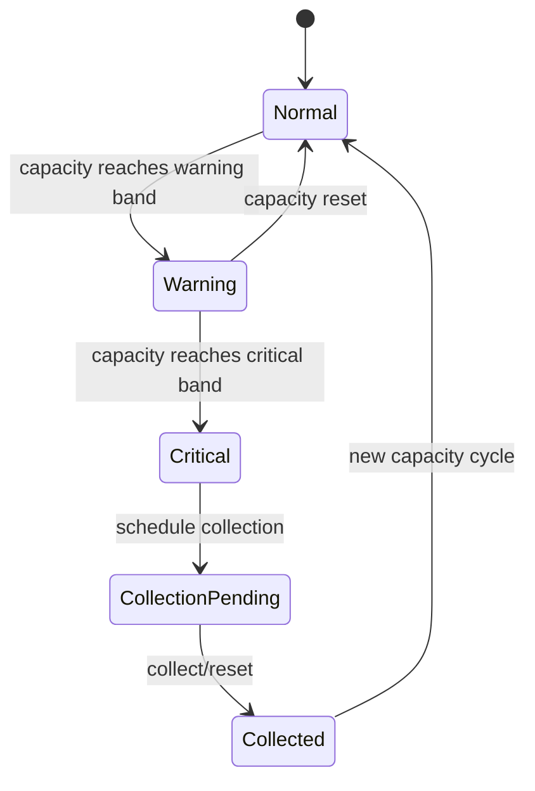

Capacity simulation is explicitly a simulation control and is not a substitute
for a sensor ingestion path.

### 7.3 Capacity alerts

The alert queue supports active/resolved filtering, search, sorting, paging,
detail inspection, and the ordered operational lifecycle:

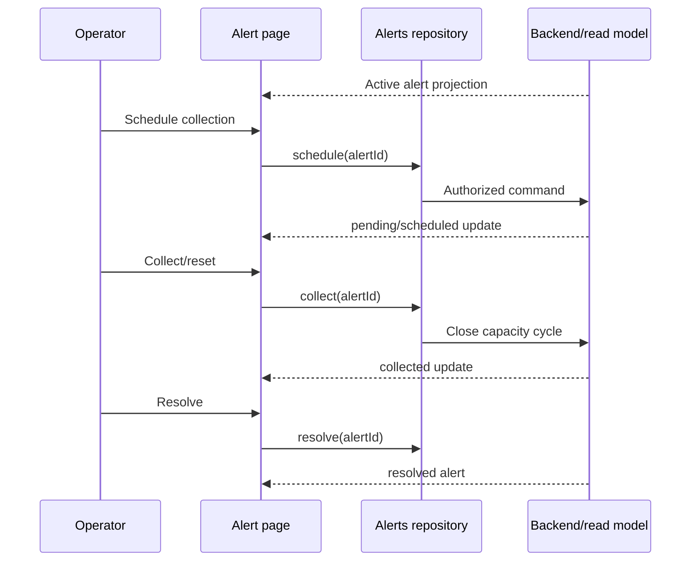

Invalid transitions are rejected by the repository/backend rather than
silently forced by the page.

### 7.4 Deposit verification

The verification screen is a review queue for AI-assisted deposit decisions.
It supports status tabs, search/filtering, ticket selection, evidence display,
object/material decisions for mixed batches, resolution preview, and an
approve/reject command.

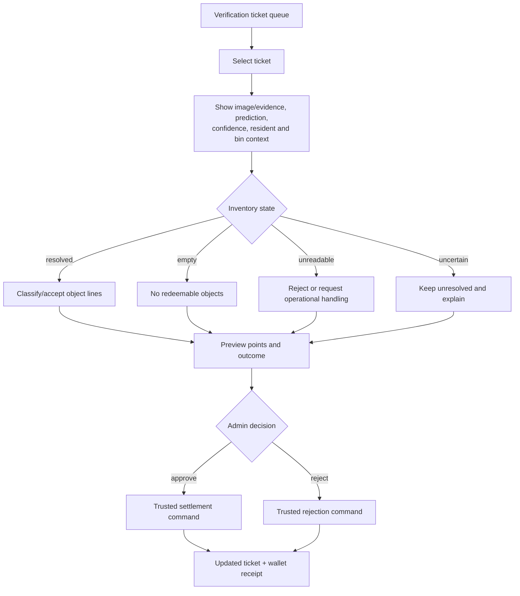

The browser renders the preview but does not award points locally. The backend
must enforce decision version checks, idempotency, pinned policy, and
single-settlement semantics.

### 7.5 Rewards and vouchers

The program screen separates reward catalog management from resident voucher
inspection. Rewards support category/publication filters, search, sorting,
pagination, create/edit, active/draft toggling, and confirmed deletion.

Required reward input includes a valid title, description/terms, merchant,
category, positive integer points cost, expiration date, and publication
state. Voucher records are resident-issued outcomes and should not be edited
as if they were catalog definitions.

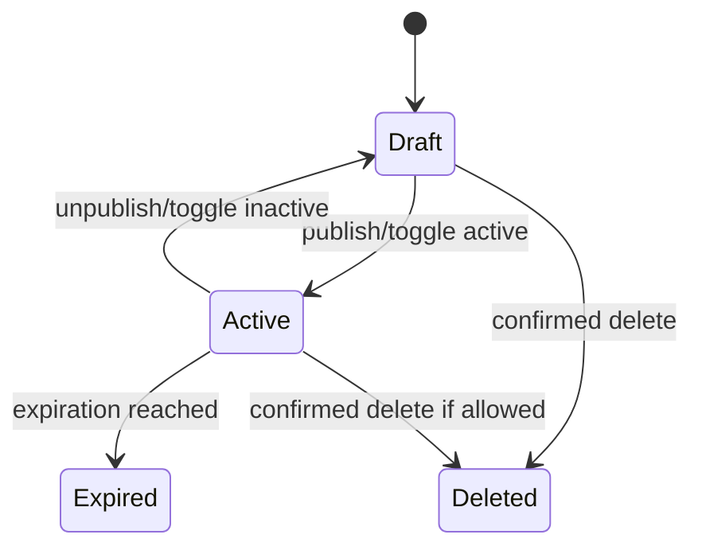

### 7.6 System settings

Settings edit the global program policy:

- capacity alert threshold: 75%, 80%, or 85%;
- accepted material types;
- integer material rates;
- optional accepted classes;
- policy/version metadata.

The page tracks dirty state, warns before leaving with unsaved changes, shows
save feedback, and handles version conflicts by allowing the operator to
reload the latest settings before retrying.

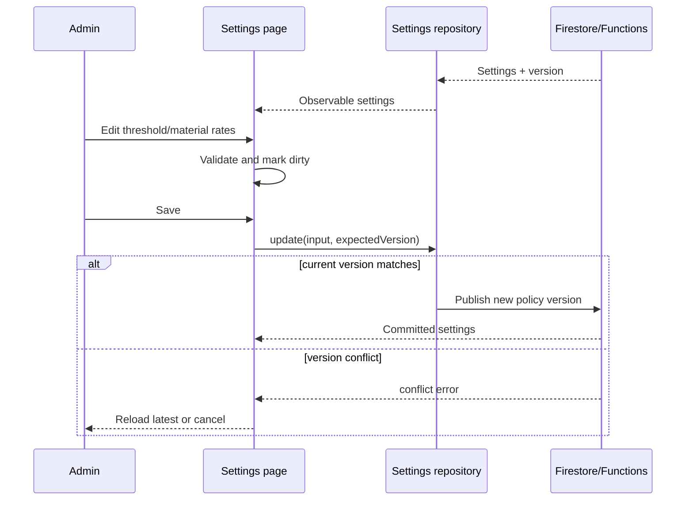

## 8. State, queries, and mutation behavior

### 8.1 State ownership

| State | Owner | Lifetime |
| --- | --- | --- |
| Auth and identity | Auth repository observable | Session |
| Dashboard/alert counts | Dashboard projection | Backend/read-model lifetime |
| Search, filters, sort, page | Feature page | Current screen |
| Form fields and dialogs | Feature page | Current dialog/screen |
| Loading/error/reload | `useQuery`/`useObservableQuery` | Current request/subscription |
| Pending mutation and mutation error | `useMutation` or page mutation state | Current operation |
| Authoritative records | Firebase/backend or mock bundle | Repository lifetime |

Pages may optimistically update local presentation state such as a dialog
closing, but committed rows and counters come from the repository result or
subsequent observable update.

### 8.2 List query pipeline

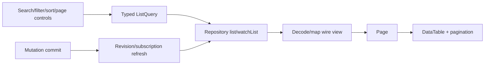

Changing a filter resets or constrains the page as appropriate. List
repositories return a typed total and page metadata; the table does not infer
totals from the current page.

## 9. Data contracts and persistence

### 9.1 Core relationships

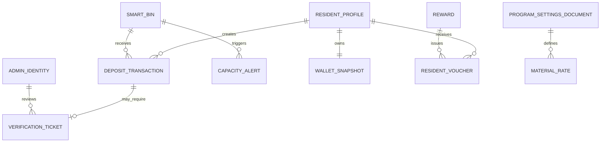

Important contracts live in [`shared.ts`](../apps/admin-web/src/contracts/shared.ts)
and [`admin.ts`](../apps/admin-web/src/contracts/admin.ts):

- shared resident records remain aligned with the Flutter client;
- admin records add operational status and review metadata;
- `Page<T>` and typed `ListQuery` standardize pagination;
- `expectedVersion` is carried by settings and reward/bin inputs where
  concurrent updates matter;
- `VerificationDecisionResult` returns the updated detail and wallet snapshot,
  not a browser-calculated balance.

### 9.2 Read models and backend collections

Firebase adapters read canonical documents and administrative projections,
including bins, capacity alerts, batches/deposits, rewards, vouchers,
`adminBinViews`, `adminAlertViews`, and `adminReviewViews`. Exact collection
availability and indexes are backend deployment concerns; the client maps
missing or malformed data to repository failures rather than fabricating a
success-shaped record.

## 10. Firebase integration and command recovery

### 10.1 Admin command envelope

[`FirebaseCommandClient`](../apps/admin-web/src/core/firebase/commandClient.ts)
wraps privileged calls in:

```text
{
  schemaVersion: "admin.v1",
  operation: "<operation name>",
  requestId: "<unique request id>",
  payload: { ... }
}
```

Committed responses contain the operation, request ID, trace ID, committed
status, and result data. The client maps Firebase error codes to stable
failure codes such as `unauthenticated`, `permissionDenied`, `notFound`,
`validation`, `conflict`, and `unavailable`.

### 10.2 Recovery and idempotency

Commands that may be retried carry a request ID. When a transport result is
ambiguous, the intended design is to recover using
`recoverAdminOperation(targetRequestId)` rather than issuing a second
settlement or collection command.

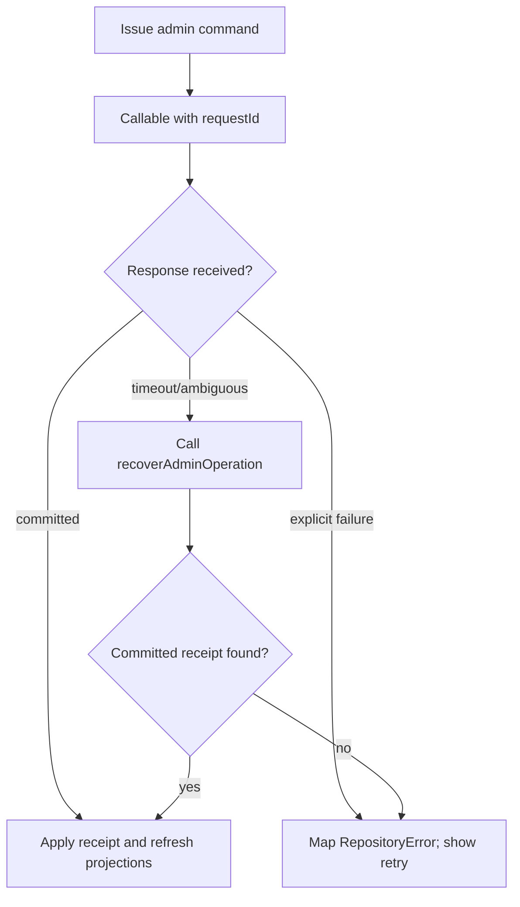

## 11. Validation, errors, and concurrency

### 11.1 Failure handling

All pages expose explicit loading, empty, and error states. Retry actions call
the query reload or repeat a safe mutation; they do not silently substitute
stale success data. Repository errors preserve a failure code and optional
field errors so forms can identify validation problems.

### 11.2 Concurrency rules

- Admin authorization is checked at the repository/backend boundary.
- Settings and reward updates may include `expectedVersion`.
- Verification decisions must reject already-decided or stale tickets.
- Capacity collection must serialize against active reservations and close one
  cycle before starting another.
- Duplicate active alerts for one bin/cycle are prohibited by the backend.
- A failed mutation must not close a dialog or update a success-shaped row
  unless the repository confirms the commit.

## 12. Security and privacy

The browser is an untrusted client. Security responsibilities are layered:

1. Firebase Authentication establishes identity.
2. The route guard hides the portal from unauthenticated/non-admin users.
3. Firestore rules and callable functions enforce authorization server-side.
4. App Check can add an application-integrity signal.
5. Trusted functions perform points, wallet, policy, and lifecycle mutations.

The admin UI should expose only the resident context needed to review a
deposit. Credentials and secrets are never embedded in source; Vite variables
contain client configuration only. Redirects are allowlisted to prevent
open-redirect behavior. Production configuration validation fails fast rather
than silently connecting to an unintended project.

## 13. Presentation and accessibility

The shell and shared primitives provide:

- semantic navigation and page landmarks;
- labeled controls and icon buttons;
- keyboard-dismissible mobile navigation (`Escape`);
- visible loading, error, empty, and feedback states;
- confirmation modals for destructive operations;
- responsive tables and drawer navigation;
- consistent status badges for online state, capacity, alert status, and review
  decisions.

Visual styling is centralized in `theme.css`, `shell.css`, feature CSS files,
and primitive CSS. Pages should compose existing controls rather than
introduce one-off interaction patterns.

## 14. Deployment and operating environments

### 14.1 Commands

From [`apps/admin-web/package.json`](../apps/admin-web/package.json):

| Command | Purpose |
| --- | --- |
| `npm run dev` | Local Vite server on `127.0.0.1:5174` |
| `npm run build` | Production Vite build |
| `npm run check:all` | Type checking for source and tests |
| `npm test` | Node contract/unit suite |
| `npm run test:e2e` | Playwright browser suite |
| `npm run preview` | Serve the production bundle locally |

The supported Node range is `>=22.14.0 <25`; npm is `>=10.9.2 <12`.

### 14.2 Mode matrix

| Mode | Use | Data authority |
| --- | --- | --- |
| `mock` | UI development and deterministic tests | Stateful in-memory seed |
| `emulator` | Local Firebase integration | Firebase emulators |
| `firebase` | Hosted/integrated deployment | Configured Firebase project |

The login screen labels the mock path as a standalone demo and warns that
in-memory data resets on refresh. This distinction must remain visible to
avoid treating demo actions as production operations.

## 15. Verification and traceability

### 15.1 SRS-to-design map

| SRS requirements | Design sections |
| --- | --- |
| `FR-ADM-01` | 5, 6 |
| `FR-ADM-02` | 5.1, 7 |
| `FR-ADM-03` | 7.1 |
| `FR-ADM-04`–`FR-ADM-06` | 7.2, 8 |
| `FR-ADM-07`–`FR-ADM-09` | 7.2, 7.3, 11 |
| `FR-ADM-10`–`FR-ADM-12` | 7.4, 9, 10 |
| `FR-ADM-13` | 7.5 |
| `FR-ADM-14`–`FR-ADM-15` | 7.6, 11 |
| `FR-ADM-16` | 8, 10, 11, 14 |

### 15.2 Verification layers

1. **Type and contract checks:** `npm run check:all`.
2. **Repository and feature behavior:** the `admin_*_ab*.test.ts` tests cover
   auth, queries, bins, settings, alerts, reviews, rewards, dashboard, and
   cross-client contracts.
3. **Browser behavior:** Playwright tests cover route protection, responsive
   interactions, dialogs, and end-to-end feature flows.
4. **Integration acceptance:** emulator/Firebase tests verify callable
   authorization, Firestore projections, version conflicts, and settlement
   idempotency.

Recommended acceptance scenarios include:

- signed-out access redirects to login and preserves an authorized destination;
- non-admin identities cannot enter the protected shell;
- an alert follows schedule → collect → resolve and rejects invalid ordering;
- a review decision cannot double-credit a wallet;
- a stale settings version displays a conflict and preserves unsaved intent;
- a failed mutation reports failure without displaying a committed result;
- mobile navigation closes on route change, backdrop, and Escape.

## 16. Design decisions and current qualifications

### 16.1 Decisions reconstructed from the implementation

- The admin portal is a sibling web client, not a role-switched Flutter screen.
- Repository ports isolate UI from Firebase and mock implementations.
- Read projections are observed reactively; privileged writes use commands.
- Admin routes are centralized in `ADMIN_PATHS`.
- The same shared resident contracts are reused to preserve cross-client
  compatibility.
- The mock environment is intentionally stateful and failure-injectable.

### 16.2 Current qualifications

- The login UI explicitly describes the standalone mock demo; hosted
  authentication behavior depends on Firebase configuration and deployed
  claims.
- Some Firebase repositories retain fallback/mock behavior for development and
  restricted callable environments. Production deployment must verify that
  fallback cannot bypass server authorization or authoritative settlement.
- Dashboard analytics are projections assembled from backend/read-model data;
  chart values are not an independent reporting warehouse.
- The exact retention, audit-log, and role-administration policies are owned by
  the backend/security design and are outside this client SDD.
- QR generation in the panel produces a bin identifier/payload for operational
  use; it does not itself register a physical sensor or validate a scan.

## 17. Source reference index

| Concern | Source |
| --- | --- |
| Route tree and guards | [`router.tsx`](../apps/admin-web/src/app/router.tsx) |
| Shell/navigation | [`AdminShell.tsx`](../apps/admin-web/src/app/AdminShell.tsx) |
| Login/logout | [`LoginPage.tsx`](../apps/admin-web/src/app/LoginPage.tsx) |
| Service composition/hooks | [`services.ts`](../apps/admin-web/src/app/services.ts) |
| Repository contracts | [`repositories.ts`](../apps/admin-web/src/data/repositories.ts) |
| Admin contracts | [`admin.ts`](../apps/admin-web/src/contracts/admin.ts) |
| Shared cross-client contracts | [`shared.ts`](../apps/admin-web/src/contracts/shared.ts) |
| Firebase command protocol | [`commandClient.ts`](../apps/admin-web/src/core/firebase/commandClient.ts) |
| Runtime configuration | [`config.ts`](../apps/admin-web/src/core/firebase/config.ts) |
| Mock implementation | [`mockRepositories.ts`](../apps/admin-web/src/data/mockRepositories.ts) |
| Dashboard | [`OverviewPage.tsx`](../apps/admin-web/src/features/fleet/OverviewPage.tsx) |
| Fleet management | [`SmartBinsPage.tsx`](../apps/admin-web/src/features/fleet/SmartBinsPage.tsx) |
| Capacity operations | [`CapacityAlertsPage.tsx`](../apps/admin-web/src/features/operations/CapacityAlertsPage.tsx) |
| Deposit review | [`DepositVerificationPage.tsx`](../apps/admin-web/src/features/operations/DepositVerificationPage.tsx) |
| Rewards and vouchers | [`RewardsVouchersPage.tsx`](../apps/admin-web/src/features/program/RewardsVouchersPage.tsx) |
| Policy settings | [`SettingsPage.tsx`](../apps/admin-web/src/features/program/SettingsPage.tsx) |

### Revision history

| Version | Date | Description |
| --- | --- | --- |
| 1.0 | 2026-10-23 | Reverse-engineered admin-panel SDD created from the implemented React/Vite client and SRS admin requirements |
