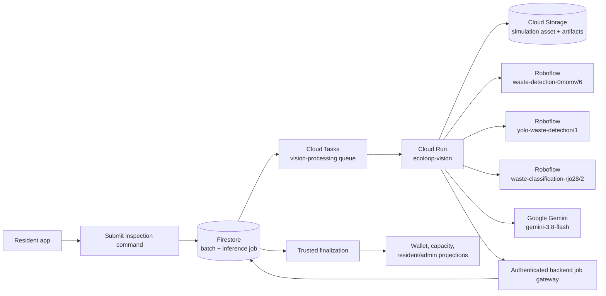
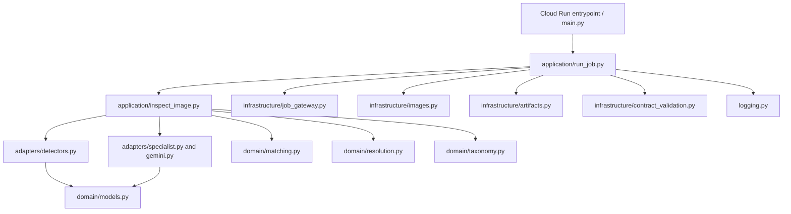
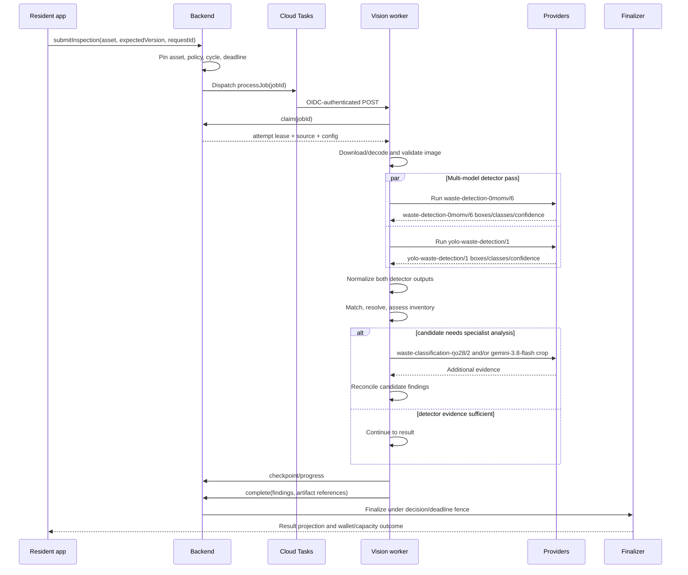
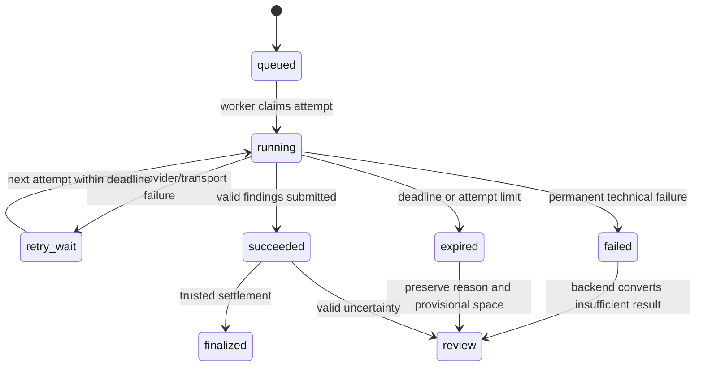
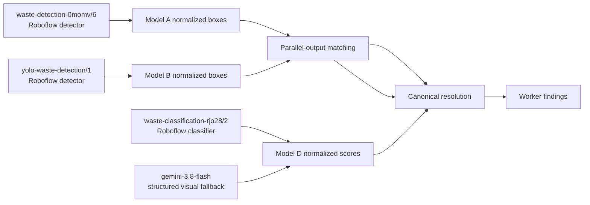
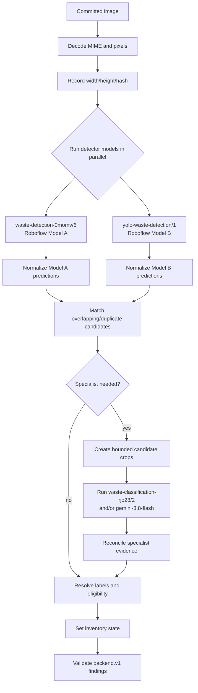
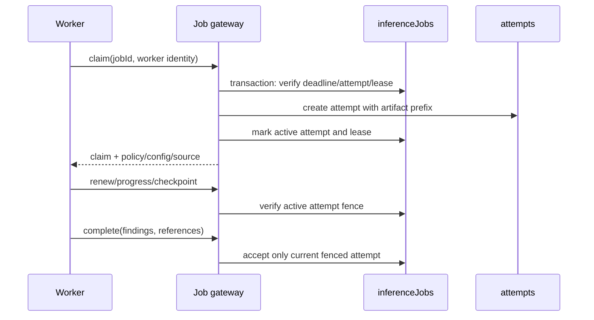
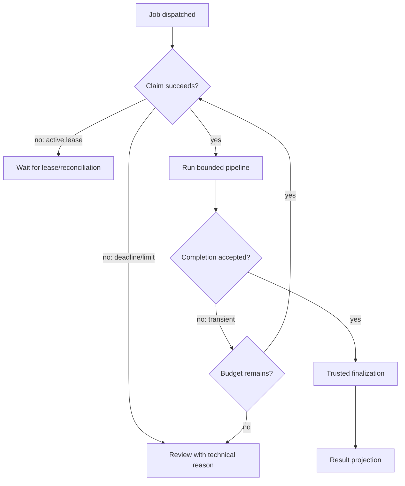
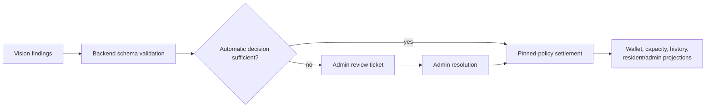

# EcoLoop AI — Software Design Document
## Computer Vision Engine

| Document control | Value |
| --- | --- |
| Document ID | ECOLOOP-SDD-CV-001 |
| Version | 1.0 |
| Prepared | 17 October 2026 |
| Design baseline | Approved design for EcoLoop AI PoC computer-vision engine development; implementation followed this document |
| Status | Approved design baseline; integration qualifications recorded in Section 16 |
| Platforms | Python 3.12 service on Google Cloud Run; hosted model APIs |
| Requirements baseline | [EcoLoop SRS](ECOLOOP_SRS.md) |
| Primary source | [`../services/vision`](../services/vision), with worker orchestration in [`../functions`](../functions) and deployment configuration in [`../infra`](../infra) |

> **Reading guide:** Start with Sections 2–5 for the engine boundary, runtime
> architecture, and processing lifecycle. Sections 6–10 describe model
> orchestration, taxonomy, evidence, contracts, and job execution. Sections
> 11–15 cover reliability, security, evaluation, deployment, and integration.
> Section 16 records design decisions and qualifications that require alignment
> with the deployed providers or backend.

This document defines the computer-vision engine as an approved design baseline
for EcoLoop AI PoC development. It is not a post-implementation proposal. The
engine and its worker integration were developed against this design. The
backend remains authoritative for policy, reward settlement, capacity
accounting, resident identity, and administrative decisions.

The engine interprets a committed image and returns structured evidence. It
does not directly credit a wallet, mutate a bin, decide an administrator's
review, or treat a model confidence score as a calibrated business truth.

## Contents

1. [Purpose, scope, and responsibilities](#1-purpose-scope-and-responsibilities)
2. [Computer-vision boundary](#2-computer-vision-boundary)
3. [Architecture at a glance](#3-architecture-at-a-glance)
4. [Source organization and technology](#4-source-organization-and-technology)
5. [Processing lifecycle](#5-processing-lifecycle)
6. [Provider registry and model roles](#6-provider-registry-and-model-roles)
7. [Inspection pipeline](#7-inspection-pipeline)
8. [Taxonomy, matching, and decision separation](#8-taxonomy-matching-and-decision-separation)
9. [Worker findings contract](#9-worker-findings-contract)
10. [Job gateway, fencing, and artifact handling](#10-job-gateway-fencing-and-artifact-handling)
11. [Failure, retry, and recovery design](#11-failure-retry-and-recovery-design)
12. [Security, privacy, and cost controls](#12-security-privacy-and-cost-controls)
13. [Evaluation and acceptance](#13-evaluation-and-acceptance)
14. [Deployment and operations](#14-deployment-and-operations)
15. [Integration with resident and admin systems](#15-integration-with-resident-and-admin-systems)
16. [Design decisions and current qualifications](#16-design-decisions-and-current-qualifications)
17. [Source reference index](#17-source-reference-index)

## 1. Purpose, scope, and responsibilities

### 1.1 Purpose

The engine receives one resident-selected image representing one newly
deposited batch and produces an auditable inventory of visible objects. For
each finding it records:

- a canonical or unresolved object resolution;
- eligibility as accepted, excluded, or unresolved;
- normalized bounding-box evidence when available;
- provider/model references and raw labels;
- a bounded confidence value and reason code.

The output allows the backend to produce a verified, rejected, empty, or
review-required result under the pinned recycling policy.

### 1.2 Responsibility split

| Responsibility | Computer-vision engine | Backend/domain services |
| --- | --- | --- |
| Decode and validate pixels | Owns | No |
| Call hosted detectors/classifiers | Owns | No |
| Normalize provider responses | Owns | No |
| Match duplicate detections | Owns | No |
| Resolve raw labels to canonical classes | Owns | Policy input |
| Decide whether a class is eligible | Produces evidence/state | Owns final policy interpretation |
| Calculate points and space | No | Owns |
| Hold/release bin reservation | No | Owns |
| Credit wallet | No | Owns |
| Create or resolve admin review | Supplies evidence | Owns |
| Enforce identity and worker authorization | Participates through gateway | Owns |

### 1.3 Non-goals

The PoC does not train or fine-tune models, export model weights, host model
weights locally, connect to a physical bin camera, measure physical weight or
volume, or guarantee material chemistry from an image. Prepared images simulate
the bin camera capture.

## 2. Computer-vision boundary

### 2.1 Input boundary

The input is a committed `simulationAsset` referenced by a submitted deposit
batch. The backend pins the asset ID, asset version, content hash, image
dimensions, policy version, configuration version, job ID, and processing
deadline before dispatch.

The engine must process the committed pixels, not a path or an untrusted
client-supplied answer. Image metadata and EXIF timestamps do not define the
deposit time.

### 2.2 Output boundary

The engine returns a `backend.v1` worker findings document. A valid result may
be:

| Inventory state | Meaning |
| --- | --- |
| `resolved` | Sufficient evidence supports one or more object findings |
| `empty` | The image is usable and no deposited objects are visible |
| `unreadable` | The image cannot support a reliable inventory |
| `uncertain` | Evidence exists but one or more objects or classifications remain unresolved |

Uncertainty is a business outcome, not automatically an infrastructure
failure. A transient provider failure is handled by retry/recovery; a valid
ambiguous image is preserved for review.

## 3. Architecture at a glance

### 3.1 Runtime environment



The worker is independent of the developer workstation. Cloud Tasks dispatches
an authenticated request to Cloud Run. The worker reads the committed source,
claims a fenced attempt, calls providers, writes bounded artifacts, and
submits findings through the gateway. Only trusted backend finalization changes
financial or capacity state.

### 3.2 Internal layering



Ports in [`application/ports.py`](../services/vision/src/ecoloop_vision/application/ports.py)
keep provider calls replaceable in tests. Domain modules are provider-neutral:
they operate on normalized predictions and canonical classes rather than SDK
objects.

## 4. Source organization and technology

### 4.1 Technology choices

| Concern | Implemented choice |
| --- | --- |
| Runtime | Python `>=3.12,<3.13` |
| HTTP/service framework | FastAPI with Uvicorn |
| Image processing | Pillow |
| Detector provider | Roboflow `inference-sdk` |
| Specialist/fallback provider | Google GenAI |
| Source/artifact storage | Google Cloud Storage |
| Job authentication | Google-auth/OIDC through the backend gateway |
| Contract validation | Pydantic and JSON Schema |
| Packaging | `pyproject.toml`, Hatchling, `uv.lock` |
| Deployment | Containerized Google Cloud Run service |

### 4.2 Source map

| Area | Responsibility | Main source |
| --- | --- | --- |
| `domain` | Provider-neutral models, taxonomy, matching, resolution | [`domain/`](../services/vision/src/ecoloop_vision/domain) |
| `adapters` | Roboflow and Gemini calls/normalization | [`adapters/`](../services/vision/src/ecoloop_vision/adapters) |
| `application` | Inspection orchestration and worker execution | [`inspect_image.py`](../services/vision/src/ecoloop_vision/application/inspect_image.py), [`run_job.py`](../services/vision/src/ecoloop_vision/application/run_job.py) |
| `infrastructure` | Images, artifacts, gateway, contract checks | [`infrastructure/`](../services/vision/src/ecoloop_vision/infrastructure) |
| `tools` | Probe, benchmark, evaluation, replay | [`tools/`](../services/vision/src/ecoloop_vision/tools) |
| `functions` | Submission, job records, leases, finalization, settlement | [`functions/src/`](../functions/src) |
| `contracts` | Cross-service JSON schemas and golden cases | [`contracts/backend/v1/`](../contracts/backend/v1) |

## 5. Processing lifecycle

### 5.1 End-to-end sequence



### 5.2 State machines



There are at most three claimed attempts within the five-minute processing
budget. Attempt leases and active-attempt fencing prevent concurrent workers
from publishing stale results.

## 6. Provider registry and model roles

The versioned registry is
[`model_registry.json`](../services/vision/model_registry.json). Credentials
are not stored in the registry.

| Role | Provider/model | Type | Output |
| --- | --- | --- | --- |
| Primary detector 1 | Roboflow `waste-detection-0momv/6` | Object detector | Pixel boxes, class, confidence |
| Primary detector 2 | Roboflow `yolo-waste-detection/1` | Object detector | Pixel boxes, class, confidence |
| Specialist classifier | Roboflow `waste-classification-rjo28/2` | Multi-label classifier | Class-score map and predicted classes |
| Visual fallback | Google AI Studio `gemini-3.8-flash` | Structured visual fallback | Bounded JSON inventory |

The provider registry records model IDs, transport, response contract, and
whether weights are present in the container. All current entries use hosted
APIs and have `weightsInContainer: false`.

### 6.1 Provider isolation



Provider adapters validate required fields and normalize coordinates, labels,
confidence, model identity, and source IDs. Provider-specific exceptions do
not leak into the worker findings contract.

## 7. Inspection pipeline

### 7.1 Pipeline stages



No inference is performed before the backend accepts the submission. A
changing draft image creates a new asset version; the worker never silently
switches to a newer image.

### 7.2 Detector and crop behavior

- `waste-detection-0momv/6` and `yolo-waste-detection/1` run as parallel
  primary detector branches over the same committed image.
- Each detector response is normalized into the common prediction model before
  the branches are merged.
- Detector boxes use normalized coordinates for the cross-service contract.
- Overlapping detections from `waste-detection-0momv/6` and
  `yolo-waste-detection/1` are matched instead of counted twice.
- Crop coordinates are derived from accepted candidate geometry and clipped to
  image bounds.
- Crop metadata preserves the parent candidate and original image box.
- Gemini prompts request only visible objects and bounded structured output; the
  model must not infer hidden objects.
- A full-image Gemini pass may be used when detector coverage is insufficient,
  but its output remains evidence requiring the same resolution rules.

### 7.3 Inventory state rules

| Condition | Inventory state |
| --- | --- |
| At least one sufficiently resolved candidate and no blocking uncertainty | `resolved` |
| Valid readable image with no visible object | `empty` |
| Image decode/quality/provider evidence cannot support inventory | `unreadable` |
| Candidates exist but one or more required decisions remain unresolved | `uncertain` |

An empty result is allowed only after validating that the image was usable.
Missing provider detections must not be treated as proof of emptiness.

## 8. Taxonomy, matching, and decision separation

### 8.1 Three separate decisions

1. **Recognition:** What visible object does the evidence support?
2. **Acceptance:** Is that canonical object class accepted by the program?
3. **Reward:** Which material rate applies if accepted?

The engine can emit `eligible`, `excluded`, or `unresolved`, but the pinned
backend policy remains the authority for settlement.

### 8.2 Initial canonical taxonomy

| Canonical class | Category | Eligible | Initial points/item | Initial space/item |
| --- | --- | ---: | ---: | ---: |
| `plastic_bottle` | plastic | Yes | 5 | 10 spc |
| `aluminium_can` | aluminium | Yes | 8 | 6 spc |
| `glass_bottle` | glass | Yes | 10 | 12 spc |
| `paper_item` | paper | Yes | 3 | 2 spc |
| `paper_bag` | paper | Yes | 3 | 8 spc |
| `cardboard_item` | paper | No | 0 | 15 spc |
| `other` / confidently excluded | configured | No | 0 | configured |
| `unknown` | unresolved | No final award | held | fallback |

An unresolved candidate consumes 10 spc provisionally. An entirely unreadable
batch uses a batch-level 50 spc provisional allowance. These are versioned
software estimates, not physical measurements.

### 8.3 Label resolution rules

- `Pet_Bottle` or `Plastic bottle` may map to `plastic_bottle` only after
  validating provider class semantics.
- Generic `can` or `Metal Can` does not prove aluminium.
- Generic `Glass` does not prove a glass bottle.
- Broad labels remain unresolved when subtype evidence is insufficient.
- Dataset labels such as `Unlabeled` never become confident material decisions.
- Unsupported raw labels remain traceable and enter uncertainty rather than
  being coerced into an accepted class.

### 8.4 Candidate matching

Matching is conservative: spatial overlap and compatible labels are used to
associate detector outputs. A candidate ID is stable within one attempt and
its evidence retains all contributing model IDs. Duplicate provider boxes must
not create duplicate rewardable objects.

Confidence values remain source evidence. The engine must not average
incompatible detector confidence values or present Gemini certainty as a
calibrated probability.

## 9. Worker findings contract

The normative JSON Schema is
[`findings.schema.json`](../contracts/backend/v1/findings.schema.json).

```json
{
  "schemaVersion": "backend.v1",
  "source": "worker",
  "jobId": "job-...",
  "attemptId": "attempt-...",
  "image": {
    "assetId": "asset-...",
    "assetVersion": "v1",
    "contentSha256": "64-hex-digest",
    "width": 574,
    "height": 348
  },
  "findings": [
    {
      "objectId": "object-1",
      "resolution": "plastic_bottle",
      "eligibility": "eligible",
      "box": { "x1": 0.10, "y1": 0.15, "x2": 0.40, "y2": 0.80 },
      "evidence": {
        "modelIds": ["waste-detection-0momv/6"],
        "rawLabel": "Plastic bottle"
      },
      "confidence": 0.91,
      "reasonCode": "matched"
    }
  ],
  "inventoryState": "resolved"
}
```

Contract invariants:

- maximum 100 findings per result;
- IDs and model IDs use bounded safe strings;
- boxes are normalized to `[0, 1]` and may be null for full-image findings;
- confidence is bounded from 0 to 1;
- raw labels and provider identities remain available for audit/review;
- `schemaVersion` and `source` are mandatory;
- diagnostic references are bounded and point to stored artifacts, not inline
  binary payloads.

Malformed provider output is an explicit technical failure or unresolved
finding; it is never converted into a successful verified result.

## 10. Job gateway, fencing, and artifact handling

### 10.1 Claim and lease



The job store limits attempts to three, uses a 90-second attempt lease, and
enforces the five-minute processing deadline. A worker can renew only its
active attempt. A late worker cannot overwrite a newer attempt or final result.

### 10.2 Checkpoints and artifacts

Large raw outputs, crops, overlays, and diagnostics are stored outside root
Firestore documents under an attempt-specific artifact prefix. Checkpoints
contain references, stage names, and timestamps. The gateway verifies that a
checkpoint reference remains inside the current attempt prefix.

The findings document contains bounded evidence references rather than raw
provider payloads or image bytes.

## 11. Failure, retry, and recovery design

### 11.1 Failure classes

| Failure | Handling |
| --- | --- |
| Invalid image/MIME/geometry | Terminal technical failure; preserve reason |
| Malformed provider response | Provider-stage failure; retry only if transient |
| Provider timeout/rate limit | Retry within deadline and attempt limit |
| Permanent provider authentication/configuration error | Fail visibly; do not loop |
| Ambiguous classification | Valid `uncertain` finding and admin review |
| Worker crash after claim | Lease expiry/reconciliation allows another attempt |
| Gateway timeout after completion | Recover current job/result, do not duplicate |
| Deadline exhausted | Convert to review with technical reason and provisional space |

Nested SDK, HTTP, queue, and worker retries must not silently exceed the
five-minute budget. A retry changes attempt identity but not batch identity.

### 11.2 Recovery flow



The worker should reuse safe stage checkpoints for the same image hash,
configuration version, and model identities. It must not reuse evidence from a
different asset version or policy context.

## 12. Security, privacy, and cost controls

### 12.1 Security boundary

- Provider API keys are server-side secrets and are never sent to resident
  clients or stored in `model_registry.json`.
- Cloud Tasks invokes Cloud Run with an OIDC identity and configured audience.
- The worker authenticates to the backend gateway using its worker identity.
- The gateway authorizes job, attempt, batch, and artifact ownership.
- Resident IDs, wallet fields, and admin identity are not supplied by the
  model provider and are not inferred by the engine.
- Raw images and artifacts use controlled storage paths and bounded retention.

### 12.2 Privacy

Images are user-submitted evidence. Logs must carry trace/job/attempt
identifiers without dumping image bytes, credentials, or unrestricted model
payloads. Structured logging redacts sensitive values. Diagnostic artifacts
must have an explicit retention and access policy.

### 12.3 Cost and resource bounds

The Cloud Run service is configured with:

- minimum scale 0 and maximum scale 1;
- concurrency 1;
- two CPU and 4 GiB memory;
- 300-second request timeout;
- health probes at `/healthz`.

The pipeline bounds candidate crops, findings, diagnostics, provider retries,
and full-image fallback use. Hosted model calls are preferred over shipping
weights to the container for the PoC's cost and deployment boundary.

## 13. Evaluation and acceptance

### 13.1 Evaluation dataset

The evaluation manifest is
[`datasets/evaluation/manifest.json`](../datasets/evaluation/manifest.json).
It is evaluation-only and must not become a training input. The current
scaffolding contains 15 inventoried but unlabeled images; it is not evidence
that acceptance targets have been achieved.

The approved evaluation plan targets approximately 100 manually labeled
images covering accepted classes, mixed batches, excluded classes, empty
scenes, and difficult cases. Related/near-duplicate scenes should remain in
one split.

### 13.2 Metrics

| ID | Measure | Target |
| --- | --- | --- |
| `CV-AC-01` | Precision of automatically rewarded object classifications | At least 95% on frozen evaluation data |
| `CV-AC-02` | Exact visible-object count on clear supported batches | At least 90% |
| `CV-AC-03` | Clear supported non-empty batches automatically verified | At least 70% |

Report per-class precision/recall, duplicate/miss counts, count error
magnitude, uncertainty/review rate, unsupported labels, latency, provider
usage, and cost. Compare A, B, A+B, D, and Gemini's incremental effect under
the same protocol.

### 13.3 Deterministic acceptance scenarios

| Scenario | Expected CV/backend observation |
| --- | --- |
| Two bottles, three cans, one paper bag, one cardboard item | Six accepted items; cardboard remains excluded; no duplicate detections |
| One confidently excluded cardboard item | `resolved` excluded finding; zero points through backend policy |
| Valid empty image | `empty`, zero points and zero object lines |
| Missing detector proposals | Not silently `empty`; fallback or `unreadable`/`uncertain` |
| Mixed batch with unresolved candidate | Findings preserve known objects and unresolved evidence; final reward held |
| Provider timeout | Retry within budget; no duplicate completion |
| Three exhausted attempts | Technical review with preserved evidence and provisional space |
| Late worker result | Fenced out; cannot credit wallet or rewrite newer decision |
| Repeated completion call | Same batch/decision identity; no duplicate accounting |

## 14. Deployment and operations

### 14.1 Build and service configuration

[`cloudbuild.vision.yaml`](../infra/cloudbuild.vision.yaml) builds
[`services/vision/Dockerfile`](../services/vision/Dockerfile) and publishes
the image to Artifact Registry in `asia-southeast1`.

[`cloudrun.vision.yaml`](../infra/cloudrun.vision.yaml) defines the
`ecoloop-vision` service with internal/load-balanced ingress, a dedicated
runtime service account, concurrency 1, bounded resources, and health probes.

### 14.2 Operational signals

Every job should be traceable by:

- job ID;
- batch ID;
- attempt ID;
- trace ID;
- model/configuration version;
- provider stage;
- latency and retry counts;
- terminal outcome or failure reason.

Reconciliation scans pending/un-dispatched jobs and expired leases. Operators
must be able to distinguish provider outage, invalid input, worker failure,
deadline exhaustion, and valid classification uncertainty.

### 14.3 Local development and tools

The Python project provides tests and tools for provider probes, replay,
benchmarking, evaluation, and contract inspection. Provider smoke tests must
use configured credentials and must not place secrets in source, fixtures, or
committed output.

## 15. Integration with resident and admin systems

### 15.1 Resident handoff

The resident client submits an image asset through the backend. It observes
processing progress and the eventual result. It must not call Roboflow or
Gemini directly, interpret raw provider labels, or calculate wallet credit.

### 15.2 Admin handoff

When the engine returns uncertainty or technical exhaustion, the backend
creates a review-ready record containing:

- original batch/session/bin references;
- image/version and content identity;
- raw labels and model IDs;
- per-object boxes and findings;
- unresolved counts and reason codes;
- pinned policy/configuration;
- provisional space and held-point context;
- current decision version.

Admin resolution sends final object decisions to the same trusted settlement
path. It must not create a separate wallet award or re-acquire a new bin
reservation.



## 16. Design decisions and current qualifications

### 16.1 Decisions reconstructed from the design baseline

- Hosted Roboflow and Gemini APIs are used instead of local model weights.
- `waste-detection-0momv/6` and `yolo-waste-detection/1` provide the primary
  inventory in parallel; `waste-classification-rjo28/2` and
  `gemini-3.8-flash` add specialist/fallback evidence.
- Provider outputs are normalized before matching and taxonomy resolution.
- Recognition, eligibility, and reward are separate decisions.
- A batch can be reviewed without pretending the model produced a final
  rewardable inventory.
- Job identity, attempt identity, deadlines, leases, checkpoints, and
  fencing are separate concepts.
- The backend, not the engine, owns all authoritative settlement and
  accounting.

### 16.2 Current qualifications

- The evaluation manifest is currently scaffolding with zero labeled,
  development, frozen, or second-reviewed images. The quantitative targets are
  acceptance criteria, not measured results.
- Hosted model availability, model version stability, Gemini response behavior,
  and provider pricing require deployment-time verification.
- The Cloud Run configuration permits scale-to-zero and one concurrent request;
  cold-start and provider latency must be measured against the five-minute
  budget.
- The engine's confidence field is bounded evidence, not a validated
  probability. Product/UI copy must not call it a guaranteed certainty.
- The backend must ensure the deployed worker gateway and artifact retention
  rules match the contracts documented here.

## 17. Source reference index

| Concern | Source |
| --- | --- |
| Existing backend/CV authority | [`ECOLOOP_BACKEND_AND_CV_SPECIFICATION.md`](archive/backend/ECOLOOP_BACKEND_AND_CV_SPECIFICATION.md) |
| Vision service package | [`pyproject.toml`](../services/vision/pyproject.toml) |
| Model registry | [`model_registry.json`](../services/vision/model_registry.json) |
| Worker orchestration | [`run_job.py`](../services/vision/src/ecoloop_vision/application/run_job.py) |
| Inspection pipeline | [`inspect_image.py`](../services/vision/src/ecoloop_vision/application/inspect_image.py) |
| Provider adapters | [`adapters/`](../services/vision/src/ecoloop_vision/adapters) |
| Domain matching and taxonomy | [`domain/`](../services/vision/src/ecoloop_vision/domain) |
| Job gateway | [`job_gateway.py`](../services/vision/src/ecoloop_vision/infrastructure/job_gateway.py) |
| Image and artifact handling | [`images.py`](../services/vision/src/ecoloop_vision/infrastructure/images.py), [`artifacts.py`](../services/vision/src/ecoloop_vision/infrastructure/artifacts.py) |
| Backend findings contract | [`findings.schema.json`](../contracts/backend/v1/findings.schema.json) |
| Job claim and lease store | [`jobs_store.ts`](../functions/src/infrastructure/firestore/jobs_store.ts) |
| Inspection submission | [`inspection_store.ts`](../functions/src/infrastructure/firestore/inspection_store.ts) |
| Finalization | [`finalize_inspection.ts`](../functions/src/application/finalize_inspection.ts) |
| Task dispatch | [`cloud_tasks.ts`](../functions/src/infrastructure/cloud_tasks.ts) |
| Cloud Run deployment | [`cloudrun.vision.yaml`](../infra/cloudrun.vision.yaml) |
| Cloud Build | [`cloudbuild.vision.yaml`](../infra/cloudbuild.vision.yaml) |
| Evaluation manifest | [`manifest.json`](../datasets/evaluation/manifest.json) |

### Revision history

| Version | Date | Description |
| --- | --- | --- |
| 1.0 | 2026-10-23 | Dedicated Computer Vision SDD created from the approved backend/CV baseline and implemented vision/worker sources |
