# EcoLoop AI — Software Design Document

## Resident Flutter Application

| Document control | Value |
| --- | --- |
| Document ID | ECOLOOP-SDD-USER-001 |
| Version | 1.0 |
| Prepared | 17 October 2026 |
| Design baseline | Approved design for EcoLoop AI PoC development; implementation followed this document |
| Status | Approved design baseline; integration qualifications recorded in Section 19 |
| Platforms | Android and Flutter web |
| Requirements baseline | [EcoLoop SRS](ECOLOOP_SRS.md) |
| Primary source | [`lib/`](../lib/), with relevant web/platform configuration and tests |

> **Reading guide:** Start with Sections 2–6 for the structural blueprint. Sections 7–14 follow the resident's journeys. Sections 15–19 explain presentation, deployment, verification, and the boundaries that still need alignment.

## Contents

1. [Purpose, scope, and document boundaries](#1-purpose-scope-and-document-boundaries)
2. [Architecture at a glance](#2-architecture-at-a-glance)
3. [Source organization and component responsibilities](#3-source-organization-and-component-responsibilities)
4. [Startup, dependency injection, and runtime modes](#4-startup-dependency-injection-and-runtime-modes)
5. [Navigation and route protection](#5-navigation-and-route-protection)
6. [State management and ownership](#6-state-management-and-ownership)
7. [Identity, account settings, and sign-out](#7-identity-account-settings-and-sign-out)
8. [Home, wallet, and guide composition](#8-home-wallet-and-guide-composition)
9. [Recycling session design](#9-recycling-session-design)
10. [Backend communication and command recovery](#10-backend-communication-and-command-recovery)
11. [Client data models and mapping boundaries](#11-client-data-models-and-mapping-boundaries)
12. [Activity history, queries, and time](#12-activity-history-queries-and-time)
13. [Rewards and voucher design](#13-rewards-and-voucher-design)
14. [Notifications and background interaction](#14-notifications-and-background-interaction)
15. [Presentation system and responsive layout](#15-presentation-system-and-responsive-layout)
16. [Security, failures, and diagnostics](#16-security-failures-and-diagnostics)
17. [Platform and deployment view](#17-platform-and-deployment-view)
18. [Verification and requirements traceability](#18-verification-and-requirements-traceability)
19. [Design decisions and integration qualifications](#19-design-decisions-and-integration-qualifications)
20. [Source reference index](#20-source-reference-index)

## 1. Purpose, scope, and document boundaries

This document explains **how the resident application is structured and how its parts collaborate**. It translates the Flutter implementation into an understandable design: application composition, navigation, state lifetimes, repository interfaces, transport, models, UI composition, and recovery behavior.

The design is based on the inspected source rather than the root README's earlier mock-only description. Firebase adapters and hosted-processing integration are present, while the mock path remains available for development.

### 1.1 The three design-document responsibilities

| Design document | Responsibility | Relationship to this document |
| --- | --- | --- |
| **Resident app SDD — this document** | Flutter composition, resident screens, state, navigation, client-side models/adapters, lifecycle, platform interfaces. | Defines the resident client and its external contracts. |
| **Administrative web SDD — separate future document** | Admin frontend architecture, operational screens, administrative state, and admin integration. | The admin portal is a sibling client, not a Flutter branch or embedded role-switching screen. |
| [Backend and Computer Vision Specification](ECOLOOP_BACKEND_AND_CV_SPECIFICATION.md) | Existing backend/CV design and specification: jobs, inference, taxonomy, trusted settlement, capacity, retention, service authorization. | Owns server-side algorithms and accounting; this SDD describes their resident-facing boundary. |

### 1.2 Interpreting the diagrams

- Diagrams show the **inspected implementation** unless explicitly labeled as a target or conceptual view.
- A remote-service box means an external responsibility, not code implemented in Flutter.
- Solid arrows normally show calls, data dependencies, or transitions; labels identify the meaning where it matters.
- Illustrative class diagrams list selected fields/methods, not complete generated API documentation.
- **Qualification** identifies a meaningful difference between the intended contract and current wiring. These observations are collected in Section 19; they are not fixes applied by this documentation task.

## 2. Architecture at a glance

### 2.1 Resident client in its environment

The resident application is a Flutter client with two main network paths: **Cloud Functions commands** and **Firestore reads/observations**. It does not invoke Roboflow or Gemini directly.

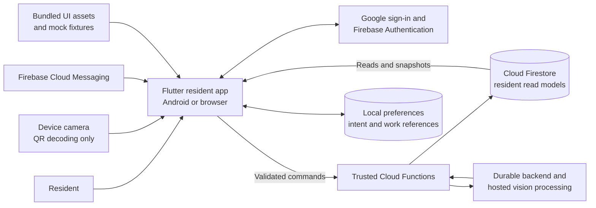

**Consequences:**

1. A button acknowledgment and a later read-model update are different events.
2. The UI renders committed points; it does not become the authority for credits or spending.
3. Closing a screen does not terminate a submitted server job.
4. Local persistence helps recover an interaction; it is not an offline wallet or authoritative transaction database.

### 2.2 Structural style

The application uses a **feature-first, layered repository architecture** with Riverpod composition. It is not a uniform implementation of a strict Clean Architecture/use-case pipeline: many screens call repository interfaces directly for commands, and some model parsing shares a Firebase-aware utility.

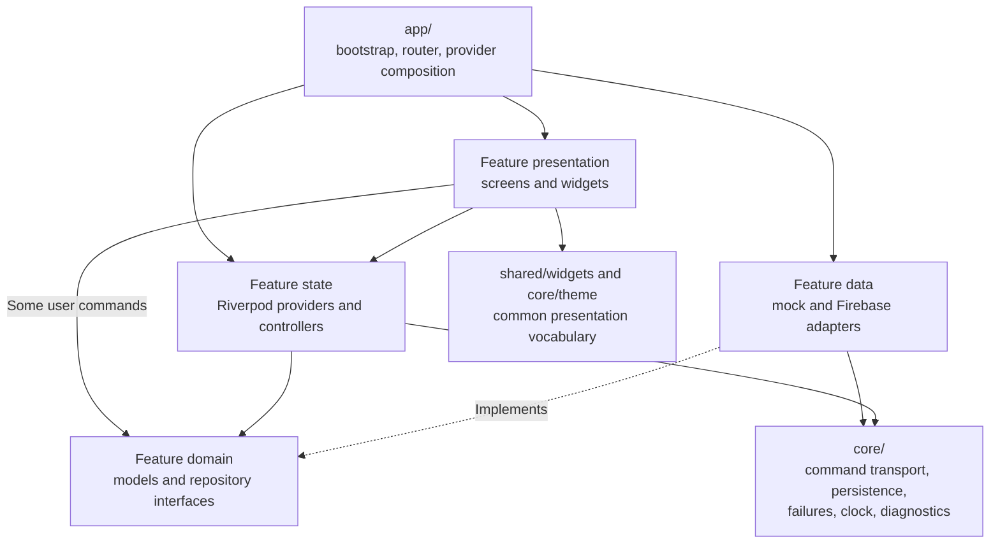

The interfaces make adapters replaceable; the composition root decides which adapter is active. Reusable widgets standardize appearance and feedback rather than owning feature transactions.

### 2.3 Major technology choices

| Technology | Design role | Current declaration |
| --- | --- | --- |
| Flutter / Dart | UI, platform-independent application logic | Dart SDK constraint `^3.13.0`; exact installed Flutter version is an environment input |
| `flutter_riverpod` | Provider graph, dependency injection, asynchronous state, feature controllers | `^2.6.1` |
| `go_router` | Declarative routing, authentication redirects, preserved branch navigators | `^16.2.4` |
| Firebase packages | Auth, named Firestore database, Functions, Storage client composition, Messaging, optional App Check | Declared together in [`pubspec.yaml`](../pubspec.yaml) |
| `google_sign_in` | Native Google authentication gateway | `^7.2.0` |
| `mobile_scanner` | Camera lifecycle and barcode decoding | `^7.4.2` |
| `shared_preferences` | Small durable client journals and references | `^2.5.6` |
| `intl`, `flutter_svg`, bundled Inter | Formatting and visual assets | Declared/bundled in `pubspec.yaml` |

`pubspec.lock` pins resolved dependencies. The source declares one light theme and targets Android/web for the agreed resident scope.

## 3. Source organization and component responsibilities

### 3.1 Physical source map

```text
lib/
├── main.dart                         Entry point
├── firebase_options.dart             Platform Firebase configuration
├── app/
│   ├── bootstrap.dart                Mode selection and root overrides
│   ├── eco_loop_app.dart              MaterialApp.router and resume hook
│   ├── providers/app_providers.dart   Repository/service composition
│   ├── router/                       Routes, guards, parameter parsing
│   └── presentation/                 Resident shell, bars, bootstrap/error views
├── core/
│   ├── config/                       RuntimeConfig
│   ├── data/                         Failures, JSON parsing, local journals
│   ├── firebase/                     SDK composition and command transport
│   ├── domain/                       Shared material and deposit-line models
│   ├── mock/                         Fixture store, scenarios, mock API, clock
│   ├── diagnostics/                  Structured application logging
│   ├── presentation/                 Copy and formatting
│   └── theme/                        Colors, typography, spacing, motion
├── features/
│   ├── account/                      Identity, profile, preferences, sign-out
│   ├── home/                         Dashboard composition and work recovery card
│   ├── wallet/                       Wallet model and read repositories
│   ├── activity/                     History, filtering, accepted impact
│   ├── recycling_guide/              Policy-driven educational content
│   ├── scan/                         QR, sessions, draft, processing, result
│   ├── rewards/                      Catalog, redemption, vouchers
│   └── notifications/                Messaging adapter and UI event coordinator
└── shared/widgets/                   Reusable controls and feedback views
```

Most business features contain `domain/models`, `domain/repositories`, `data`, and `presentation`. This is a convention, not a claim that every feature has identical folders: Home primarily composes other features, and notifications use a messaging service/coordinator.

### 3.2 Responsibility map

| Component | Responsibility | Important collaborators |
| --- | --- | --- |
| `bootstrap()` | Restore local exit state, choose runtime mode, initialize required services, install root overrides. | `RuntimeConfig`, `FirebaseClients`, mock seed loader, `ProviderScope` |
| `EcoLoopApp` | Configure theme/router, install notification coordinator, request resident-work restoration on app resume. | Router provider, `ActiveScanSessionController` |
| `ResidentShell` | One constrained Scaffold, top/bottom bars, branch-history back behavior. | `StatefulNavigationShell` |
| `RouteGuards` | Resolve/watch account state and choose bootstrap, signed-out, or resident destinations. | `AccountRepository`, local sign-out fence |
| `LeaveDecisionCoordinator` | Ask registered feature guards before shell branch transitions. | Scan and editable account forms |
| Feature controllers/providers | Fetch, combine, and expose asynchronous presentation state. | Repository interfaces |
| Firebase repositories | Map commands and reads to typed client models. | `CommandClient`, injected read transports |
| `CommandClient` | Request identity, envelope validation, per-UID serialization, durable intent/recovery. | `PendingOperationStore`, Functions transport |
| `ActiveScanSessionController` | Retain and restore active/latest work independently of the current scan screen. | Scan repository, work store, exit fences |
| `FirebaseNotificationService` | Bridge auth/device/token and messaging events. | FCM gateway, account-specific command clients |

## 4. Startup, dependency injection, and runtime modes

### 4.1 Bootstrap sequence

The entry point is deliberately small: `main()` awaits `bootstrap()`. Initialization precedes `runApp()`.

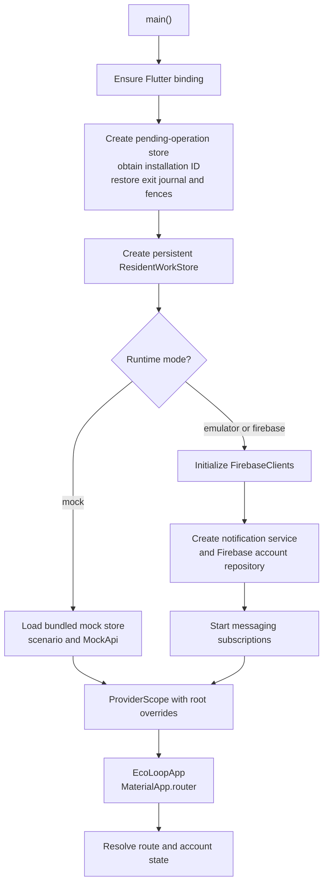

**Actual root overrides:**

- Both paths provide the restored `ExitIntentCoordinator` and persistent `ResidentWorkStore`.
- Mock mode overrides fixture store, mock API, scenario, and fixed metadata-based clock.
- Firebase/emulator mode overrides runtime config, Firebase clients, notification service, Firebase account repository, and a system clock.
- Other Firebase repositories are composed lazily by providers once a signed-in UID is available.

**Qualification:** Bootstrap has no enclosing application-level startup error screen for failures before `runApp()`. Router/bootstrap-screen recovery handles account resolution after the app starts, not every initialization exception.

### 4.2 Adapter-selection design

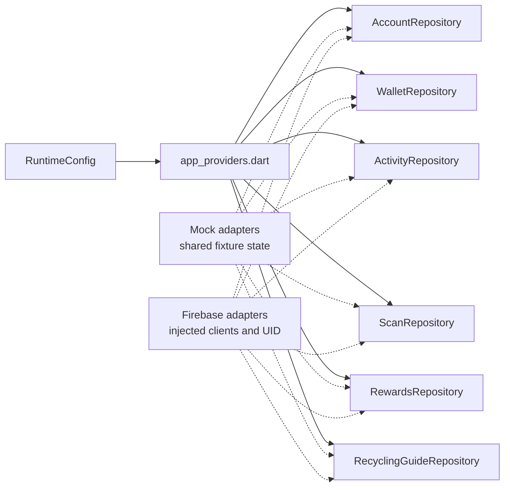

The account repository is specially overridden in live bootstrap because auth and notification cleanup need to exist before the resident providers become usable. `createFirebaseAccountRepository()` is also defined as a helper; it is not the main bootstrap path.

### 4.3 Runtime contract

| Input / mode | Actual behavior |
| --- | --- |
| `ECOLOOP_FIREBASE_MODE` | `mock` by default; accepts `mock`, `emulator`, `firebase`; unknown values throw. |
| Release mode | `RuntimeConfig.validate()` requires `firebase` in a release build. |
| Mock mode | No Firebase initialization; bundled fixture content and stateful mock repositories. |
| Emulator mode | Same Firebase adapters; Auth 9099, Firestore 8080, Functions 5001, Storage 9199 on configured hosts. Messaging has no corresponding emulator wiring here. |
| Firestore database | Explicit named database `ecoloop-db`. |
| Resident Functions region | `FirebaseClients` currently uses the constant `us-central1`. |
| `ECOLOOP_FIREBASE_REGION` | Parsed into `RuntimeConfig.region`; the current client initializer does not consume that field for Functions selection. |
| `ECOLOOP_FIRESTORE_HOST`, `ECOLOOP_AUTH_HOST`, `ECOLOOP_FUNCTIONS_HOST`, `ECOLOOP_STORAGE_HOST` | Emulator host inputs; default loopback must be adjusted for a device/emulator where necessary. |
| `ECOLOOP_EMULATOR_PORT` | Parsed/validated, but the current initializer uses fixed service ports rather than this value. |
| `ECOLOOP_USE_APP_CHECK` | Defaults false; activates configured platform provider only when true. |
| `ECOLOOP_WEB_APP_CHECK_SITE_KEY` | Used for non-debug web Enterprise provider activation when nonempty. |
| `ECOLOOP_WEB_VAPID_KEY` | Read by messaging token acquisition; required there for web notification builds. |
| `MOCK_SCENARIO` | Selects the mock scenario; unknown names fall back to normal. |

These distinctions matter for reproducible builds: a declared configuration field does not necessarily control the runtime path its name suggests.

### 4.4 Stateful mock design

Mock mode is an executable development environment, not a set of disconnected static screens. `MockSeedLoader` loads the bundled account, wallet, activity, scan, guide-rate, reward, voucher, and metadata fixtures into `MockDataStore`. Feature adapters share that store so a simulated deposit or redemption can update multiple screens coherently.

| Mechanism | Behavior |
| --- | --- |
| Store reads | Return copied maps/lists so consumers do not accidentally mutate stored records. |
| Transactions | Work on copies, then publish wallet/deposit/profile changes and a revision after successful commit. Scan and reward mutations have dedicated transaction helpers. |
| Observations | Broadcast profile, wallet, deposit, and revision events; repositories build typed projections from them. |
| `MockApi` | Simulated read/write latency and targeted failure injection; default delays are 350 ms for reads and 650 ms for writes. |
| `MockScenarioState` | Normal, one-time read/classification/profile/redemption failure, review/rejected deposit, invalid QR, full bin, empty activity/rewards/vouchers, and zero balance scenarios. |
| Determinism | Metadata-based clock and injectable IDs/transport delays support repeatable widget and repository checks. |

The shared mock business store is in memory and reloads from fixtures on process restart; the separately configured local journals may persist. Mock QR lookup and classification use fixture behavior rather than live QR mappings/model inference. They validate UI collaboration, not parity with every live backend rule.

## 5. Navigation and route protection

### 5.1 Three preserved branches

`GoRouter` uses `StatefulShellRoute.indexedStack`. Each branch has its own navigator; switching branches can preserve nested navigation and offstage widgets.

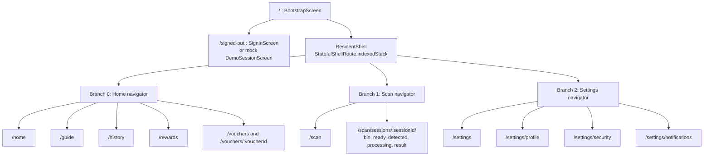

Rewards, vouchers, history, and guide are destinations in the **Home branch**, not separate bottom-navigation tabs. The bottom bar exposes Home, Scan, and Settings.

### 5.2 Route inventory and parameter design

| Destination | Parameters | Rendering/validation |
| --- | --- | --- |
| `/` | None | Bootstrap loading/error and retry for account resolution. |
| `/signed-out` | None | Sign-in builder; normal provider wiring supplies `SignInScreen`. |
| `/home` | None | Dashboard and resident-work card. |
| `/guide` | None | Policy-driven guide. |
| `/history` | Optional `from`, `to`, `status` | Dates parse as calendar boundaries; `to` becomes exclusive next-day boundary. Invalid recognized query values redirect to clean history. |
| `/rewards` | Optional `category` | Router currently admits `food` and `shopping`; screen also checks against loaded categories. |
| `/vouchers` | Optional `status` | Parsed known voucher status; invalid status redirects to clean list. |
| `/vouchers/:voucherId` | Decoded nonempty opaque ID | Unknown/unavailable details render recovery. |
| `/scan/sessions/:sessionId/{stage}` | Decoded nonempty session ID | Route maps to `ScanSessionScreen` with an expected stage. |
| Account subroutes | None | Profile/security/preferences screen-specific load/save/leave behavior. |
| Unknown route | Any unsupported location | `RouteErrorScreen`. |

Opaque-ID parsing handles decoding/blank values; it does not itself authorize ownership. Backend/rules and repository checks handle authorization.

### 5.3 Authentication redirect algorithm

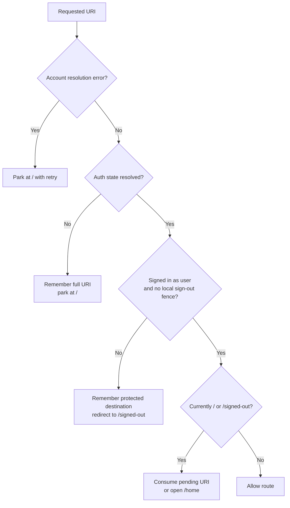

`RouteGuards` subscribes to `watchAuthState()` and also calls `getAuthState()` for initial resolution. The first resolved state wins where appropriate; errors reset readiness. `AppRole.admin` is not admitted as a resident by this guard. There is no embedded admin shell.

### 5.4 Stage canonicalization and back behavior

- Mock mode supplies `peekSessionStage()` for synchronous route redirects.
- Live mode intentionally leaves that callback unset; `ScanSessionScreen` observes the session asynchronously and navigates to its committed stage.
- `_sync()` checks that the current route still belongs to that screen before issuing redirects. This prevents a retained offstage scan screen from hijacking another branch.
- The shell remembers prior branch selections for system Back when nothing can pop. Individual screens use `PopScope` and feature-specific recovery for nested work.
- `ResidentBottomNavigation` consults `LeaveDecisionCoordinator`; reselecting Home/Settings resets that branch root, while Scan uses tracked work to decide whether to preserve its current branch location.

**Qualification:** Shell fallback comparisons include parameterized route templates, while actual paths contain IDs. Dynamic-route Back behavior should be verified through the feature screens rather than assumed correct from the shell table alone.

## 6. State management and ownership

### 6.1 Four state lifetimes

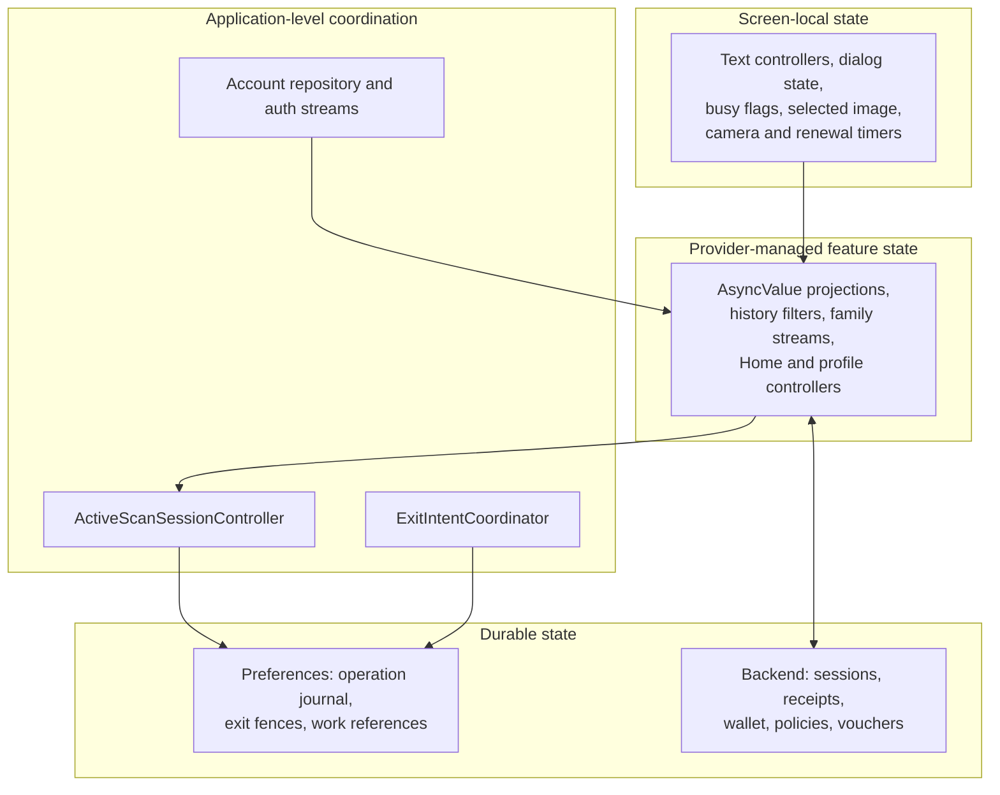

| Lifetime | Representative implementation | Why it lives there |
| --- | --- | --- |
| Screen | `_redeeming`, `_selectedAssetId`, `_actionError`, edit controllers | Ephemeral interaction details do not need global ownership. |
| Feature/provider | `HistoryFilterNotifier`, `HomeController`, stream families | Shared typed presentation state and asynchronous rebuilds. |
| Application | Auth repository, active scan notifier, exit coordinator | Must outlive navigation between screens/branches. |
| Local durable hint | Shared preferences adapters | Recover uncertain operations and latest submitted work after restart. |
| Remote authoritative | UID-owned records, policy, wallet, final results | Enforce cross-client consistency and trusted business rules. |

### 6.2 Riverpod patterns actually used

| Pattern | Examples | Behavior |
| --- | --- | --- |
| `Provider` | Runtime config, repository/service composition | Dependency object; construction may require a ready UID. |
| `FutureProvider` | Activity repository construction, instructions, single reward | One asynchronous acquisition. |
| `StreamProvider` | Wallet, profile, guide, rewards, scan records | Typed asynchronous projection for observation. |
| Provider families | Session/bin/result by ID, reward category, voucher status/detail | Separate state keyed by a domain parameter. |
| `AsyncNotifierProvider` | Home, history, profile, security, preferences | Initial load plus imperative refresh/save behavior. |
| `NotifierProvider` | Active scan session and history filter | Synchronous shared state plus explicit commands/subscriptions. |
| `ChangeNotifier` | `AuthController`, `RouteGuards` | Sign-in interaction and router refresh notification. |

Providers are manually declared rather than code-generated. Not every provider is `autoDispose`: account UID/profile streams are, while several shared/family providers intentionally or currently remain container-lived.

### 6.3 Ownership transitions

Wallet, activity, and rewards repository providers listen to `residentUidProvider` and invalidate themselves when the UID changes. `accountProfileProvider` cancels/replaces its profile subscription on auth events. Active scan coordination clears its subscriptions on sign-out and initiates restoration for a new UID.

**Design invariant:** account A's late read must never be accepted as account B's state. The repository/rules owner check is independent of widget navigation.

**Qualification:** The scan repository provider currently reads `auth.currentUser` at construction without the same explicit UID invalidation listener as wallet/activity/rewards. Some asynchronous restore paths also lack a post-await owner generation check. Account-switch correctness is a verification item, not a blanket guarantee of the current provider graph.

## 7. Identity, account settings, and sign-out

### 7.1 Sign-in and provisioning sequence

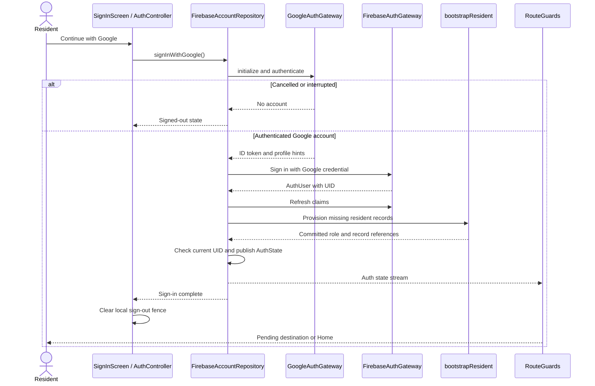

`FirebaseAccountRepository` hides SDK details behind `GoogleAuthGateway` and `FirebaseAuthGateway`. It memoizes initial resolution, coalesces provisioning for the same UID, remembers the provisioned UID, and checks the current UID after provisioning before publishing success.

The account stream replays `_lastState` to a new subscriber. This supports the router and feature providers subscribing at different times.

### 7.2 Profile, preferences, and provider-aware security

| Concern | Client design |
| --- | --- |
| Profile read | `getResidentProfile` callable maps response DTO to `ResidentProfile`. |
| Profile observation | Initial callable read followed by repository-local profile-change events; not a direct Firestore profile listener. |
| Profile edit | `ProfileScreen` owns text/edit state; `ProfileController.save()` preserves previous state while awaiting the repository command. |
| Email | Disabled edit control; backend identity remains Auth-derived. |
| Avatar | Profile model supports URL; current summary widgets use initials. No avatar-upload workflow is implied. |
| Preferences | Initial `getResidentPreferences`; save uses only the three supported booleans. Repository emits local preference updates. |
| Security | Derived from actual Auth provider IDs. Google-managed accounts report the provider without a fabricated password-update age. |
| Password command | Firebase adapter returns unsupported rather than pretending to change a Google-managed password. Mock security behavior is a separate simulation. |

Unsaved profile/security forms register leave guards and use `PopScope`. Controllers use `AsyncValue.guard()` and previous-value preservation to avoid throwing away visible data during a save failure.

### 7.3 Local-first sign-out

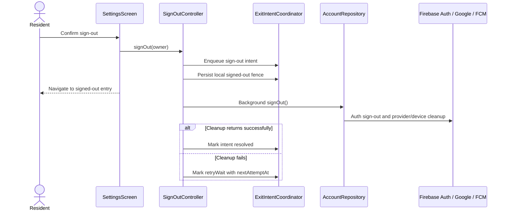

The fence expresses immediate **local privacy/navigation intent**. It does not claim that a disconnected device has already completed remote token unregistration. Firebase account sign-out catches provider/device cleanup errors and still attempts Auth sign-out.

**Qualification:** The journal can record due retries, but a central retry runner for `retryDue()` is not wired in the inspected Flutter source. Persisted retry state alone does not prove eventual delivery after restart.

## 8. Home, wallet, and guide composition

### 8.1 Dashboard composition

Home is a cross-feature projection, not a separately stored dashboard document.

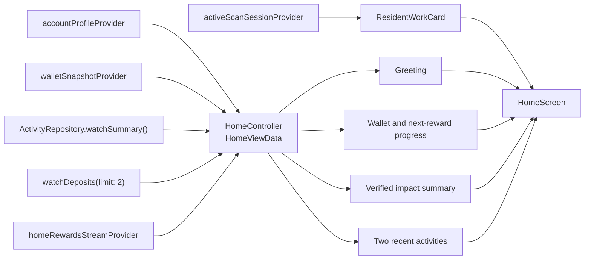

`HomeController.build()` waits for initial profile, wallet, summary, and recent-activity values. It installs explicit listeners for wallet and catalog changes. Wallet updates are accepted when their version is newer; catalog updates recompute the reward-progress state.

The reward-progress projection filters active, unexpired offers below their resident limit, then chooses the cheapest still-higher point cost. It distinguishes loading, error, ready, all higher levels unlocked, and no eligible offer.

`refresh()` performs one-shot repository reads and can preserve the previous dashboard on failure. It is not an atomic multi-document server snapshot. Subsequent summary/recent stream emissions should be tested independently; using a stream's `.future` for the initial join is not equivalent to an explicit continuous reducer for every input.

### 8.2 Wallet and impact

- `FirebaseWalletRepository` reads `residents/{uid}/wallet/current` and suppresses observed wallet versions that are not newer.
- It returns `nextRewardCost = null`; Home derives reward progress from the actual catalog.
- `FirebaseActivityRepository` obtains accepted category counts from `residents/{uid}/stats/current` and derives estimated kilograms using `MaterialWeightConstants`.
- Weight is presentation data, not an input to reward credit. The current kg/item constants are plastic 0.025, aluminium 0.015, paper 0.050, and glass 0.200.
- The client has no public wallet mutation method in `WalletRepository`.

### 8.3 Policy-driven guide

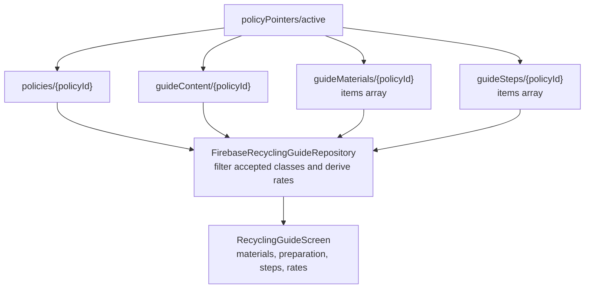

The repository watches the active pointer and policy. On a pointer change it reads content/material/step documents, uses a generation counter to discard superseded subscriptions, and replaces the policy listener. Content arrays are not separate continuously watched collections in this implementation.

Paper items and paper bags may be combined into one display card while acceptance remains class-specific. The guide screen consumes `recyclingGuideProvider`; the separately defined refresh-oriented guide controller is not its main observation path.

## 9. Recycling session design

This is the resident client's most stateful feature. Three different concepts must remain separate:

1. **Session stage:** which resident action is allowed.
2. **Processing progress:** what the backend is doing within `processing`.
3. **Result outcome:** what the inspection decision means.

### 9.1 Client state machine

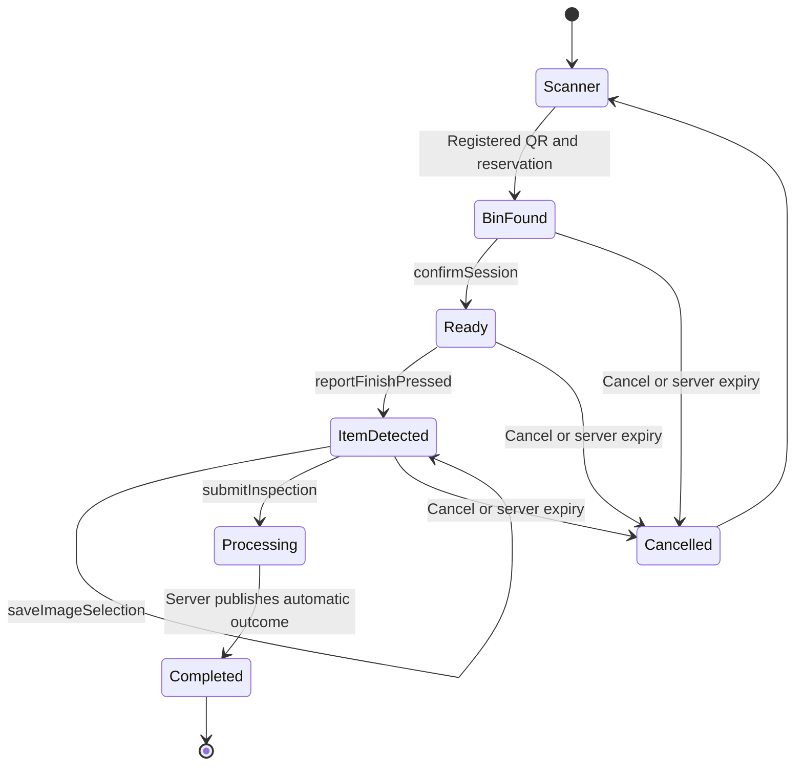

`ScanSessionScreen` renders every session stage by ID. Its `expectedStage` is the route's expectation, not permission to force the server into that stage. Live commands carry `expectedVersion` to reject stale transitions.

| Stage | Primary UI | Command / observation |
| --- | --- | --- |
| Scanner | Live camera or mock frame | `scanBinQr(qrPayload, requestId)` |
| `binFound` | Bin identity, location, fill, acceptance | `confirmSession(sessionId, version)` |
| `ready` | Ready-to-recycle instructions | `reportFinishPressed(sessionId, version)` |
| `itemDetected` | One prepared-image selection and Continue | Save draft, then submit exact asset/version |
| `processing` | Progress card and Continue using EcoLoop | Observe session/result; no live client finalization |
| `completed` | Receipt, pending review, rejected, or empty presentation | Observe result and return Home |
| `cancelled` | Exit/recover to scanner | No further stage advance |

### 9.2 QR camera control

`QrCaptureView` owns a `MobileScannerController` unless one is injected for tests. It disables automatic scanner lifecycle management and coordinates start/stop itself.

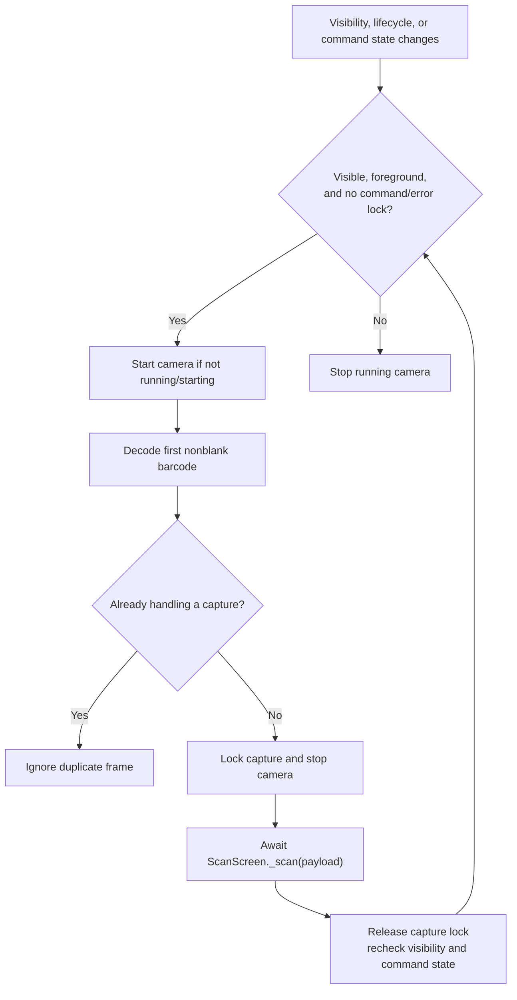

The controller uses a 500 ms detection timeout and 300 ms lifecycle synchronization debounce. Camera startup and permission-denied UI are separate from backend QR/bin errors. `ScanScreen` retains its request ID on failure and clears it on acknowledgment; mock mode alone displays Simulate QR scan.

### 9.3 Draft-to-submission sequence

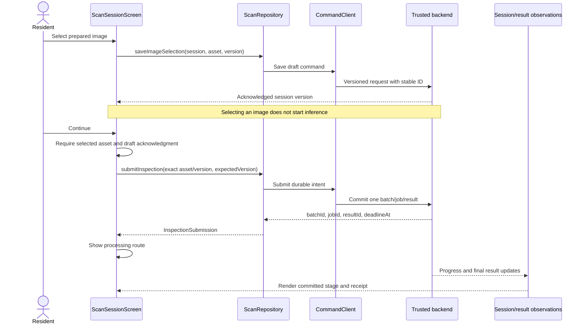

Screen-local fields coordinate immediate responsiveness: `_selectedAssetId`, `_draftAcknowledgement`, `_draftSaveFuture`, `_confirmedSession`, and `_busy`. Commands are still committed online through the repository.

**Qualification:** Only one draft-save future is started at a time. Rapidly replacing selection while an earlier save is in flight needs explicit verification: the Continue path can await the older future without first proving it acknowledges the newest selected image. Server version/asset validation prevents treating an unmatched draft as a valid submission; it does not by itself make the UI selection queue complete.

### 9.4 Repository observation and monotonic state

`FirebaseScanRepository`:

- Reads `scanContent/default`, `bins`, enabled `simulationAssets`, owned `depositSessions`, and owned `depositResults`.
- Converts backend names through `BackendScanMapper`.
- Caches observed session/bin values as read-through presentation aids.
- Rejects a session update older than the cached session version, or an equal-version update with older progress revision.
- Checks ownership on private records and supports disposal of its local caches.
- Uses `residents/{uid}.activeSessionId`, falling back to `latestSubmittedDeposit.sessionId`, for work discovery.
- Does not implement live `startVerification()` or `completeVerification()`; those methods explicitly throw in Firebase mode.

`ScanCompletionController` exists to complete mock verification at application scope. The screen invokes it only for `MockScanRepository`; that simulated completion must not be mistaken for the live inference mechanism.

### 9.5 Progress and outcome rendering

| Backend progress phase | Displayed step |
| --- | --- |
| Queued | 1 — Request received / waiting |
| Validating | 2 — Validating image |
| Detecting | 3 — Identifying recyclable items |
| Additional analysis | 4 — Confirming materials |
| Finalizing | 5 — Saving result |

`ScanProgressCard` uses the published activity/revision when present. It updates an elapsed-time display once per second. Missing-progress fallback copy offers reassurance after 30/60 seconds; elapsed time never fabricates a successful outcome. An elapsed deadline changes copy to checking completion, not a client-issued final decision.

`DepositResultCard` distinguishes processing, verified, review, empty, rejected, and unknown. It shows the earned-points strip only for a positive verified result. Review hides the headline count/material row; mixed results can show grouped lines and excluded labels. A debug-only trace reference helps diagnosis.

### 9.6 Restoration, seen state, and independent work

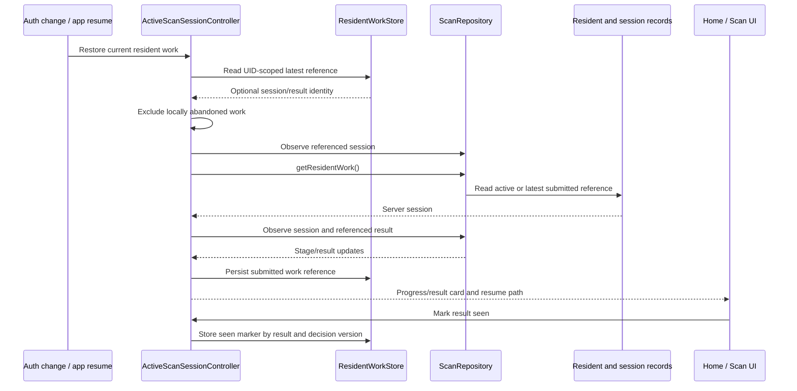

Home suppresses a completed result card once that decision is marked seen. A later decision version has a separate seen key. A completed review referral can therefore remain discoverable without keeping the bin reserved.

`watchResidentWork()` in the live adapter currently yields a one-shot discovery; continuous per-session/result observation is established separately. This is not a continuously watched server resident-work pointer.

### 9.7 Lease renewal and cancellation

- The visible owned foreground pre-processing screen attempts renewal every 30 seconds and pauses while a draft save is in flight.
- A successful contact renews the backend's ten-minute reservation; backgrounding or leaving removes the client's renewal activity.
- Confirmed pre-submission cancellation journals an exit intent, fences the session, clears active presentation state, stops renewal, and navigates immediately.
- `_reconcileCancellation()` attempts the backend cancellation asynchronously, then records resolved or retry-wait state.
- Leaving `processing` uses Continue using EcoLoop / Back to Home and does not send cancellation.

The local fence and remote release are separate facts. A disconnected unsubmitted reservation can remain held until backend expiry. Generation-safe retry execution remains an alignment item.

## 10. Backend communication and command recovery

### 10.1 Separate commands from projections

This is a command/read separation pattern, not a separate enterprise CQRS framework.

```mermaid
flowchart LR
    Screen["Screen or controller"] -->|"Action"| Repository["Repository interface"]
    Repository --> Adapter["Firebase adapter"]
    Adapter -->|"Command"| Client["CommandClient"]
    Client --> Callable["Cloud Functions callable"]
    Callable --> Records[("Committed records")]
    Records -->|"Firestore snapshot / read"| ReadTransport["Injected read transport"]
    ReadTransport --> Mapper["DTO mapping and validation"]
    Mapper --> Provider["Riverpod AsyncValue"]
    Provider --> Screen
```

Some account reads are callables as well. The diagram describes the main command/projection split, not a rule that every read is Firestore.

### 10.2 Wire envelope

`CommandClient.execute()` sends this shape to the callable named by `operation`:

```json
{
  "schemaVersion": "backend.v1",
  "operation": "submitInspection",
  "requestId": "req-0123456789abcdef",
  "payload": {
    "sessionId": "session-example",
    "assetId": "asset-example",
    "assetVersion": "v1",
    "expectedVersion": 4
  }
}
```

This example illustrates the client contract; the identifiers are not executable fixture identities.

`BackendEnvelope` requires `backend.v1`, a nonempty request ID, a 32-lowercase-hex trace ID, and either a committed data map or typed error map. Optional timestamps must be UTC strings. `CommandClient` checks the returned request ID against the sent ID and maps Functions exceptions/domain failures to `AppFailure`.

**Qualification:** The envelope parser accepts an optional response operation; the command client does not independently compare it with the invoked operation. Field validation and domain validation remain distinct responsibilities.

### 10.3 Durable command algorithm

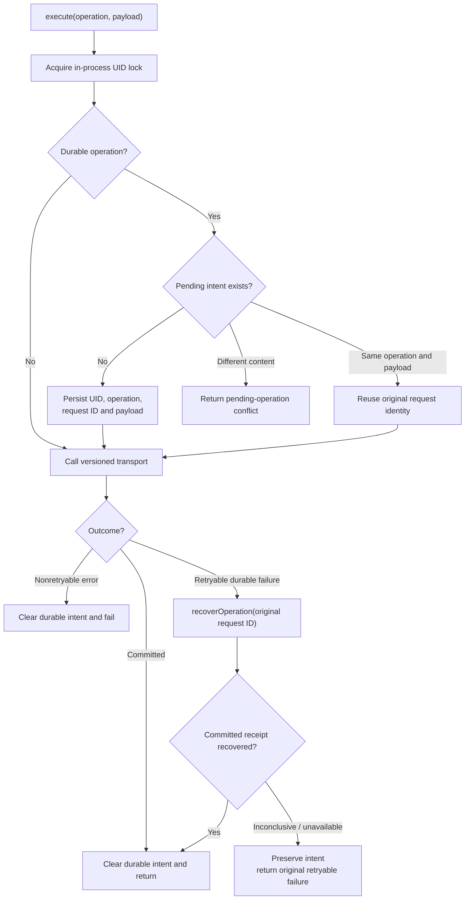

The `_uidLocks` map is static across `CommandClient` instances in one Dart runtime. It serializes account commands and protects a single local pending slot per UID; it is not cross-device or cross-browser-tab transaction locking. The backend supplies actual idempotency/concurrency enforcement.

Durable names currently include QR scan, confirm/renew/finish/cancel, save selection, submit inspection, redeem reward, and demo voucher-use operations. Reads/provisioning/profile/preferences/device commands are not all journaled as durable business intents.

A preserved unmatched intent blocks a different durable operation until it is resolved. The current journal is **one in-flight intent per UID**, not a general queue of offline operations.

### 10.4 Resident callable surface

| Feature | Operation names used by the client |
| --- | --- |
| Account | `bootstrapResident`, `getResidentProfile`, `updateResidentProfile`, `getResidentPreferences`, `saveResidentPreferences` |
| Device | `registerResidentDevice`, `unregisterResidentDevice` |
| Session | `scanBinQr`, `confirmSession`, `reportFinishPressed`, `renewSession`, `cancelSession`, `saveImageSelection` |
| Inspection | `submitInspection` |
| Recovery | `recoverOperation` with `operationId` containing the original request ID |
| Rewards | `redeemReward`, `useResidentDemoVoucher` |

Worker claims, model calls, finalization, admin review, and collection are outside this resident command surface. Their implementation belongs to the backend/CV and future admin design documents.

### 10.5 Local persistence schema

Shared preferences hold small JSON/string values with explicit namespaces:

| Key / namespace | Stored content | Scope and authority |
| --- | --- | --- |
| `ecoloop.pending_operation.v1.{uid}` | One pending operation: UID, callable name, request ID, payload. | UID-scoped retry identity; server determines whether it committed. |
| `ecoloop.pending_operation.v1.installation_id` | Generated installation identifier. | Installation-scoped device association input; not an authentication credential. |
| `ecoloop.exit_intents.v1` | List of exit intents with owner, operation, target, generations, state, attempts, and optional remote references. | Device-local journal; no remote-release guarantee. |
| `ecoloop.exit_fence.v1` | Signed-out marker. | Immediate local privacy/navigation fence. |
| `ecoloop.abandoned_sessions.v1` | Locally abandoned session IDs. | Prevents local resume of work the resident chose to leave. |
| `ecoloop.resident_work.reference.{uid}` | Latest session, submission time, optional batch/result/decision references. | UID-scoped discovery hint, refreshed against server records. |
| `ecoloop.resident_work.seen.{uid}.{resultId}.{decisionVersion}` | Seen marker. | Display acknowledgment for one result decision; no accounting effect. |

These stores are replaceable through small preferences interfaces, enabling in-memory test doubles. They are not encrypted storage or a cache of complete private account histories. The backend and local namespaces must not treat the persisted owner/generation strings as proof of authentication.

## 11. Client data models and mapping boundaries

### 11.1 Core model relationships

The following are client model relationships, not Firestore collection nesting. Selected fields retain their actual Dart names; nullable fields are described in the following table.

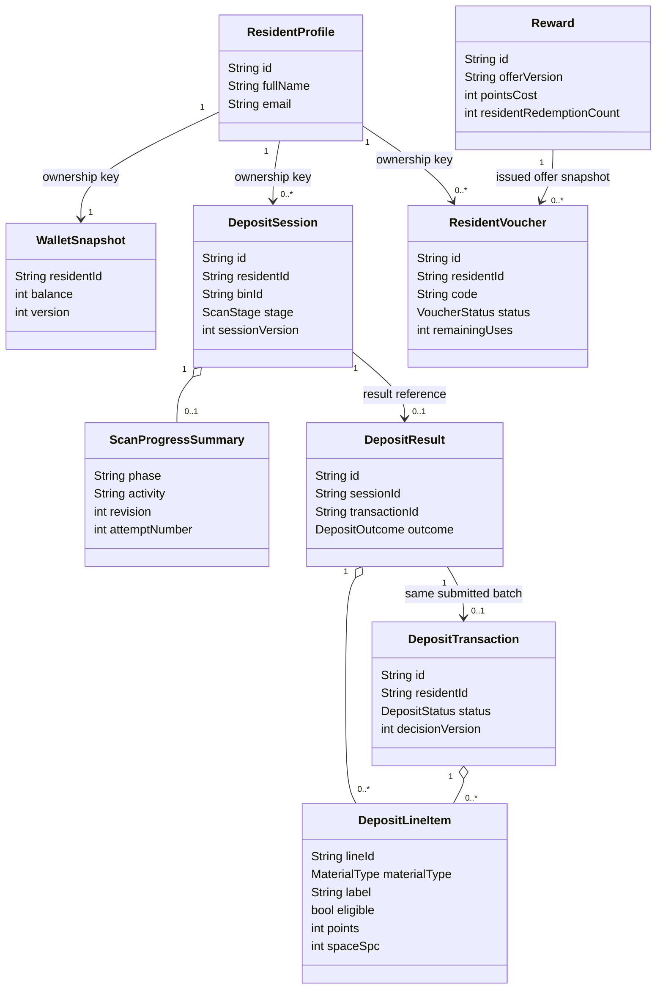

`DepositResult.transactionId` maps to backend batch identity; it is not a separate extra deposit. Voucher relation cardinality describes normal issuance; the model permits nullable legacy `rewardId` values.

### 11.2 Model semantics

| Model | Important fields / interpretation |
| --- | --- |
| `AuthState` | UID, role, signed-in state; router admits the resident role. |
| `ResidentProfile` | Display-facing name/email/avatar and identity; not a freely writable auth record. |
| `DepositSession` | Stage/version, draft asset/version, optional committed asset hash, batch/job/result IDs, lease/deadline, progress, termination reason. |
| `DepositResult` | Nullable final points/total count, grouped lines, policy/decision/trace identity; legacy headline `itemCount` is nonnullable and not authoritative for unknown inventory. |
| `DepositTransaction` | History projection with nullable count/points, lines, current decision version, displayed occurrence/verification times. |
| `DepositLineItem` | Class-derived label/category, eligibility, nullable count, points and space. It is a display projection rather than raw worker evidence. |
| `SmartBin` / `SimulationAsset` | Bin display/availability and prepared-source identity; neither contains permission to grant rewards. |
| `Reward` | Catalog offer/version and resident redemption-count projection for eligibility display. |
| `RewardRedemptionReceipt` | Returned redemption, voucher, and post-debit wallet snapshot. |
| `ResidentVoucher` | Owner, original title/merchant/terms/code, dates, status, remaining use, demo flag, optional offer version. |

### 11.3 Mapping stages and compatibility

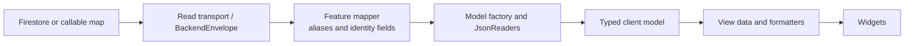

Examples:

- Account writer fields `residentId`/`displayName` are exposed through the backend profile DTO as `id`/`fullName`.
- `BackendScanMapper` normalizes `id` to `sessionId`/`binId`/`assetId`, attaches expected snapshot discriminators, and adapts timestamp aliases.
- Rewards adapt `merchant` to `merchantName` and catalog-expiry aliases; vouchers snapshot issued metadata.
- `JsonReaders` checks required values and can read Firestore `Timestamp`, ISO strings, or seconds/nanoseconds maps.

**Qualification:** Because `JsonReaders` imports Firestore and is used by domain model factories, SDK isolation is partial. Tolerant date parsing also does not make a Firestore query over mixed timestamp/string storage types correct.

### 11.4 Resident read paths

| Concern | Current physical read source |
| --- | --- |
| Wallet / stats | `residents/{uid}/wallet/current`, `residents/{uid}/stats/current` |
| Active/latest work | `residents/{uid}` pointers, followed by `depositSessions/{sessionId}` |
| Scan details | `bins/{binId}`, `scanContent/default`, `simulationAssets` |
| Receipt | `depositResults/{resultId}` |
| History | Owner-filtered `deposits` |
| Rewards and categories | `rewards`, `rewardCategories` |
| Vouchers | `vouchers` filtered by `residentId`, or owned detail by ID |
| Guide | Active policy pointer and policy-keyed content/material/step documents |
| Profile/preferences | Callables through `FirebaseAccountRepository` rather than direct feature Firestore listeners |

The client does not need to read private `binQrMappings` directly; the scan command resolves the mapping on the trusted side.

## 12. Activity history, queries, and time

### 12.1 Filter-to-render pipeline

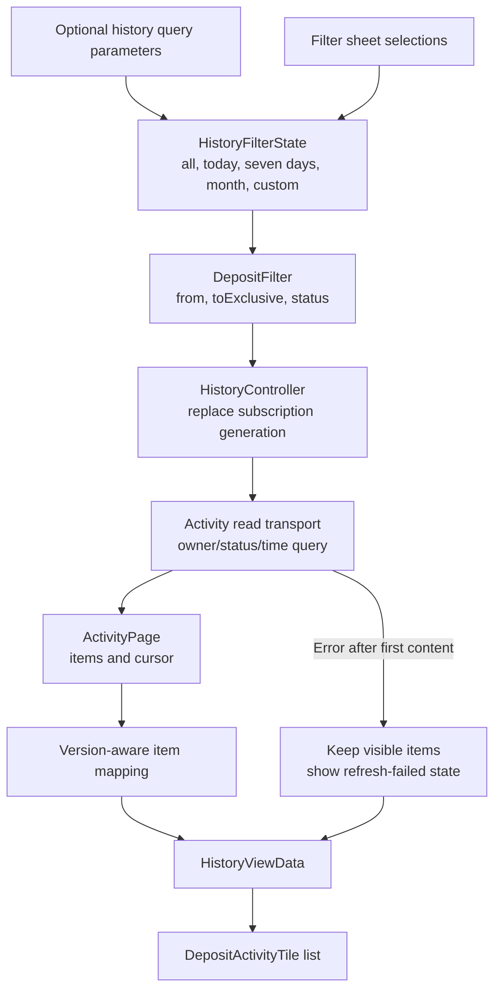

`HistoryController` waits for the first stream value with a completer, then updates `AsyncValue` on subsequent events. A generation counter excludes superseded subscription events. A filter change rebuilds the query; a refresh invalidates the controller.

### 12.2 Query and pagination details

- The Firebase query filters `deposits.ownerId == uid`, optionally status and `updatedAt` range.
- Ordering is `updatedAt DESC`, then document ID DESC; cursor values use the same pair.
- Default repository page size is 25. Home asks for two recent rows.
- Live page observation merges seen records by batch ID and accepts nonolder decision versions.
- `HistoryViewData` includes a next cursor; a one-shot `getDepositsPage()` supports an `after` cursor.

**Qualifications:** The current screen has no explicit load-more interaction. `watchDepositsPage(after: ...)` does not apply its cursor to the watched query, and its accumulated window does not remove every record absent from a later snapshot. Paginated correctness should not be inferred from the interface alone.

### 12.3 Time responsibilities

| Time concern | Design |
| --- | --- |
| Mock determinism | `AppClock` fixed from metadata/reference date. |
| Live now | `AppClock.system()` supplied by live bootstrap. |
| Display | Explicit `en_MY` and +480-minute display/calendar helpers. |
| Voucher ticking | `systemAppClockProvider` and detail invalidation timer. |
| History range | Inclusive start and exclusive next-day end. |
| Reservation/credit/expiry authorization | Backend time; display clock is not authority. |

The current history mapper assigns `occurredAt` from backend `updatedAt`, so a later review may move displayed occurrence time. The intended contract preserves submission time separately. Local preset calculations and route-date conversions also need consistent Malaysia-calendar verification across device time zones.

## 13. Rewards and voucher design

### 13.1 Catalog composition and eligibility

`RewardsScreen` consumes category, category-keyed reward, wallet, and voucher providers. Category changes update the query string. Cards use balance, validity, active state, and resident limit to decide the visible redemption action; backend validation remains decisive.

`FirebaseRewardsRepository` maps catalog documents and derives resident redemption counts from owned vouchers. Its current mapping enforces an effective minimum limit of three, as does the backend store; the historical specification's one-redemption examples need explicit reconciliation.

### 13.2 Redemption sequence

```mermaid
sequenceDiagram
    actor R as Resident
    participant UI as RewardsScreen / dialog
    participant Repo as RewardsRepository
    participant Cmd as CommandClient
    participant Backend as Trusted redemption
    participant Views as Wallet and voucher observations
    R->>UI: Choose reward
    UI->>UI: Capture offer version/cost and request ID
    R->>UI: Confirm displayed offer
    UI->>Repo: redeemReward(id, key, version, cost)
    Repo->>Cmd: redeemReward command
    Cmd->>Backend: Stable durable request
    alt Current eligible offer and enough points
        Backend->>Backend: Atomically debit and issue voucher
        Backend-->>Repo: Original-offer receipt and new balance
        Repo-->>UI: Typed RewardRedemptionReceipt
        UI->>UI: Close dialog and show voucher link
        UI->>Views: Invalidate relevant catalog/voucher providers
        Views-->>UI: Committed wallet and issued voucher
    else Changed offer, insufficient points, or limit
        Backend-->>UI: Safe mapped failure
        UI->>UI: Keep useful retry/error state
    end
```

The screen keeps the same `_idempotencyKey` while retrying that dialog intent and prevents simultaneous confirm taps. A committed response is authoritative; the screen does not optimistically subtract points before server confirmation.

### 13.3 Voucher lifecycle

```mermaid
stateDiagram-v2
    [*] --> Available: Trusted redemption issues voucher
    Available --> Available: Copy code only
    Available --> Used: Valid owner demo-use command
    Available --> Expired: Expiry reached while unused
    Used --> Used: Expiry passes after consumption
    Used --> [*]
    Expired --> [*]
```

- List/detail providers perform an initial read and then subscribe.
- `statusAt(now)` derives expired display state only for currently available vouchers; used remains used.
- Detail UI refreshes every 30 seconds, offers Copy code, and offers Simulate voucher use only for an available demo voucher.
- `_useRequestId` remains stable for that detail widget's intent; `CommandClient` persists uncertain durable use.
- `useDemoVoucher()` executes `useResidentDemoVoucher`, rereads the owned voucher, and returns its used projection.
- Actual expiry, single-use enforcement, owner checks, and no-second-debit behavior belong to the backend contract.

**Qualifications:** The UI's current voucher feed reads the owner set rather than using its paginated repository method. Reward observation primarily follows catalog snapshots; a voucher-count change alone is not a complete reactive catalog recomputation trigger. The immediate redemption response constructs a voucher without explicitly copying its demo flag, while the later stored-voucher read carries that flag.

## 14. Notifications and background interaction

### 14.1 Service and UI coordination

```mermaid
sequenceDiagram
    participant Auth as Raw Firebase auth stream
    participant Service as FirebaseNotificationService
    participant FCM as Messaging gateway
    participant Backend as Device registration callables
    participant Coord as NotificationCoordinator
    participant Router as Resident router
    Auth-->>Service: UID changes
    Service->>Backend: Unregister previous association if applicable
    Service->>FCM: Request permission
    alt Permission allowed
        Service->>FCM: Obtain token and subscribe to refresh
        Service->>Backend: Register installation/platform/token
    else Permission denied
        Note over Service,Router: Core resident features remain independent
    end
    FCM-->>Service: Foreground/opened/initial event
    Service-->>Coord: NotificationEvent
    Coord->>Coord: Check event ID, target type and ready UID
    alt Deposit event and signed in
        Coord->>Router: Go to History and show update notice
    else Deposit event before ready UID
        Coord->>Coord: Hold one pending event
    end
```

`NotificationMessagingClient` abstracts the platform SDK for tests. The service registers a native background entrypoint, captures an initial event, and forwards foreground/opened streams. Foreground native presentation is disabled after permission, leaving in-app handling to the coordinator.

**Actual coordinator behavior:** it deduplicates event IDs in memory, handles deposit targets, and navigates to History rather than an exact receipt. Voucher targets are currently ignored. The in-memory handled set/pending event are not an owner-generation-scoped durable navigation queue.

### 14.2 Web worker boundary

[`web/firebase-messaging-sw.js`](../web/firebase-messaging-sw.js) loads Firebase compat scripts and displays a background notification containing safe target fields. Firebase Hosting serves it as JavaScript with `no-cache`.

Worker presence alone does not prove notification-click recovery. The current worker has no custom click-routing handler; browser-specific registration, VAPID, origin permission, background delivery, and target handling require deployed acceptance.

### 14.3 Preference and device authority

The Flutter preference screen persists three booleans; backend dispatch decides which events are eligible. FCM delivery never credits a wallet or resolves a deposit. Device registration follows raw Auth UID changes, which may occur before resident provisioning completes.

**Qualification:** Authentication/token transition handlers are asynchronous and are not fully serialized by generation in the current service. Permission/token/unregistration errors need isolation so they cannot strand lifecycle state. These are implementation verification points, not reasons to move business settlement into notifications.

## 15. Presentation system and responsive layout

### 15.1 Shell and page composition

```mermaid
flowchart TD
    App["MaterialApp.router<br/>AppTheme.light"] --> Notifications["NotificationCoordinator wrapper"]
    Notifications --> Shell["ResidentShell"]
    Shell --> Frame["Centered frame<br/>max width 480 logical px"]
    Frame --> Scaffold["One shell Scaffold"]
    Scaffold --> Top["ResidentTopBar"]
    Scaffold --> Body["StatefulNavigationShell"]
    Scaffold --> Bottom["ResidentBottomNavigation<br/>SafeArea and raised Scan button"]
    Body --> Page["AppPage"]
    Page --> Scroll["Single page scroll owner<br/>padding and optional header"]
    Scroll --> Feature["Feature cards, forms,<br/>loading/error/content"]
```

The app intentionally remains a centered mobile-first experience on a large browser viewport. It does not expand into the admin portal's desktop dashboard layout.

```text
┌──────────── Resident frame: maximum 480 logical px ────────────┐
│ ResidentTopBar                                                │
├──────────────────────────────────────────────────────────────┤
│ AppPage: scrollable content                                   │
│   Optional page header                                       │
│   Feature information / cards / controls                     │
│   Loading, error, empty, or committed content                 │
│                                                              │
├───────────────────────────◉ Scan──────────────────────────────┤
│             Home                              Settings       │
└──────────────────────── SafeArea ─────────────────────────────┘
```

### 15.2 Design tokens and shared controls

| Layer | Source / responsibility |
| --- | --- |
| Color | `AppColors`: primary green, neutral surfaces, mint/amber/red semantic feedback. |
| Typography | `AppTypography`: locally bundled Inter and named content styles. |
| Geometry | `AppSpacing`, `AppRadii`, `AppShadows`: consistent page/card/control/frame geometry. |
| Theme | `AppTheme.light`, `EcoThemeExtension`: Material theme configuration. |
| Controls | `AppButton`, text/dropdown fields, switches, filter chips, cards, badges, avatar/icons. |
| Feedback | Loading, error, empty, feedback banner, confirmation dialog. |
| Copy/formatting | `AppCopy`, application formatters, locale-aware dates and points presentation. |

`AppPage` owns one `SingleChildScrollView` inside the shell and adds page padding/minimum-height content. The shell owns the Scaffold and major safe-area layout; nested feature Scaffolds are not the standard pattern.

`AppButton` disables callbacks while loading, preserves label geometry, supports a pending label, exposes semantics, and uses a minimum 48-pixel height. Navigation controls expose button/selection semantics. Progress uses a live region.

Guide cards switch from two columns to one for narrow content or enlarged text; long labels can wrap. These are practical accessibility provisions, not a formal claim of complete accessibility conformance.

## 16. Security, failures, and diagnostics

### 16.1 Client trust boundary

| The client may do | The trusted backend must decide |
| --- | --- |
| Capture a QR string and select an authorized asset ID | Whether the mapping/bin is enabled and reservable |
| Submit session/version and request identity | Whether the transition/draft is current and belongs to the caller |
| Display current policy and calculated progress | Which pinned policy settles a submitted batch |
| Render server-provided receipt lines/points | Recognition eligibility, credit amount, space entries, and decision version |
| Confirm a displayed reward offer | Current offer validity, balance, limits, atomic debit and issuance |
| Request demo voucher use | Ownership, available state, backend expiry and remaining use |
| Store local pending/reference state | Authoritative committed transaction state |

Resident Firestore/Storage access is governed by rules; the callable boundary derives actor identity from auth. Client owner checks improve failure behavior but cannot replace those boundaries. No provider model secret belongs in Dart defines, bundled assets, or the client journal.

### 16.2 Error transformation

```mermaid
flowchart LR
    Transport["SDK exception or<br/>backend error envelope"] --> Command["CommandClient<br/>stable code and retryability"]
    BadData["Invalid map/model contract"] --> Failure["AppFailure"]
    Command --> Failure
    Failure --> Feature["Feature-specific mapping<br/>scanFailureCopy or dialog copy"]
    Feature --> UI["Safe retry, refresh,<br/>sign-in, or unavailable presentation"]
```

| Failure category | Expected client treatment |
| --- | --- |
| Camera denied/unavailable | Camera-specific explanation; no fabricated scan. |
| Invalid QR / busy / full | Distinct scan feedback and safe return/retry. |
| Stale session/asset | Refresh current state or reselect; do not change a committed batch. |
| Temporary transport failure | Recover original durable intent where applicable. |
| Malformed envelope/model | Non-success contract failure; no default verified result. |
| Stream failure after useful content | Where implemented, show last loaded content plus recovery state. |
| Missing result after completed session | Separate receipt-loading/retry UI; completion does not imply the receipt has loaded. |
| Changed reward or insufficient points | Preserve understandable dialog state and request refreshed confirmation where needed. |

Not all read adapters throw `AppFailure`; some raise `StateError` or SDK stream errors, and some scan message keys still fall back to generic copy. Uniform failure mapping is a remaining design consistency item.

### 16.3 Logging

`AppLogger` emits time, severity, service/environment, event, and optional request/trace/session/deposit context. The command client logs transport/envelope outcomes, and scan UI/controller code emits safe timing/restore events through `dart:developer`.

Redaction currently matches top-level field names containing token, secret, password, voucher, or authorization. It is not recursive redaction of every nested `details` object or arbitrary message string. `withContext()` also restores context synchronously; it is not an asynchronous zone-based tracing system.

The design target is correlated safe diagnostics. Existing logging helpers should not be described as complete protection against every sensitive nested payload.

## 17. Platform and deployment view

### 17.1 Runtime placement

```mermaid
flowchart LR
    Source["Flutter source and locked dependencies"] --> Android["Android build<br/>device camera, Google auth,<br/>native messaging"]
    Source --> WebBuild["Flutter web build<br/>build/web"]
    WebBuild --> Hosting["Firebase Hosting<br/>resident target and SPA rewrite"]
    Hosting --> Browser["HTTPS browser<br/>camera, clipboard, web push"]
    Android --> Firebase["Firebase project<br/>Auth, ecoloop-db, Functions"]
    Browser --> Firebase
    Firebase --> Backend["Tasks / Cloud Run / providers<br/>external to resident executable"]
```

### 17.2 Platform-specific responsibilities

| Concern | Android | Web |
| --- | --- | --- |
| Firebase initialization | Platform Firebase options and native app registration | Web Firebase options and authorized origin |
| Google authentication | Existing `GoogleSignIn.authenticate()` gateway and Firebase credential | Same gateway is wired; browser-specific provider support must be rehearsed independently |
| Camera | Native camera permission and plugin lifecycle | Supported browser, camera permission, secure origin |
| Push | Native handler and installation registration | VAPID, browser permission, service-worker integration |
| App Check when enabled | Debug provider in debug; Play Integrity outside debug | Enterprise provider on non-debug web with configured site key |
| Local preferences | Platform shared-preferences implementation | Browser-backed shared-preferences implementation; not cross-tab transaction locking |
| Distribution | Android build/device installation | `build/web` served by the resident Hosting target |

`firebase.json` rewrites Hosting routes to `/index.html`; exact browser-visible hash/path behavior depends on Flutter's configured URL strategy. The source does not explicitly install a path URL strategy, so a clean path route should not be inferred solely from the rewrite.

The source includes iOS scaffolding and platform cases in some helpers, but this document's accepted resident platform scope remains Android/web. Build/deployment settings are public configuration; provider credentials remain server-side.

## 18. Verification and requirements traceability

### 18.1 Design-to-SRS map

| Design area | Principal SRS requirements | Relevant design sections |
| --- | --- | --- |
| Composition, entry, role guard | FR-AUTH-01–06; NFR-MAINT-01–03 | 4–7 |
| Profile/security/preferences | FR-ACC-01–05 | 7, 15–16 |
| Dashboard/wallet/guide | FR-HOME-01–04; FR-WAL-01–02; FR-GUIDE-01–03 | 6, 8, 11 |
| QR/session/draft/receipt | FR-SCAN-01–16; resident-facing FR-CV-01, FR-CV-12–15 | 5, 9–11 |
| History and impact | FR-HIST-01–06; BR-17–18 | 8, 11–12 |
| Reward/voucher interactions | FR-REW-01–06; FR-VOU-01–06 | 10–11, 13 |
| Messaging and recovery | FR-NOT-01–06; NFR-REL-01–06 | 7, 9–10, 14 |
| Presentation, access, platform | NFR-UX-01–05; NFR-SEC-01–06; NFR-PORT-01 | 15–17 |

Server-side inspection, review settlement, retention execution, and administrative operations are referenced as interfaces rather than re-specified here.

### 18.2 Existing test locations

| Design concern | Existing verification source |
| --- | --- |
| Route/auth/shell | [`test/app/`](../test/app/), [`test/features/account/firebase_auth_flow_test.dart`](../test/features/account/firebase_auth_flow_test.dart) |
| Command contract and durable storage | [`test/core/firebase/command_client_test.dart`](../test/core/firebase/command_client_test.dart), [`test/core/data/`](../test/core/data/) |
| Runtime/logging/model parsing | [`test/core/config/`](../test/core/config/), [`test/core/diagnostics/`](../test/core/diagnostics/), [`test/core/domain/`](../test/core/domain/) |
| Scan camera, selection, flow, resume | [`test/features/scan/`](../test/features/scan/) |
| Dashboard/wallet/history | [`test/features/home/`](../test/features/home/), [`test/features/wallet/`](../test/features/wallet/), [`test/features/activity/`](../test/features/activity/) |
| Guide/rewards/vouchers | [`test/features/recycling_guide/`](../test/features/recycling_guide/), [`test/features/rewards/`](../test/features/rewards/) |
| Messaging | [`test/features/notifications/notification_lifecycle_test.dart`](../test/features/notifications/notification_lifecycle_test.dart) |
| Shared visuals/layout | [`test/shared/widgets/`](../test/shared/widgets/), [`test/refactor_visuals/`](../test/refactor_visuals/) |
| Resident integration | [`integration_test/resident_journey_test.dart`](../integration_test/resident_journey_test.dart) |

These paths document available checks; no prior test count is treated as current proof. Fixture/widget tests cannot establish deployed OAuth, private backend inference, device push, or server-rule correctness by themselves.

### 18.3 Recommended verification gates

For implementation work, select the affected tests and run the standard Flutter gates appropriate to the change:

```bash
dart format --output=none --set-exit-if-changed lib test integration_test
flutter analyze
flutter test
flutter build web --dart-define=ECOLOOP_FIREBASE_MODE=firebase
```

The explicit mode is required by release-mode validation. A successful web build alone does not prove the live Firebase configuration or every web plugin path. Device integration must state whether it uses mocks or genuine deployed services; camera/auth/messaging and interrupted-session rehearsal need actual platform evidence.

## 19. Design decisions and integration qualifications

### 19.1 Architectural decisions reconstructed from the code

| Decision | Rationale and tradeoff |
| --- | --- |
| Feature-first folders with repository interfaces | Keep feature behavior understandable and support alternate data sources; some cross-feature composition remains centralized in Home/app providers. |
| Riverpod dependency graph | Share typed asynchronous state and inject adapters in tests; lifetime/UID invalidation must be deliberate. |
| Stateful branch navigation | Preserve resident context while moving between Home, Scan, and Settings; retained offstage screens must suppress navigation/camera side effects. |
| Commands through trusted Functions | Keep actor/version/idempotency validation outside the UI; requires recovery for lost acknowledgments. |
| Firestore observations for results | Permit server work to finish independently; a snapshot can arrive separately from a callable response. |
| Persistent local references/journals | Recover interaction identity after restart; not a substitute for backend authorization or an offline financial queue. |
| Prepared-image selection for PoC | Exercise genuine hosted inference without physical bin hardware; UI must clearly retain the simulation boundary. |
| Mobile-first 480-pixel shell | Preserve a coherent resident experience across phone/browser; large-screen web remains a centered mobile layout. |
| Provider-aware account security | Reflect Google-managed identity rather than expose a fake password flow. |

### 19.2 Current qualifications and follow-up design obligations

| ID | Source-grounded observation | Required alignment / verification |
| --- | --- | --- |
| UA-D01 | `RuntimeConfig.region` and generic emulator port are parsed, but `FirebaseClients` selects a fixed region/service ports. | Document actual build inputs or wire the intended configuration consistently. |
| UA-D02 | Some domains import Firebase-aware `JsonReaders`; widgets sometimes call repositories directly. | Describe the actual layered architecture accurately; a stricter SDK-free boundary would be a deliberate later refactor. |
| UA-D03 | Scan repository composition lacks the explicit UID invalidation used by wallet/activity/rewards; restore work includes awaits without complete owner-generation fencing. | Verify account switching and ensure old subscriptions/responses cannot populate a new resident's state. |
| UA-D04 | Local exit journaling records retries; no central caller of `retryDue()` is wired. Generation fields are currently populated from owner identity. | Implement/verify an actual generation-safe retry delivery strategy before promising durable background cleanup. |
| UA-D05 | Rapid image replacement may occur while an earlier draft-save future is retained. | Serialize/coalesce the latest selection and prove Continue submits exactly the acknowledged current asset. |
| UA-D06 | `_preferredSession()` favors a local session on equal version, while backend progress can advance using a separate revision. | Verify that acknowledgment caching cannot hide equal-version newer progress. |
| UA-D07 | History uses `updatedAt` as display occurrence, cursor, and filter time; some backend writers use ISO strings while queries use `Timestamp`. | Preserve submission/decision semantics and normalize storage/query types. |
| UA-D08 | History/voucher pagination APIs exceed what the current screens exercise; live history merges can retain stale window entries. | Verify true cursor paging and bounded live-window semantics before claiming complete large-history support. |
| UA-D09 | `DepositLineItem` does not retain a canonical-class field; serialization maps paper bags to `paper_item` and cardboard/other categories to `unknown`. | Preserve canonical identity for lossless DTO round trips; category/label alone is insufficient. |
| UA-D10 | Backend/session parsing is strict in places, legacy parsing falls back differently, and the `excluded`/`rejected` compatibility interpretation is not uniform across every model. | Centralize/document supported legacy aliases and unknown-state recovery. |
| UA-D11 | Home explicitly listens for wallet/catalog changes but joins other stream first values; catalog eligibility also depends on separately changing resident counts. | Verify complete dashboard/catalog reactivity rather than assuming every input is continuously recomposed. |
| UA-D12 | Notification coordinator handles deposits by opening History, ignores vouchers, and uses a non-owner-scoped in-memory event set; auth registration uses asynchronous raw-UID callbacks. | Add/verify authorized owner-fenced target routing and lifecycle error isolation. |
| UA-D13 | Web worker displays background notifications but has no custom click route; the same Google gateway is wired for web. | Rehearse actual supported browser authentication, worker registration, click handling, and VAPID flow. |
| UA-D14 | Logger redaction is top-level and some errors include nested details/arbitrary strings; pre-`runApp` initialization has no outer recovery screen. | Verify diagnostic privacy and startup failure presentation explicitly. |
| UA-D15 | Source contains adapter/DTO tolerances and mock-specific copy/defaults; effective reward limits differ from historical one-use examples. | Reconcile the agreed product contract, model defaults, and live presentation before release acceptance. |

These qualifications retain the distinction between **an architectural intention, an implemented mechanism, and demonstrated correctness**. Detailed backend evidence-path, capacity, and admin-claim alignment remains covered by the SRS and backend/CV references.

## 20. Source reference index

Use this index to move from each design view to its implementation. Paths are relative to the repository root.

| Area | Primary sources |
| --- | --- |
| Entry/composition | [`main.dart`](../lib/main.dart), [`bootstrap.dart`](../lib/app/bootstrap.dart), [`eco_loop_app.dart`](../lib/app/eco_loop_app.dart), [`app_providers.dart`](../lib/app/providers/app_providers.dart) |
| Runtime/SDK | [`runtime_config.dart`](../lib/core/config/runtime_config.dart), [`firebase_clients.dart`](../lib/core/firebase/firebase_clients.dart), [`pubspec.yaml`](../pubspec.yaml) |
| Navigation | [`app_router.dart`](../lib/app/router/app_router.dart), [`app_routes.dart`](../lib/app/router/app_routes.dart), [`route_guards.dart`](../lib/app/router/route_guards.dart), [`route_parameter_parsers.dart`](../lib/app/router/route_parameter_parsers.dart), [`leave_decision_coordinator.dart`](../lib/app/router/leave_decision_coordinator.dart) |
| Shared frame | [`resident_shell.dart`](../lib/app/presentation/resident_shell.dart), [`resident_bottom_navigation.dart`](../lib/app/presentation/resident_bottom_navigation.dart), [`app_page.dart`](../lib/shared/widgets/app_page.dart), [`core/theme/`](../lib/core/theme/) |
| Authentication/account | [`firebase_account_repository.dart`](../lib/features/account/data/firebase_account_repository.dart), [`account_repository.dart`](../lib/features/account/domain/repositories/account_repository.dart), [`account controllers`](../lib/features/account/presentation/controllers/), [`account screens`](../lib/features/account/presentation/screens/) |
| Home | [`home_controller.dart`](../lib/features/home/presentation/controllers/home_controller.dart), [`resident_work_card.dart`](../lib/features/home/presentation/widgets/resident_work_card.dart), [`firebase_wallet_repository.dart`](../lib/features/wallet/data/firebase_wallet_repository.dart) |
| Guide | [`firebase_recycling_guide_repository.dart`](../lib/features/recycling_guide/data/firebase_recycling_guide_repository.dart), [`recycling_guide_controller.dart`](../lib/features/recycling_guide/presentation/controllers/recycling_guide_controller.dart) |
| Scan orchestration | [`scan_screen.dart`](../lib/features/scan/presentation/screens/scan_screen.dart), [`scan_session_screen.dart`](../lib/features/scan/presentation/screens/scan_session_screen.dart), [`scan_controller.dart`](../lib/features/scan/presentation/controllers/scan_controller.dart) |
| Scan adapters/models | [`scan_repository.dart`](../lib/features/scan/domain/repositories/scan_repository.dart), [`firebase_scan_repository.dart`](../lib/features/scan/data/firebase_scan_repository.dart), [`backend_scan_mapper.dart`](../lib/features/scan/data/backend_scan_mapper.dart), [`scan models`](../lib/features/scan/domain/models/) |
| Camera/receipt/progress | [`qr_capture_view.dart`](../lib/features/scan/presentation/widgets/qr_capture_view.dart), [`deposit_result_card.dart`](../lib/features/scan/presentation/widgets/deposit_result_card.dart), [`scan_progress_card.dart`](../lib/features/scan/presentation/widgets/scan_progress_card.dart) |
| Commands/contracts | [`command_client.dart`](../lib/core/firebase/command_client.dart), [`backend_envelope.dart`](../lib/core/firebase/backend_envelope.dart), [`json_readers.dart`](../lib/core/data/json_readers.dart), [`backend schemas`](../contracts/backend/v1/) |
| Local journals | [`pending_operation_store.dart`](../lib/core/data/pending_operation_store.dart), [`resident_work_store.dart`](../lib/core/data/resident_work_store.dart), [`exit_intent_coordinator.dart`](../lib/core/data/exit_intent_coordinator.dart), [`exit_intent_store.dart`](../lib/core/data/exit_intent_store.dart) |
| Mock execution | [`mock_seed_loader.dart`](../lib/core/mock/mock_seed_loader.dart), [`mock_data_store.dart`](../lib/core/mock/mock_data_store.dart), [`mock_api.dart`](../lib/core/mock/mock_api.dart), [`mock_scenario.dart`](../lib/core/mock/mock_scenario.dart) |
| History/materials | [`history_controller.dart`](../lib/features/activity/presentation/controllers/history_controller.dart), [`firebase_activity_repository.dart`](../lib/features/activity/data/firebase_activity_repository.dart), [`deposit_transaction.dart`](../lib/features/activity/domain/models/deposit_transaction.dart), [`core/domain/`](../lib/core/domain/) |
| Rewards/vouchers | [`firebase_rewards_repository.dart`](../lib/features/rewards/data/firebase_rewards_repository.dart), [`rewards controllers`](../lib/features/rewards/presentation/controllers/), [`rewards screens`](../lib/features/rewards/presentation/screens/), [`reward/voucher models`](../lib/features/rewards/domain/models/) |
| Messaging | [`firebase_notification_service.dart`](../lib/features/notifications/data/firebase_notification_service.dart), [`notification_coordinator.dart`](../lib/features/notifications/presentation/notification_coordinator.dart), [`web worker`](../web/firebase-messaging-sw.js) |
| Diagnostics/platform | [`app_logger.dart`](../lib/core/diagnostics/app_logger.dart), [`firebase.json`](../firebase.json), [`web/index.html`](../web/index.html), [`firestore.rules`](../firestore.rules), [`storage.rules`](../storage.rules) |
| Requirements and server contract | [`ECOLOOP_SRS.md`](ECOLOOP_SRS.md), [`ECOLOOP_BACKEND_AND_CV_SPECIFICATION.md`](ECOLOOP_BACKEND_AND_CV_SPECIFICATION.md) |

---

### Revision history

| Version | Date | Change |
| --- | --- | --- |
| 1.0 | 2026-10-23 | Reconstructed resident Flutter architecture, component/state/route/data designs, workflow and lifecycle visuals, platform boundaries, traceability, and implementation qualifications. |
