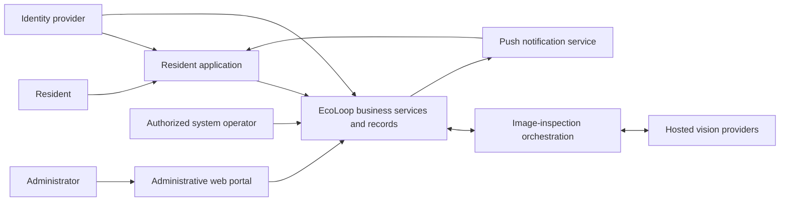
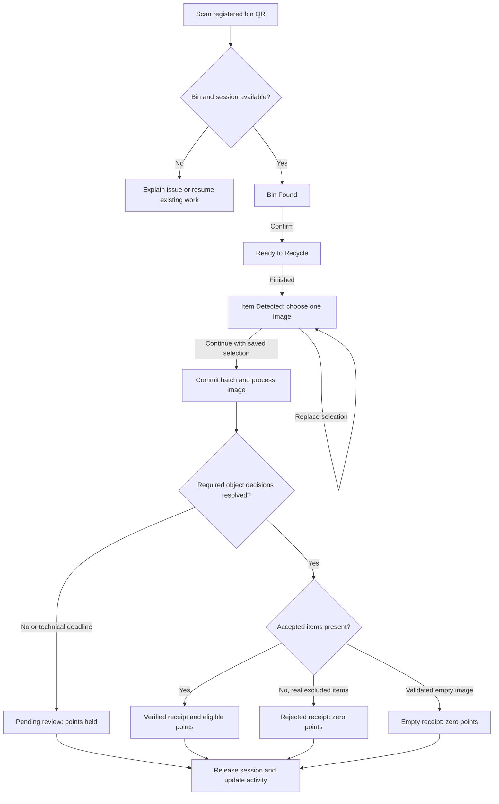
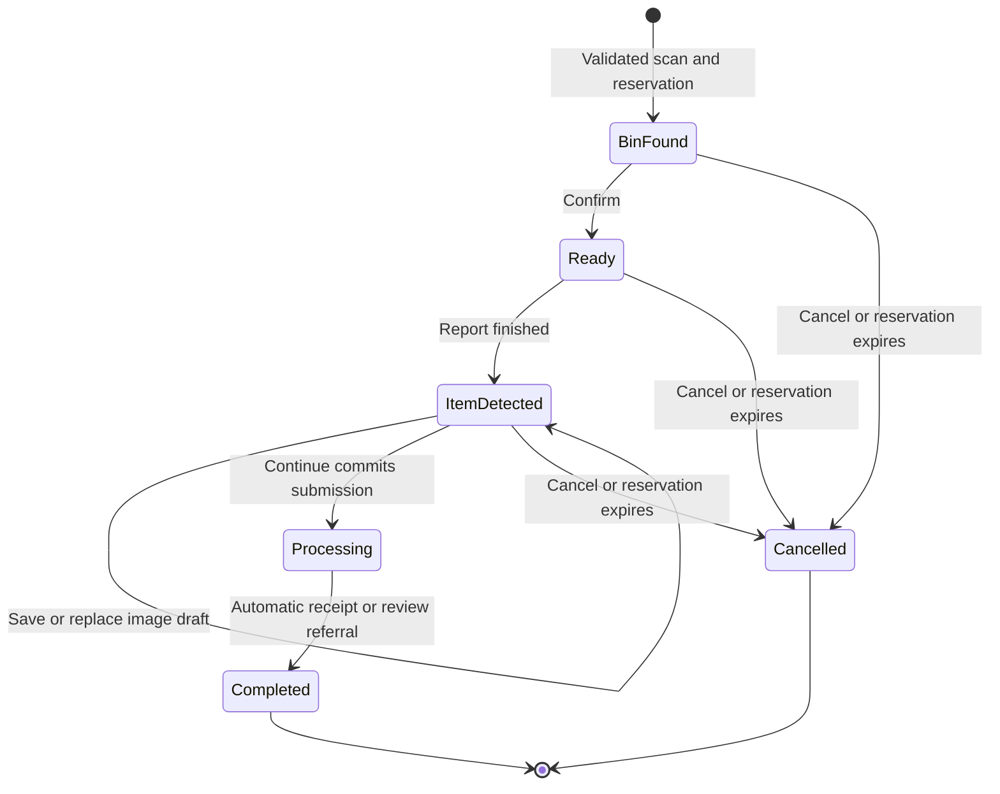

# EcoLoop AI — Software Requirements Specification

**Smart Recycling. Sustainable Communities. Rewarding Actions.**

| Document control | Value |
| --- | --- |
| Document ID | ECOLOOP-SRS-001 |
| Version | 1.0 |
| Prepared | 16 October 2026 |
| Status | Approved requirements baseline for EcoLoop AI PoC development |
| Product | EcoLoop AI smart recycling platform |
| Repository baseline | `56fc3a4`, working application built against this baseline |
| Intended audience | Project stakeholders, developers, designers, testers, recycling-program administrators, and assessors |

## Contents

1. [Purpose and interpretation](#1-purpose-and-interpretation)
2. [Problem, objectives, and stakeholders](#2-problem-objectives-and-stakeholders)
3. [Product scope and operating context](#3-product-scope-and-operating-context)
4. [Actors and access requirements](#4-actors-and-access-requirements)
5. [Principal user journeys](#5-principal-user-journeys)
6. [Functional requirements](#6-functional-requirements)
7. [Business rules and calculation requirements](#7-business-rules-and-calculation-requirements)
8. [Information and external-interface requirements](#8-information-and-external-interface-requirements)
9. [Non-functional requirements](#9-non-functional-requirements)
10. [Acceptance criteria and verification](#10-acceptance-criteria-and-verification)
11. [Assumptions, dependencies, and open decisions](#11-assumptions-dependencies-and-open-decisions)
12. [Source traceability and current implementation alignment](#12-source-traceability-and-current-implementation-alignment)
13. [Glossary](#13-glossary)

## 1. Purpose and interpretation

This document specifies the requirements that would reasonably have guided the development of EcoLoop AI: a resident-facing recycling application, a separate administrative web portal, and supporting cloud and image-inspection services. It describes the required user outcomes, observable behavior, business rules, interfaces, and acceptance conditions.

It has been **reverse-engineered from the project**, including application screens, repositories, backend operations, vision orchestration, security rules, tests, and existing specifications. The requirements use prospective language so the document can serve as a pre-development-style baseline. Its preparation date does not imply that it existed before implementation or that stakeholders have formally approved it.

### 1.1 Requirement conventions

- **Shall** denotes a mandatory requirement within its stated scope.
- **Should** denotes a recommended quality or behavior whose omission must be recorded.
- **May** denotes permitted behavior.
- Identifiers such as `FR-SCAN-01`, `BR-01`, and `NFR-REL-01` provide stable references for design, implementation, and acceptance work.
- Requirements describe the intended product contract. Their presence does not certify implementation or successful live testing. Section 12 records the important differences between that contract and the inspected baseline.

### 1.2 Relationship to the detailed design

This is the product requirements baseline. The diagrams explain actors, workflows, and permitted states. The [resident Flutter Software Design Document](ECOLOOP_SDD_USER_APP.md) describes the user application's architecture and component interactions. Component internals, class diagrams, schemas, API payloads, and deployment topology are design-document concerns; implementation sequencing belongs in the corresponding delivery plans.

For backend/CV behavior, the existing [Backend and Computer Vision Specification](archive/backend/ECOLOOP_BACKEND_AND_CV_SPECIFICATION.md), including its dated demo delivery addendum, remains the established technical contract. This SRS consolidates the whole product and does not silently amend that contract. Conflicts requiring a decision are identified in Sections 11–12.

## 2. Problem, objectives, and stakeholders

### 2.1 Problem statement

Residents need an understandable way to identify eligible recyclables, participate in a recycling program, see the outcome of their submissions, and receive a consistent incentive. Program administrators need visibility into bin availability, estimated fill, deposits requiring review, collection needs, and reward configuration.

EcoLoop shall connect these activities through a traceable workflow: **identify a bin → submit a batch → inspect items → settle EcoPoints → record impact → redeem a reward**.

### 2.2 Product objectives

| ID | Objective | Observable success condition |
| --- | --- | --- |
| OBJ-01 | Make participation accessible | A new resident can sign in, understand the guide, and follow the complete recycling journey. |
| OBJ-02 | Make recycling outcomes transparent | Each submitted batch has a recoverable status and receipt showing counts, eligibility, and points where known. |
| OBJ-03 | Reward eligible actions consistently | Accepted item counts produce policy-based EcoPoints; repeat requests do not create duplicate credits. |
| OBJ-04 | Support responsible operations | Administrators can identify bins needing attention and follow review and collection workflows. |
| OBJ-05 | Keep personal and financial records trustworthy | Private records are owner-scoped; balances and decisions change through authorized operations. |
| OBJ-06 | Demonstrate genuine image inspection | Hosted inference processes the selected image content and communicates uncertainty honestly. |
| OBJ-07 | Make participation rewarding over time | Residents can track verified impact, browse rewards, and manage issued vouchers. |

The project does not establish a quantified increase in recycling participation or environmental impact. Such outcomes require a separate field study.

### 2.3 Stakeholders

| Stakeholder | Primary needs |
| --- | --- |
| Residents / recycling participants | Clear guidance, convenient scanning, understandable results, accurate points, private history, usable rewards. |
| Township or community recycling administrators | Fleet overview, capacity alerts, review decisions, collection tracking, reward and policy management. |
| Collection operators | Identification of bins requiring collection and a controlled way to record collection/reset; represented through the administrator/operator workflow in this release. |
| Project owner and development team | A coherent, testable product baseline and clear integration boundaries. |
| System operators | Reliable cloud processing, recovery, diagnostics, controlled credentials, and manageable operating costs. |
| Demonstration reward partners | Clearly defined reward descriptions and terms; real merchant fulfillment is outside the current proof of concept. |

## 3. Product scope and operating context

### 3.1 Product boundary



This is the **required logical product boundary**. In the inspected baseline, the administrative portal uses an independent mock data source; its link to the shared live services is an integration requirement, not an assertion of existing connectivity.

### 3.2 Included capabilities

| Area | Required scope |
| --- | --- |
| Resident access | Google sign-in/registration, automatic provisioning, account session, profile, provider-aware security information, notification preferences, sign-out. |
| Resident dashboard | Wallet balance, reward progress, verified recycling summary, recent activity, active/recent work recovery, navigation shortcuts. |
| Recycling participation | Real camera QR scanning, registered-bin validation, exclusive session, guided intermediate stages, one prepared-image draft, explicit submission, processing, final/review result. |
| Recycling information | Accepted-object guidance, preparation instructions, recycling steps, and current item-based points rates. |
| History and incentives | Own deposit history and filters, reward catalog, point redemption, voucher details, copy code, single-use demonstration consumption, expiry. |
| Administration | Protected entry, overview, bin management, capacity alerts/collection lifecycle, deposit review, reward catalog management, program settings. |
| Trusted services | Identity/ownership checks, reservations, durable jobs, inspection, settlement, wallet/capacity accounting, recovery, notifications, reminders, and retention. |

### 3.3 Proof-of-concept boundary

1. The current recycling system shall be **software-only**. A phone/browser camera scans a real QR code; a prepared image simulates the bin-camera capture.
2. Each selected image shall represent one newly deposited batch. Reusing a prepared image in a new legitimate simulation session is allowed.
3. The selected pixels shall undergo real hosted inference in live mode. Filenames, fixture answers, or expected labels shall not determine the result.
4. Bin access, opening/closing, collection, and occupancy shall be logical simulations. Estimated space and kilograms shall not be presented as sensor measurements.
5. Rewards shall issue demonstration vouchers with explicit demonstration terms. A currency amount in a reward title does not create a real merchant obligation.
6. Mock, emulator, and live operation shall be explicitly distinguishable. A successful mock journey shall not count as evidence of a successful cloud deployment.

### 3.4 Excluded from this release

- Physical bin cameras, embedded controllers, lid actuators, weighing scales, fill sensors, and hardware communication protocols.
- Detector/model training, fine-tuning, labeled training-dataset uploads, model-weight downloads, or self-hosting the selected pretrained model weights.
- Real merchant point-of-sale integration, cash payments, monetary wallets, and paid voucher fulfillment.
- Building-membership enforcement, resident-address verification, or proof of physical presence through a static QR code.
- Public administrator registration, a separate collection-driver application, or a separate merchant application.
- Additional resident login providers, provider linking, and an application-managed Google-password reset/change flow.
- Leaderboards, social feeds, location maps, route optimization, and carbon-offset accounting; these are not established requirements in the inspected application.

### 3.5 Platforms and environment

- The resident application shall target **Android and Flutter web**. Native iOS scaffolding alone does not establish iOS acceptance scope.
- The administrative portal shall be browser-based and responsive across desktop, tablet, and narrow mobile viewports.
- The initial operating context shall be Malaysia, with English-language UI and Malaysia calendar/time presentation where relevant.
- Live reservation, submission, redemption, and voucher consumption shall require backend connectivity.
- Deployed image processing shall work without a running service on the developer's computer.

## 4. Actors and access requirements

There are two interactive product roles: **resident** and **administrator**. Automated services and controlled operators have separate operational authority.

| Capability | Signed-out visitor | Resident | Administrator / authorized operator | Trusted services |
| --- | --- | --- | --- | --- |
| Sign in | Yes | Yes | Through authorized admin access | Validate identity |
| Read bin/guide/reward catalog | Sign-in required | Yes | As required for operations | Maintain records |
| Start and submit a recycling session | No | Own session | Not an implicit admin privilege | Validate and commit |
| Read wallet, deposits, receipts, vouchers | No | Own records | Authorized operational scope only | Process as required |
| Edit resident profile/preferences | No | Permitted own fields | No unrestricted identity editing | Validate and save |
| Directly edit balance, credit, occupancy ledger, or final decision | No | No | No direct accounting edits | Business-rule-controlled changes only |
| Manage bins, alerts, rewards, and program policy | No | No | Authorized operations | Enforce and persist |
| Resolve a review or record collection | No | No | Authorized operations | Apply shared settlement/cycle rules |
| Execute inference jobs | No | No | No resident-token impersonation | Authenticated worker identity |

`SEC-01`: Authorization shall be enforced at the backend/data boundary; hiding a button or protecting a route is insufficient.

`SEC-02`: A signed-in public resident shall be able to use an enabled available bin without a building-membership relationship.

## 5. Principal user journeys

### 5.1 UC-01 — Join the recycling program

- **Actor:** Resident.
- **Trigger:** Select Continue with Google.
- **Main flow:** Authenticate → provision missing resident records → establish the resident role → open Home with the resident's data.
- **Initial state:** A new resident has zero EcoPoints and no recycling history.
- **Alternative flows:** Cancelled sign-in returns to entry; provisioning failure offers recovery; returning sign-in preserves prior wallet, preferences, and edited profile information.
- **Success:** One stable authenticated identity owns the resident's records; repeated provisioning does not reset them.

### 5.2 UC-02 — Recycle a batch and receive an outcome

- **Preconditions:** Resident is authenticated; a registered bin is enabled, online, not full, and available for reservation.
- **Main flow:** Scan QR → inspect Bin Found details → confirm → Ready to Recycle → report finished → select one prepared image → Continue → observe processing → read the outcome.
- **Success:** One batch/result identity is retained, applicable points and space are posted once, and the automatic session releases the bin.
- **Alternative flows:** Invalid QR, unavailable/busy/full bin, existing resident session, changed image version, cancellation, expired reservation, transient failure, review referral, or interrupted connection.



### 5.3 UC-03 — Redeem points and use a demo voucher

- **Preconditions:** An eligible active reward is available and the resident has sufficient points and remaining redemption allowance.
- **Main flow:** Browse/filter rewards → inspect cost/terms → confirm displayed offer → atomically debit points and issue voucher → open voucher → copy code or simulate use.
- **Alternatives:** Offer changed, insufficient points, limit reached, unavailable reward, ambiguous response, used voucher, or expired voucher.
- **Success:** One confirmed redemption produces one debit and one unique voucher. Simulated use consumes that voucher once and does not debit points again.

### 5.4 UC-04 — Resolve a deposit requiring review

- **Actor:** Authorized administrator/operator.
- **Preconditions:** An open review ticket references a submitted batch and its current decision version.
- **Main flow:** Open queue → inspect source/evidence, reasons, known objects, and pinned policy → make a final decision → apply trusted settlement → update the same receipt/history and notify the resident.
- **Success:** Eligible credit, accepted-item statistics, and any capacity correction are applied once. A competing or stale decision cannot also commit.
- **Current delivery boundary:** The admin mock demonstrates approval/rejection; live mixed-batch review requires the integration described in Section 12.

### 5.5 UC-05 — Collect a bin requiring attention

- **Actor:** Administrator/operator acting for collection staff.
- **Main flow:** Identify capacity alert → schedule collection → confirm collection/reset → resolve alert → retain resolved history.
- **Success:** A controlled collection starts a new occupancy cycle without erasing earlier deposits or accounting records.
- **Alternative:** A changed cycle or active reservation prevents an unsafe reset and requires refresh/retry.

### 5.6 Lifecycle requirements

The session state describes the resident's journey; the batch state describes the inspection decision. A session may be completed while its batch awaits human review.



Ordinary navigation away from processing is not cancellation. The required resident flow permits cancellation before submission; any explicit post-submission cancellation capability must separately define its accounting and review semantics (Section 12).

## 6. Functional requirements

### 6.1 Identity, account, and settings

| ID | Requirement |
| --- | --- |
| FR-AUTH-01 | The resident application shall provide Google sign-in for both first registration and returning access. |
| FR-AUTH-02 | The backend shall provision a missing profile, zero-balance wallet, recycling statistics, and default preferences idempotently using the authenticated UID. |
| FR-AUTH-03 | Provisioning shall derive identity-controlled fields from the authenticated provider and preserve existing trusted privileges and previously committed resident data. |
| FR-AUTH-04 | Protected destinations shall require a ready authenticated session; direct links and reopened applications shall resolve authentication before exposing private data. |
| FR-AUTH-05 | The application shall handle cancelled sign-in, failed provisioning, expired authentication, and permission denial with safe recovery actions. |
| FR-AUTH-06 | Sign-out shall immediately remove access to private resident UI, clear/fence account-scoped observers and cached state, and attempt device/provider cleanup. Submitted backend work shall remain recoverable. |
| FR-ACC-01 | Residents shall be able to view their name, provider-controlled email, and avatar/initials, and save a valid edited display name. |
| FR-ACC-02 | Profile editing shall validate required input, expose save failures, and ask before discarding unsaved edits. Email shall not be freely editable as a way to change the login identity. |
| FR-ACC-03 | The security screen shall display actual provider/account protection information; Google-managed security shall not expose a simulated application password change. |
| FR-ACC-04 | Residents shall be able to independently save recycling-update, points-credit, and reward-reminder preferences. Device notification permission shall be managed separately. |
| FR-ACC-05 | Settings shall provide access to profile, security, notification preferences, and sign-out. |

### 6.2 Home, wallet, and recycling guide

| ID | Requirement |
| --- | --- |
| FR-HOME-01 | Home shall show the resident's current EcoPoints balance and progress toward an eligible reward, with a meaningful state when no suitable reward exists. |
| FR-HOME-02 | Home shall show verified recycling-batch count, accepted-item-derived impact, and recent recycling activities. A new resident shall see valid zero/empty states. |
| FR-HOME-03 | Home shall provide direct access to scanning, the guide, history, and rewards. |
| FR-HOME-04 | Home shall expose recoverable active work and the latest submitted result so navigation or application reopening does not orphan the journey. |
| FR-WAL-01 | The wallet shall reflect committed credits and reward-redemption debits, with a nonnegative integer balance and a version supporting coherent updates. |
| FR-WAL-02 | Positive credits and redemption debits shall have traceable ledger records identifying the source operation and resulting balance. |
| FR-GUIDE-01 | The recycling guide shall explain accepted objects, preparation steps, items/behaviors to avoid, and how to complete a recycling session. |
| FR-GUIDE-02 | Guide rates and acceptance information shall reflect the current program policy and use points per item. Educational material categories shall not imply acceptance of every subtype. |
| FR-GUIDE-03 | The guide shall provide usable navigation back to the resident journey without losing unrelated application state. |

### 6.3 QR scanning and session management

| ID | Requirement |
| --- | --- |
| FR-SCAN-01 | Live mode shall capture and decode a QR using the resident device/browser camera, with permission-denied, unavailable-camera, invalid-code, and retry states. |
| FR-SCAN-02 | The backend shall resolve the decoded payload through an enabled registered QR-to-bin mapping. A payload shall not be trusted as an unchecked bin identity. |
| FR-SCAN-03 | A successful scan shall atomically establish or recover the resident's exclusive session and the bin reservation before simulated access is granted. |
| FR-SCAN-04 | The system shall allow at most one unfinished session per resident and one active reservation per bin. A repeated same-bin scan shall recover existing work. |
| FR-SCAN-05 | Invalid/disabled QR mappings and unavailable, disabled, offline, full, or busy bins shall produce distinct useful outcomes. Existing work at another bin shall be recoverable. |
| FR-SCAN-06 | Bin Found shall show bin identity, location, accepted-object information, and estimated fill. Confirmation shall advance to Ready to Recycle. |
| FR-SCAN-07 | Ready to Recycle shall let the resident report that throwing is finished, close simulated access, and advance to Item Detected. |
| FR-SCAN-08 | Item Detected shall allow exactly one enabled prepared-image draft. Choosing another image shall replace the previous selection without starting inference. |
| FR-SCAN-09 | Continue shall require a valid saved selection and current online validation, and shall commit the exact asset version selected by the resident. |
| FR-SCAN-10 | A session shall create at most one submitted batch. After submission, an image change shall require a new legitimate session. |
| FR-SCAN-11 | Before submission, residents shall be able to cancel explicitly. Navigation that abandons such a session shall offer a clear continue/cancel choice. Successful cancellation shall release the reservation without credit or space contribution. |
| FR-SCAN-12 | Unsubmitted reservations shall expire after ten minutes without successful renewal. Connected foreground interaction may renew a valid lease. Expiry shall be enforced by backend time checks. |
| FR-SCAN-13 | The application shall restore a valid session and saved image draft after reopening, and shall use server state to correct stale/future-stage URLs. |
| FR-SCAN-14 | After Continue, processing shall continue independently of the screen and resident sign-out. Returning to the app shall recover the existing job/result. |
| FR-SCAN-15 | Processing shall expose meaningful queue/inspection/finalization status and a bounded failure/review outcome rather than a fabricated timed success. |
| FR-SCAN-16 | Completion, including referral for review, shall release only the matching resident/bin reservation and permit a subsequent legitimate session. |

### 6.4 Image inspection and result settlement

| ID | Requirement |
| --- | --- |
| FR-CV-01 | The live inspection service shall obtain the committed authorized image and verify its identity/version/content before processing. |
| FR-CV-02 | The configured baseline shall inspect the same image with hosted detectors A and B, normalize their outputs, and reconcile detections of the same physical object before counting. |
| FR-CV-03 | Recognition shall preserve canonical object class separately from material category and reward eligibility. Broad labels shall not manufacture unsupported subtype certainty. |
| FR-CV-04 | Specialist classification may refine an existing candidate crop; multiple classifier scores shall not create additional physical objects. |
| FR-CV-05 | Low-confidence, conflicting, or incomplete required findings shall use the configured structured visual fallback. Missing proposals shall not by themselves establish an empty image. |
| FR-CV-06 | Fallback shall support uncertain object crops and, where no usable proposals exist, a bounded full-image inventory. Findings shall pass schema, label, identity, count, and applicable geometry validation. |
| FR-CV-07 | Each physical candidate shall contribute once to the inventory. Tested false detections shall contribute neither item count nor space. |
| FR-CV-08 | Any unresolved decision required for reliable acceptance/counting shall hold the whole batch for review; there shall be no partial automatic point credit. |
| FR-CV-09 | A fully resolved batch containing accepted objects shall be verified and credit only eligible objects. A confidently excluded object shall not, solely because it is excluded, force review. |
| FR-CV-10 | Validated empty captures shall produce an empty result with zero points and zero space. Unreadable/provider-failed processing shall remain distinguishable from valid emptiness. |
| FR-CV-11 | Trusted settlement shall validate findings and independently calculate points and space using the submitted policy version. Client- or model-supplied financial totals shall not be authoritative. |
| FR-CV-12 | Automatic work shall have at most three execution attempts within five minutes of successful submission. Exhausted/expired work shall become a recoverable review result when the backend can finalize it. |
| FR-CV-13 | Duplicate deliveries, expired worker leases, stale attempts, and late outputs shall not overwrite a newer decision or post duplicate accounting effects. |
| FR-CV-14 | Review referral shall create a stable ticket with safe resident-facing explanation and authorized evidence references, while completing the automatic session. |
| FR-CV-15 | Receipts shall show outcome, bin/batch reference, grouped object lines, known counts, eligible points, and relevant explanation. Unknown quantities shall remain unknown. |

### 6.5 Activity and impact

| ID | Requirement |
| --- | --- |
| FR-HIST-01 | Residents shall be able to view their own recycling batches with date/time, bin/location, status, item/material breakdown, estimated weight where applicable, and awarded or held points. |
| FR-HIST-02 | History shall support status and date-range filtering, including valid custom ranges, clear empty states, and recovery after a failed load/refresh. |
| FR-HIST-03 | History reads shall be owner-scoped, bounded, and stably ordered, with pagination support for growing histories. |
| FR-HIST-04 | A later review shall update the existing batch/result identity rather than append a second apparent deposit or duplicate settled impact. |
| FR-HIST-05 | Only verified accepted quantities shall contribute to recycled-item and estimated-weight totals. Spending points shall not reduce recycling impact. |
| FR-HIST-06 | A refresh failure may preserve the last loaded data, but the application shall identify that state rather than present it as newly synchronized data. |

### 6.6 Rewards and vouchers

| ID | Requirement |
| --- | --- |
| FR-REW-01 | Residents shall be able to browse rewards by category and view title, merchant, description/terms, point cost, availability, and expiry information. |
| FR-REW-02 | Reward eligibility shall consider current balance, active/catalog validity, and the resident's committed redemption count against the applicable limit. |
| FR-REW-03 | Redemption shall require confirmation of the displayed offer version and cost. A changed offer shall require refreshed confirmation rather than silently charging a different amount. |
| FR-REW-04 | A successful redemption shall atomically create one redemption record, debit ledger entry, updated wallet, and unique single-use voucher. Concurrent requests shall not overdraw the wallet or exceed the allowed limit. |
| FR-REW-05 | Retrying a committed redemption with the same operation identity shall return its original receipt, even if catalog availability subsequently changes. |
| FR-REW-06 | The application shall distinguish insufficient points, offer changes, unavailable rewards, limit conflicts, and retryable failures. |
| FR-VOU-01 | Residents shall be able to list/filter their own available, used, and expired vouchers and open individual voucher details. |
| FR-VOU-02 | Voucher details shall include snapshotted title, merchant, terms, code, issue time, expiry, and current use status. |
| FR-VOU-03 | Copy code shall copy to the clipboard without consuming the voucher. |
| FR-VOU-04 | A clearly labeled simulated-use action shall allow the authenticated owner to consume an available, unexpired demonstration voucher exactly once. |
| FR-VOU-05 | Voucher consumption shall record use time and zero remaining uses without deducting points again. Used/expired/foreign/non-demo vouchers shall not be consumed. |
| FR-VOU-06 | Issued vouchers shall expire thirty days after issuance independently of catalog expiry. Unused expiry shall not automatically refund points. |

### 6.7 Notifications and scheduled work

| ID | Requirement |
| --- | --- |
| FR-NOT-01 | Supported Android/web environments shall support push registration and updates for the current authenticated resident/device association. |
| FR-NOT-02 | Recycling outcomes, review outcomes, and positive-credit messages shall respect the corresponding current preferences. Related result/credit information should form one logical event per decision. |
| FR-NOT-03 | Denied push permission, missing tokens, or delivery failure shall not block recycling, settlement, reward redemption, or in-app result observation. |
| FR-NOT-04 | Opening a notification shall require appropriate authentication and authorization before showing the target deposit/voucher details. Repeated event handling shall not repeat business mutations. |
| FR-NOT-05 | A daily Malaysia-time schedule shall create at most one logical reminder for an available voucher around three days before expiry, respecting preference and current voucher state. |
| FR-NOT-06 | Device changes, token refresh, sign-out, and account switching shall not leave another resident as an eligible recipient for the current account's private updates. |
| FR-OPS-01 | Background reconciliation shall recover missing dispatch, abandoned reservations, stuck attempts, and deadline-expired jobs without requiring the original resident screen to remain open. |
| FR-OPS-02 | Scheduled maintenance shall expire eligible vouchers and purge resolved diagnostic artifacts thirty days after resolution. Unresolved review evidence and shared prepared source assets shall be preserved. |
| FR-OPS-03 | Authorized operators shall be able to inspect correlated session/job/result/accounting state and exercise controlled review and collection operations. |
| FR-OPS-04 | Overall processing unavailability shall pause new recycling work with an explicit message and preserve submitted batches for recovery/review. Fallback-only unavailability may still permit sufficiently resolved detector-only outcomes under the configured rules. |

### 6.8 Administrative portal

These are requirements for the administrative product, including its eventual shared-backend integration. The current portal demonstrates them through stateful mock repositories.

| ID | Requirement |
| --- | --- |
| FR-ADM-01 | The portal shall provide administrator sign-in/sign-out, protected navigation, return to the intended authorized destination after sign-in, and a recoverable unknown-route page. |
| FR-ADM-02 | Its six primary modules shall be Overview, Smart Bins, Capacity Alerts, Deposit Verification, Rewards/Vouchers, and System Settings. |
| FR-ADM-03 | Overview shall display registered bins, active alerts, verified deposits, EcoPoints issued, estimated recycling totals, recent activity trends, material distribution, and bins needing attention. |
| FR-ADM-04 | Bin management shall support search, sorting, pagination, and filters for capacity band, collection status, and online/offline status. |
| FR-ADM-05 | Authorized administrators shall be able to register and edit bin identity/location/display configuration and availability. Inputs shall be validated and duplicate IDs rejected. |
| FR-ADM-06 | Bin deletion shall require confirmation and preserve referential integrity; a bin referenced by deposits or alerts shall not be silently removed. |
| FR-ADM-07 | Reaching the configured capacity threshold shall create an active alert without duplicate active alerts for the same bin. Relevant badges and overview data shall refresh coherently. |
| FR-ADM-08 | Alerts shall support active/resolved views, detail inspection, and the ordered schedule → collect/reset → resolve lifecycle with invalid transitions rejected. |
| FR-ADM-09 | Collection/reset shall record an authorized action, serialize against active reservations, close the old capacity cycle, and start a new current cycle. |
| FR-ADM-10 | Deposit Verification shall provide searchable/filterable review records and evidence such as predicted objects/materials, source-specific confidence where meaningful, reasons, bin, and an appropriately presented resident reference. |
| FR-ADM-11 | Authorized approval/rejection shall record the reviewer/time, check current decision version, and invoke the shared pinned-policy settlement rules. Duplicate/competing decisions shall not double-credit. |
| FR-ADM-12 | The review UI shall support the canonical mixed-batch contract when connected live; a single-material mock must not discard additional object lines or unresolved quantities. |
| FR-ADM-13 | Reward management shall support category/publication filters, sorting/pagination, creation/editing, active/draft publication, and confirmed deletion with valid title, cost, category, terms, and dates. |
| FR-ADM-14 | System Settings shall support the existing threshold choices of 75%, 80%, or 85%, material/rate configuration, validated integer rates, save feedback, and unsaved-change protection. |
| FR-ADM-15 | Integrated policy changes shall publish a new version for future submissions; they shall not retroactively change submitted-batch or issued-voucher terms. |
| FR-ADM-16 | Administrative mutations shall update affected portal views coherently and report failure without implying a successful operation. Simulation controls shall be identifiable as simulation. |

## 7. Business rules and calculation requirements

### 7.1 Recognition, acceptance, and initial rates

`BR-01`: Recognition, program acceptance, reward category, and occupied space shall be separate decisions. A recognized item may occupy space while receiving no EcoPoints.

`BR-02`: The initial backend policy shall accept exactly these five canonical object classes:

| Canonical class | Resident description | Reward category | Eligible | EcoPoints/item | Space/item |
| --- | --- | --- | --- | ---: | ---: |
| `plastic_bottle` | Plastic bottle | Plastic | Yes | 5 | 10 spc |
| `aluminium_can` | Aluminium can | Aluminium | Yes | 8 | 6 spc |
| `glass_bottle` | Glass bottle | Glass | Yes | 10 | 12 spc |
| `paper_item` | Paper item | Paper | Yes | 3 | 2 spc |
| `paper_bag` | Paper bag | Paper | Yes | 3 | 8 spc |
| `cardboard_item` | Cardboard item | Paper | No | 0 | 15 spc |

Other confidently recognized excluded objects use the configured recognized-item space allowance, initially 10 spc. Unresolved candidates use 10 spc each. An entirely unreadable inventory uses the configured 50-spc batch allowance; it does not create an invented object count.

`BR-03`: Generic labels such as metal can, glass, or plastic shall not automatically establish aluminium can, glass bottle, or plastic bottle. Unsupported/uncertain labels shall remain traceable and require resolution where eligibility depends on them.

### 7.2 Policy and settlement

| ID | Business rule |
| --- | --- |
| BR-04 | All initial PoC bins shall use the active shared acceptance/reward/space policy; each bin shall retain its own capacity and occupancy. |
| BR-05 | Successful Continue shall pin the policy and image/configuration identities. Review shall use the submitted policy; current guide content shall use the active policy. |
| BR-06 | Counts, point rates, costs, balances, and posted point deltas shall be integers. A wallet shall never be negative. |
| BR-07 | Verified points shall equal the sum of accepted item count × pinned category rate. Excluded objects receive zero reward. |
| BR-08 | Processing/review points shall be `null`/held, not an asserted zero or spendable balance. Final zero-credit outcomes shall use `0`. |
| BR-09 | Any unresolved required inventory/eligibility decision shall hold the entire batch. Already recognized accepted objects shall not be partially credited. |
| BR-10 | A verified batch with accepted items shall increase verified-batch and accepted-item statistics once, even if its configured reward rate is zero. |
| BR-11 | One stable actor/operation/request identity shall represent a retryable business intent. Reuse with different content shall conflict; replay shall not repeat its effects. |
| BR-12 | A later review shall update the same batch/result and post only the necessary new credit/capacity correction. A closed or stale decision shall not be decided twice. |

### 7.3 Capacity and collection cycles

```text
batchSpace = sum(resolvedObjectCount × classSpaceAllowance)
           + unresolvedCandidateCount × unresolvedAllowance

cycleOccupiedSpace = openingOccupiedSpace + sum(cycleCapacityLedgerDeltas)
displayedFillPercent = clamp(100 × occupiedSpace / configuredCapacity, 0, 100)
binIsFull = occupiedSpace >= configuredCapacity
```

`BR-13`: Resolved and unresolved sets shall be disjoint; one object shall not receive both space allowances. The unreadable-batch allowance replaces an unavailable inventory estimate.

`BR-14`: Raw occupancy shall preserve overflow even when display is capped at 100%. New sessions shall be blocked for a full bin.

`BR-15`: Collection shall start a new current occupancy cycle and preserve previous-cycle records. A late review correction shall affect its original cycle and shall not refill a bin already collected into a new cycle.

`BR-16`: Technical failure without a usable image inventory shall have an explicit provisional/unknown occupancy treatment. It shall not invent objects or silently convert an infrastructure error into an empty deposit. The exact timeout allowance remains an alignment item in Section 12.

### 7.4 Estimated weight and resident impact

`BR-17`: Kilograms shall be display estimates derived from accepted verified counts; they shall not drive EcoPoints. The current display constants are:

| Material category | Estimated kg/item |
| --- | ---: |
| Plastic | 0.025 |
| Aluminium | 0.015 |
| Paper | 0.050 |
| Glass | 0.200 |
| Unknown | 0.000; no unsupported weight inference |

`BR-18`: Rejected, empty, processing, and unresolved quantities shall not increase verified recycling impact. Redemption/use/expiry shall not subtract historical recycling impact.

### 7.5 Rewards and vouchers

| ID | Business rule |
| --- | --- |
| BR-19 | Costs and redemption allowances shall be backend-controlled. Using or expiring a voucher shall not erase the committed redemption for limit calculation. |
| BR-20 | Each redemption shall create a unique demo code with one remaining use, an original-offer snapshot, and expiry at issuance + 30 days. |
| BR-21 | Catalog changes shall affect new redemption eligibility; issued vouchers shall retain their snapshotted terms and expiry. |
| BR-22 | Voucher validity shall be checked against backend time during use, even if scheduled expiry processing has not run. |
| BR-23 | A consumed voucher shall remain used after its expiry date. Copying is not use; unused expiry is not a refund. |

### 7.6 Canonical outcome meanings

| Outcome | Meaning | Spendable credit from this outcome | Session destination |
| --- | --- | --- | --- |
| `processing` | Submitted; automatic work is incomplete | None; final amount unknown | Processing |
| `verified` | Required decisions resolved and accepted objects present | Calculated integer, possibly zero under a zero-rate policy | Completed receipt |
| `rejected` | Resolved real objects, none eligible | 0 | Completed zero-credit receipt |
| `empty` | Validated absence of visible deposited objects | 0 | Completed empty receipt |
| `review` | Classification/count uncertainty or technical referral | None; held/unknown | Completed automatic session; pending-review receipt |

Legacy `excluded` is a read/migration alias for `rejected`. Internal failed-job state shall not be presented as verified, rejected, or empty without a valid decision. Unsupported future outcomes shall produce explicit recovery behavior.

## 8. Information and external-interface requirements

### 8.1 Required information

This is a logical information inventory, not the physical database design.

| Information group | Minimum required meaning |
| --- | --- |
| Resident account | Stable UID, display name, Auth-derived email, optional avatar, trusted role, creation/update times. |
| Wallet and ledger | Owner, current balance/version, credit/debit amounts, source operation, resulting balance, posting time. |
| Preferences/device registration | Three preference values, owner/installation association, platform, enabled recipient state, protected push token. |
| Bin and QR registration | Bin identity/location, enabled/online state, capacity, estimated occupancy, collection cycle, enabled QR mapping. |
| Session and reservation | Owner/bin, current stage/version, reservation expiry, image draft/version, submitted batch/job/result references, termination reason where applicable. |
| Prepared image | Authorized asset ID/version, exact stored source identity/digest, format/dimensions, enabled state, display name without answer semantics. |
| Policy | Immutable accepted classes, category mapping, point rates, space allowances, and active-version reference. |
| Deposit/result | Stable batch/result identity, owner/session/bin/cycle, original submission time, source/policy identity, outcome, nullable quantities, grouped lines, decision version, reasons. |
| Job/attempt/evidence | Durable execution state, deadlines/leases, attempt identity, model/configuration identity, object findings, diagnostic references and retention state. |
| Review | Original batch/evidence references, open/resolved state, current version, reasons, held quantities/points, authorized reviewer and resolution. |
| Capacity and collection | Original cycle, contribution/correction deltas, reset event, actor/time, and current-cycle projection. |
| Reward/redemption/voucher | Versioned offer, category/availability/cost/limits, redemption owner/cost, immutable issuance snapshot, code, expiry/use state. |
| Alerts and operational summaries | Trigger/resolve state and times, threshold, collection status, fleet metrics and trends derived from source records. |
| Notification/reminder | Stable logical event, recipient, safe target, decision identity, preference eligibility, dispatch/reminder state. |

`DATA-01`: Records shall retain enough relationships and versions to explain a receipt and reconstruct financial/impact/capacity summaries.

`DATA-02`: Original submission time, later decision time, wallet posting time, voucher issuance/use time, and collection time shall remain distinguishable.

`DATA-03`: Stored timestamps and wire/display conversions shall have a consistent documented contract. Malaysia date filters shall respect calendar boundaries; timestamps shall not be compared as incompatible storage types.

`DATA-04`: Unknown count/held-point fields shall remain nullable. Missing or unknown business facts shall not be silently replaced by successful defaults.

`DATA-05`: Historical location, submitted policy, and issued-offer snapshots shall remain interpretable after current catalog/bin configuration changes.

### 8.2 User interfaces

| Interface | Required destinations and interactions |
| --- | --- |
| Resident | Sign-in, Home, Guide, History, Rewards, My Vouchers/detail, Scan and all intermediate stages, Settings, Profile, Security, Notification Preferences. |
| Administration | Login, Overview, Smart Bins, Capacity Alerts, Deposit Verification, Rewards/Vouchers catalog, System Settings. |
| Cross-cutting | Loading/refresh, empty, validation/error/retry, success receipt, confirmation, unsaved-edit protection, and invalid-route recovery states. |

### 8.3 External services and devices

| Interface | Required responsibility and boundary |
| --- | --- |
| Google / Firebase Authentication | Authenticate residents and provide stable identity and trusted claims. Application email editing shall not alter identity. |
| Device/browser camera | Decode bin QR codes; handle permission and hardware/browser availability. QR camera footage need not be retained. |
| Firebase data/storage services | Persist application records and authorized prepared/evidence images, with client access controls. |
| Trusted callable/backend operations | Validate ownership, stage/version, request identity and business rules before mutations. Versioned command/error contracts shall be supported. |
| Cloud Tasks / Cloud Run | Deliver durable authenticated inspection work and execute the Python orchestration independently of a local development machine. |
| Roboflow hosted A/B/D APIs | Perform pretrained detection/specialist inference using server-held credentials; model roles/versions shall be recorded. |
| Gemini visual API | Perform bounded structured visual fallback; it shall not assign authoritative points or bypass settlement. |
| Firebase Cloud Messaging | Deliver preference-controlled updates/reminders; delivery is supplementary to persistent in-app state. |
| HTTPS hosting and browser navigation | Serve the resident web application and support refresh/direct-route recovery; the admin remains a separate frontend. |
| Clipboard | Copy a displayed voucher code without changing its use status. |

The inspected model registry specifies A `waste-detection-0momv/6`, B `yolo-waste-detection/1`, D `waste-classification-rjo28/2`, and fallback `gemini-3.8-flash`. These are project configuration identities, not independently verified provider-availability or accuracy claims in this document.

## 9. Non-functional requirements

### 9.1 Usability and accessibility

| ID | Requirement / acceptance approach |
| --- | --- |
| NFR-UX-01 | The resident UI shall be mobile-first, readable and operable on the supported Android/web viewports, with coherent navigation and preserved intermediate scan stages. |
| NFR-UX-02 | The admin UI shall remain usable at desktop, tablet, and a narrow mobile viewport such as the existing 390 × 844 acceptance case, including tables, drawers, and forms. |
| NFR-UX-03 | Controls shall have understandable labels, visible pending/disabled states, and validation feedback. Repeated taps while pending shall not create duplicate intent. |
| NFR-UX-04 | Status shall not rely only on color. Web dialogs/navigation should support keyboard use, meaningful focus, and Escape/close behavior where appropriate. |
| NFR-UX-05 | Cached data, estimated figures, demonstration features, uncertain results, and committed outcomes shall be described accurately. |

### 9.2 Reliability and consistency

| ID | Requirement / acceptance approach |
| --- | --- |
| NFR-REL-01 | Reservation, submission, settlement, review, redemption, and consumption shall preserve their invariants under repeated requests and concurrency. Verify with independent accounting assertions. |
| NFR-REL-02 | An ambiguous response shall recover by persisted request/session identity. The client shall not invent a fresh financial intent merely because the previous response was lost. |
| NFR-REL-03 | Core mutations shall not show committed success before backend confirmation. Last-synced reads/local drafts may be used during interruption with appropriate presentation. |
| NFR-REL-04 | Automatic processing shall be bounded by the three-attempt/five-minute contract, including queue time. During a backend outage, final referral is eventual and shall occur when reconciliation resumes. |
| NFR-REL-05 | Account switching shall reset owner-specific observations and ignore late responses from the previous account. Backend isolation shall remain independently enforced. |
| NFR-REL-06 | Receipts, wallet, accepted-item statistics, and occupancy shall reflect one coherent committed decision; read refresh shall not duplicate already posted effects. |

### 9.3 Security and privacy

| ID | Requirement / acceptance approach |
| --- | --- |
| NFR-SEC-01 | Unauthenticated/cross-owner private reads and unauthorized mutations shall be rejected at trusted service and data-access boundaries. |
| NFR-SEC-02 | Financial, role, policy, job, and occupancy changes shall require the appropriate trusted operation; a client field, URL, QR, or simulation flag shall not grant privilege. |
| NFR-SEC-03 | Worker invocations/finalization shall use authenticated service identity with the expected audience/issuer/subject and current job/attempt scope. |
| NFR-SEC-04 | Provider credentials and service tokens shall remain server-side. Logs shall exclude secrets, raw FCM tokens, full private responses, and unnecessary personal/voucher-code data. |
| NFR-SEC-05 | Private evidence access shall be authorized and scoped. Purged evidence shall be recorded unavailable without erasing compact financial/decision history. |
| NFR-SEC-06 | Live network interfaces shall use HTTPS. Applicable platform attestation/App Check behavior shall be explicit per release; the documented debug-demo exception shall not be described as production attestation. |

### 9.4 Performance, resource bounds, and cost

| ID | Requirement / acceptance approach |
| --- | --- |
| NFR-PERF-01 | The initial sizing assumption shall be approximately 50 batches/day or 1,500/month. This is a planning workload, not an automatic daily rejection quota or proven throughput. |
| NFR-PERF-02 | Prepared inspection inputs shall be limited to supported JPEG/PNG/WebP images, at most 10 MiB and 40 million pixels under the current execution bounds. |
| NFR-PERF-03 | Provider calls, crops, retries, output sizes, task concurrency, and worker resources shall be bounded by recorded configuration. Unbounded fallback/retry loops are prohibited. |
| NFR-PERF-04 | User histories/queues shall support bounded queries and stable pagination instead of requiring complete history downloads. |
| NFR-PERF-05 | Queue, model, fallback, and total processing latency shall be measurable. The five-minute processing budget is not a claim of a particular average or percentile response time. |
| NFR-COST-01 | The planning target shall be RM50/month for the stated PoC workload across required cloud/model services. Actual provider access, costs, quotas, and validation traffic shall be measured before claiming compliance. |

### 9.5 Maintainability, operations, and portability

| ID | Requirement / acceptance approach |
| --- | --- |
| NFR-MAINT-01 | Mock/emulator/live adapters shall support consistent user-facing contracts so UI development and failure testing can run without paid provider requests. |
| NFR-MAINT-02 | Versioned schemas, canonical enum meanings, and source/model/policy identities shall support cross-language compatibility and explicit migrations. |
| NFR-MAINT-03 | Reproducible dependency/configuration inputs and automated checks shall support independent rebuilding of the candidate release. |
| NFR-OBS-01 | Safe logs/diagnostics shall correlate request, session, batch, job, attempt, and decision identity to explain dispatch, inference, settlement, and recovery failures. |
| NFR-OBS-02 | Operational tools shall support reconciliation of wallet entries, verified impact, capacity cycles, redemptions, and voucher use without destructive reseeding. |
| NFR-PORT-01 | Android and supported HTTPS browsers shall be verified separately for authentication, camera, lifecycle recovery, and messaging; one platform's pass shall not certify another. |

### 9.6 Vision quality and acceptance interpretation

The historical backend/CV specification proposes targets of **95% rewarded-class precision**, **90% exact counting on clear supported batches**, and **70% useful automatic completion** on a defined frozen evaluation set. These are unproven targets, not measured application capabilities.

For the documented demonstration release, the dated addendum replaces frozen-dataset/manual-labeling acceptance with **genuine deployed inference and independent end-to-end rehearsal**. Therefore:

- `NFR-CV-01`: The release shall demonstrate actual pixel-based inference, conservative uncertainty handling, and at least a useful automatic verified path as well as a review path.
- `NFR-CV-02`: The project shall distinguish deterministic fixture checks, provider smoke calls, deployed journey evidence, and measured recognition accuracy.
- `NFR-CV-03`: No precision/counting/coverage, guaranteed recognition, or measured total-cost claim shall be made without the corresponding evaluation evidence.

## 10. Acceptance criteria and verification

### 10.1 Requirement-level acceptance scenarios

The following are acceptance expectations, **not a report of tests executed during preparation of this document**.

| ID | Scenario and expected result | Principal requirement coverage |
| --- | --- | --- |
| AC-01 | New Google sign-in creates one UID-owned account with zero points, empty impact, and preferences enabled; repeating provisioning preserves data. | FR-AUTH-01–03, FR-HOME-02 |
| AC-02 | Real camera scanning of a registered QR traverses Bin Found → Ready → Item Detected; invalid/busy/full/offline cases remain recoverable. | FR-SCAN-01–07 |
| AC-03 | Selecting image A then B leaves only B selected; no inference begins before Continue; the committed version is B. | FR-SCAN-08–10, FR-CV-01 |
| AC-04 | Under the initial policy, 2 plastic bottles + 3 aluminium cans + 1 paper bag + 1 cardboard item produce 7 detected objects, 6 accepted objects, 37 points, and 61 spc once. | FR-CV-07–11, BR-02, BR-07 |
| AC-05 | One confidently resolved cardboard item produces `rejected`, zero points, and 15 spc without an unnecessary uncertainty referral. | FR-CV-09, BR-01–03 |
| AC-06 | No detector proposals trigger the appropriate fallback; a validated empty scene is zero/zero; unreadable/provider failure is not labeled empty. | FR-CV-05–10 |
| AC-07 | Two bottles + one unresolved candidate hold all points and provisionally contribute 30 spc. Resolving the candidate to a paper bag credits 13 points and corrects total space to 28 spc once. | FR-CV-08, FR-ADM-11, BR-09, BR-12–13 |
| AC-08 | If collection occurs before that review, its -2 spc correction affects the original cycle and does not refill the new cycle. | FR-ADM-09, BR-15 |
| AC-09 | Concurrent residents cannot reserve one bin twice; one resident cannot hold a second unfinished journey; an abandoned unsubmitted reservation expires after ten minutes. | FR-SCAN-03–05, FR-SCAN-12 |
| AC-10 | Reopening before Continue restores the valid draft; leaving/signing out after Continue does not repeat or lose the submitted job. | FR-SCAN-13–14, NFR-REL-02 |
| AC-11 | Repeated taps, lost responses, duplicate tasks, and stale workers do not double-submit, double-credit, double-charge, or double-count capacity. | FR-CV-13, BR-11, NFR-REL-01 |
| AC-12 | Exhausted attempts/deadline produce a technical review reason and release the matching reservation once reconciliation can run. Late findings do not auto-credit. | FR-CV-12–14, FR-OPS-01 |
| AC-13 | A full/overflowing bin displays at most 100% but preserves raw occupancy; authorized collection starts a clean new cycle without deleting old records. | FR-SCAN-05, FR-ADM-09, BR-14–15 |
| AC-14 | With a 37-point wallet and an active 25-point offer, redemption yields 12 points, one debit, and one voucher; replay returns the original receipt. | FR-REW-03–05 |
| AC-15 | Insufficient funds, changed offers, concurrent spending, and resident limits reject safely without partial records or overdraft. | FR-REW-02–06, BR-19 |
| AC-16 | Copying does not consume; valid demo use consumes once; used/expired/foreign use fails; expiry produces no refund. | FR-VOU-01–06, BR-20–23 |
| AC-17 | Policy changes update current guidance/future batches while preserving previously submitted rates/eligibility and issued-voucher terms. | FR-GUIDE-02, FR-ADM-15, BR-05, BR-21 |
| AC-18 | History filters and stable pages show only the current owner; later decisions update one record; accepted-item summaries remain coherent after redemption. | FR-HIST-01–06, NFR-REL-05 |
| AC-19 | Notification preferences/permission are respected; denied push leaves core journeys functional; authorized targets recover after sign-in. | FR-NOT-01–04, FR-NOT-06 |
| AC-20 | Controlled time proves one reminder around three days before expiry and resolved-evidence cleanup at 30 days; unresolved/shared evidence is preserved. | FR-NOT-05, FR-OPS-02 |
| AC-21 | Cross-resident reads, client accounting/role edits, and unauthorized worker/admin operations are denied. | SEC-01, NFR-SEC-01–05 |
| AC-22 | Admin login protects all six modules; fleet search/filter/CRUD works; referenced-bin deletion is blocked. | FR-ADM-01–06 |
| AC-23 | A threshold breach creates one alert; schedule → collect/reset → resolve works; invalid transitions fail and badges/history remain coherent. | FR-ADM-07–09 |
| AC-24 | Review decisions, reward publication/editing, and valid settings saves update affected views; failed operations and unsaved drafts remain understandable. | FR-ADM-10–16 |
| AC-25 | The supported Android device and HTTPS web/browser independently complete the live resident journey; the admin remains usable at its target viewports. | NFR-UX-01–04, NFR-PORT-01 |
| AC-26 | A global processing pause rejects new work explicitly while existing jobs remain recoverable; fallback-only failure refers uncertain cases without inventing an empty result. | FR-OPS-04, FR-CV-05–12 |

### 10.2 Verification layers

| Layer | Appropriate evidence |
| --- | --- |
| Business/unit/contract | Policy math, taxonomy, counts, request identity, lifecycle transitions, schema compatibility, voucher validity. |
| Firebase emulator | Real-path access rules, transaction concurrency, reservation/submission/settlement, review correction, redemption, maintenance. |
| Flutter widget/repository | Navigation, form and filter behavior, loading/error/empty states, owner changes, draft/reopen and receipt presentation. |
| Admin contract/browser | Protected routes, responsive tables/drawers/dialogs, fleet/alert/review/reward/settings workflows against the declared data source. |
| Hosted integration | Real provider calls, private source reads/evidence writes, authenticated task delivery, worker callbacks, persistent settlement. |
| Actual device/browser rehearsal | Google sign-in, camera permissions/QR, interrupted/reopened sessions, live results/wallet/history, voucher actions, push/background behavior. |

Release acceptance shall identify the exact build/configuration and distinguish passed, failed, blocked, and unexecuted scenarios. Existing test files are coverage evidence, not proof that every assertion or deployed scenario currently passes.

## 11. Assumptions, dependencies, and open decisions

### 11.1 Assumptions and dependencies

| ID | Assumption or dependency | Consequence |
| --- | --- | --- |
| DEP-01 | Firebase/Google Cloud resources, billing, OAuth identities, and authorized HTTPS domains are configured. | Required for live identity, data, task, storage, and hosting integration. |
| DEP-02 | Required hosted model APIs and server-held credentials are available. | Provider failure must yield explicit bounded recovery/review, not fabricated classification. |
| DEP-03 | Prepared assets and enabled QR mappings have been provisioned consistently. | A real QR scan and selected-image inference depend on valid reference data. |
| DEP-04 | Camera and notification behavior varies by device/browser and permission state. | Platform-specific rehearsal is required; notification denial cannot block participation. |
| DEP-05 | An authorized operator is available to exercise reviews and collection. | Automatic referral can complete without a connected admin portal; human settlement remains separate. |
| DEP-06 | Shared account, batch, policy, and reward contracts are adopted by both clients. | Admin integration requires explicit adaptation from its current mock schema. |

### 11.2 Decisions to finalize before integrated acceptance

1. **Resident reward limit:** Resolve the historical one-redemption examples versus the current live adapter/store's minimum effective limit of three. The UI and backend must expose/enforce one agreed rule.
2. **Admin policy semantics:** Adapt category toggles/rate edits to immutable, object-specific policy versions; pending batches must not use whichever rate happens to be current at approval time.
3. **Collection semantics:** Replace mock percentage reset behavior with the agreed new-cycle operation when integrating the portal.
4. **Administrative authority:** Align claim provisioning and authorization consistently across callable operations, Firestore/Storage rules, and the admin frontend.
5. **Technical-failure capacity:** Establish and verify the provisional occupancy rule for jobs with no usable findings, separately from known unresolved candidates and an unreadable inspected image.
6. **Platform release gates:** Record the supported browser/device matrix, App Check mode, actual live rehearsal, and any remaining messaging/evidence-retention gaps.
7. **Operational service targets:** Confirm measured latency, sustained workload/cost, provider quotas, review response expectations, and availability targets. The repository does not establish a contractual uptime or human-review turnaround SLA.

These decisions clarify existing product boundaries; they do not authorize new unrelated features.

## 12. Source traceability and current implementation alignment

### 12.1 Evidence index

Paths are relative to the repository root. These are primary derivation references, not a replacement for the detailed design.

| Requirement area | Inspected source and supporting evidence |
| --- | --- |
| Product entry/runtime/navigation | [`lib/app/bootstrap.dart`](../lib/app/bootstrap.dart), [`runtime_config.dart`](../lib/core/config/runtime_config.dart), [`app_routes.dart`](../lib/app/router/app_routes.dart), [`app_providers.dart`](../lib/app/providers/app_providers.dart). |
| Resident identity/settings | [`lib/features/account/`](../lib/features/account), [`resident_accounts.ts`](../functions/src/transport/resident_accounts.ts), [`accounts_store.ts`](../functions/src/infrastructure/firestore/accounts_store.ts). |
| Home/wallet/history/guide | [`lib/features/home/`](../lib/features/home), [`wallet/`](../lib/features/wallet), [`activity/`](../lib/features/activity), [`recycling_guide/`](../lib/features/recycling_guide), [`material_weight_constants.dart`](../lib/core/domain/material_weight_constants.dart). |
| Scan and recovery | [`lib/features/scan/`](../lib/features/scan), [`sessions_store.ts`](../functions/src/infrastructure/firestore/sessions_store.ts), [`inspection_store.ts`](../functions/src/infrastructure/firestore/inspection_store.ts), [`lib/core/data/`](../lib/core/data). |
| Inspection and accounting | [`policy.ts`](../functions/src/domain/policy.ts), [`settlement_store.ts`](../functions/src/infrastructure/firestore/settlement_store.ts), [`services/vision/src/ecoloop_vision/`](../services/vision/src/ecoloop_vision), [`model_registry.json`](../services/vision/model_registry.json). |
| Rewards/vouchers | [`lib/features/rewards/`](../lib/features/rewards), [`rewards_store.ts`](../functions/src/infrastructure/firestore/rewards_store.ts), [`reward_policy.ts`](../functions/src/domain/reward_policy.ts). |
| Messaging and operations | [`lib/features/notifications/`](../lib/features/notifications), [`notifications.ts`](../functions/src/application/notifications.ts), [`maintenance_store.ts`](../functions/src/infrastructure/firestore/maintenance_store.ts), [`schedules.ts`](../functions/src/transport/schedules.ts). |
| Administrative workflows | [`apps/admin-web/src/features/`](../apps/admin-web/src/features), [`repositories.ts`](../apps/admin-web/src/data/repositories.ts), [`mockRepositories.ts`](../apps/admin-web/src/data/mockRepositories.ts), [`admin.ts`](../apps/admin-web/src/contracts/admin.ts), [Admin Web Acceptance](archive/admin/ADMIN_WEB_ACCEPTANCE.md). |
| Security and shared contracts | [`firestore.rules`](../firestore.rules), [`storage.rules`](../storage.rules), [`contracts/backend/v1/`](../contracts/backend/v1), [`request.ts`](../functions/src/transport/request.ts). |
| Existing behavioral checks | [`test/`](../test), [`integration_test/`](../integration_test), [`functions/tests/`](../functions/tests), [`services/vision/tests/`](../services/vision/tests), [`apps/admin-web/tests/`](../apps/admin-web/tests). |
| Agreed backend behavior and demo scope | [Backend/CV specification and demo addendum](archive/backend/ECOLOOP_BACKEND_AND_CV_SPECIFICATION.md), [count-based points decisions](archive/calibration/ecopoints_weight_to_count_refactor_preferences.md), [demo execution tracker](archive/demo_refactor/EXECUTION_TRACKER.md). |

### 12.2 Implementation alignment snapshot

The following observations explain why this SRS does not equate every existing mock behavior or planning statement with a completed live requirement. They describe repository evidence at preparation time, not a new deployment audit.

| Area | Observed baseline | Requirement interpretation |
| --- | --- | --- |
| Resident application | Mock, emulator, and Firebase paths exist. Runtime defaults to mock; live repositories and backend operations are present. | Live scope is broader than the root README's historical mock-only description. Live mode still needs its own acceptance evidence. |
| Administrative portal | `services.ts` instantiates `createMockRepositories()`; no shared live admin adapter is wired there. | Portal workflows are implemented demonstrations. Shared live fleet/alerts/review/catalog/settings integration remains a delivery requirement. |
| Product status records | Existing plans/trackers contain partial, historical, and sometimes inconsistent completion statements. | Source existence and old test counts do not establish current end-to-end readiness. No overall completion percentage is asserted here. |
| Object policy | Backend accepts five canonical classes and excludes cardboard; older admin/mock guide labels use broader categories. | Object-level backend policy governs integrated eligibility. A paper-category label must not accidentally reward cardboard. |
| Review rate selection | Admin mock approval calculates from current mutable material rates; backend review uses the batch policy. | Integrated review must preserve pinned-policy semantics, even if a mock dynamic-settings scenario behaves differently. |
| Reward limits | Historical catalog examples specify one; current Flutter and Functions redemption code apply a minimum of three. | Keep the requirement backend-controlled and resolve the concrete limit before acceptance; do not present historical values as current truth. |
| Bin collection | Admin mock collection sets displayed fill to 10%; backend collection creates a new cycle with reset occupancy. | Integrate the cycle operation and agree any explicit opening occupancy. A hardcoded 10% mock is not the physical capacity contract. |
| Time contract | Some backend stores write ISO strings while resident range/cursor queries use Firestore `Timestamp` values. | Normalize writer/reader/query contracts before claiming filter/pagination acceptance; do not assume they already agree. |
| Evidence paths | Worker/finalization code uses `vision-artifacts/...`; client rules/retention use `inspection-evidence/...`. | Authorized evidence retrieval and retention must share a compatible path/manifest contract before acceptance. |
| Admin claims | Account/backend models use `role: user/admin`; current data rules test the separate `admin == true` claim. | Claim mapping/provisioning needs explicit agreement and security testing; one representation does not prove the other. |
| Notification targets | The current Flutter coordinator handles deposit events by opening History; voucher-target routing is not implemented there. | Target-specific authorized routing and account-switch behavior remain acceptance requirements, particularly for reminders. |
| Technical referral space | Inspected settlement timeout finalization uses 0 spc, while the unreadable-inventory policy uses 50 spc. | Document distinct failure categories and settle the intended allowance explicitly; do not silently treat the paths as equivalent. |
| Cancellation | The normal UI protects pre-submission cancellation and permits leaving processing; the backend also exposes broader cancellation handling. | Requirements specify the normal journey. Any post-submission cancellation needs explicit ticket, capacity, and stale-worker semantics before being accepted as a product feature. |
| Platform attestation/vision metrics | Demo addendum permits the Android debug exception and changes demonstration acceptance; historical production/evaluation expectations remain separate. | Report the demonstrated platform configuration and measured evidence precisely; do not infer production security or recognition metrics. |

## 13. Glossary

| Term | Meaning |
| --- | --- |
| EcoPoints | Integer, non-monetary program points earned for eligible verified items and spent on rewards. |
| Resident | Public recycling participant identified by an authenticated UID. |
| Administrator | Authorized program-management user of the separate portal. |
| Smart bin | Registered logical recycling bin; physical intelligence/access is simulated in this PoC. |
| Session | One resident's exclusive guided interaction with a bin. |
| Batch / deposit | One committed image representing newly deposited items; at most one per session. |
| Draft | Replaceable selected asset before Continue submits it. |
| Canonical class | Specific normalized object identity such as `plastic_bottle`, distinct from a broad material category. |
| Receipt | Resident-readable projection of the batch's current decision and accounting outcome. |
| Settlement | Trusted application of a decision to points, impact, capacity, and related records. |
| spc / space points | Versioned software units for estimated occupied bin space; not kilograms, liters, or EcoPoints. |
| Collection cycle | Occupancy-accounting period between controlled collection/reset operations. |
| Review ticket | Durable referral for unresolved classification, count, or technical processing. |
| Idempotent operation | An operation whose repeat with the same identity does not repeat its business effects. |
| Voucher | Resident-owned, single-use issued reward instance with snapshotted terms and expiry. |
| Policy version | Immutable acceptance, rewards, and space rules used to evaluate a submitted batch. |
| PoC | Proof of concept demonstrating the software workflow under explicit simulation boundaries. |

---

**Revision history**

| Version | Date | Change |
| --- | --- | --- |
| 1.0 | 2026-10-23 | Reconstructed whole-product SRS from resident, admin, backend, vision, rules, tests, and existing project specifications; identified current integration differences. |
