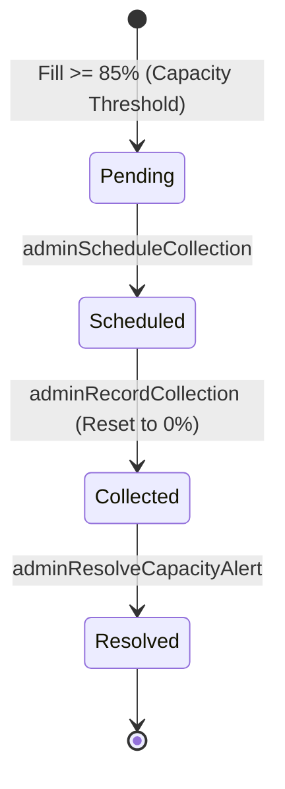

# EcoLoop Database Structure

This document describes the Firebase data structure currently configured in
the repository. The source of truth for access control is
[`../../../firestore.rules`](../../../firestore.rules), and the source of truth for indexes is
[`../../../firestore.indexes.json`](../../../firestore.indexes.json).

## Database address

| Resource | Address |
| --- | --- |
| Firebase project ID | `ecoloop-thesmartrecycling` |
| Firestore database ID | `ecoloop-db` |
| Firestore REST endpoint | `https://firestore.googleapis.com/v1/projects/ecoloop-thesmartrecycling/databases/ecoloop-db/documents` |
| Firebase Console | `https://console.firebase.google.com/project/ecoloop-thesmartrecycling/overview` |
| Firestore Console | `https://console.firebase.google.com/project/ecoloop-thesmartrecycling/firestore` |
| Authentication domain | `ecoloop-thesmartrecycling.firebaseapp.com` |
| Storage bucket | `gs://ecoloop-thesmartrecycling.firebasestorage.app` |

The Firebase project configuration is shared by the Flutter app and web
messaging worker. API keys and app IDs remain in the platform configuration
files; private service-account credentials must not be committed.

### Local emulator addresses

These addresses come from [`../../../firebase.json`](../../../firebase.json):

| Service | Address |
| --- | --- |
| Firebase Emulator UI | `http://127.0.0.1:4000` |
| Firestore | `http://127.0.0.1:8080` |
| Hosting | `http://127.0.0.1:5000` |
| Functions | `http://127.0.0.1:5001` |
| Authentication | `http://127.0.0.1:9099` |
| Storage | `http://127.0.0.1:9199` |

## Firestore structure

Firestore uses a document/collection model. `{uid}` identifies a Firebase
Authentication user. `{id}` values are generated or domain-specific document
IDs.

```text
ecoloop-db
├── residents/{uid}
│   ├── wallet/current
│   ├── preferences/current
│   ├── stats/current
│   └── devices/{deviceId}
│
├── bins/{binId}
├── binQrMappings/{mappingId}
├── binCycles/{cycleId}
├── binCollectionState/{binId}
├── capacityAlerts/{alertId}
├── simulationAssets/{assetId}
├── policies/{policyId}
├── policyPointers/{pointerId}
├── rewards/{rewardId}
├── rewardCategories/{categoryId}
├── guideContent/{contentId}
├── guideMaterials/{materialId}
├── guideSteps/{stepId}
├── scanContent/{contentId}
├── depositSessions/{sessionId}
├── deposits/{batchId}
├── depositResults/{receiptId}
├── walletEntries/{entryId}
├── vouchers/{voucherId}
├── inferenceJobs/{jobId}
│   └── {subcollection}/{documentId}
├── reviewTickets/{ticketId}
├── notificationEvents/{eventId}
│
├── adminAccounts/{uid}
├── adminSettings/{settingId}
├── adminAuditEvents/{eventId}
│
├── adminDashboardViews/{dashboardId}
├── adminBinViews/{binId}
├── adminAlertViews/{alertId}
├── adminReviewViews/{reviewId}
├── adminRewardViews/{rewardId}
├── adminRewardCategoryViews/{categoryId}
└── adminReadVersions/{topic}
```

### Collection responsibilities

| Collection/path | Purpose |
| --- | --- |
| `residents/{uid}` | Resident profile, including `residentId`, `displayName`, `email`, `avatarUrl`, `role`, and timestamps. |
| `residents/{uid}/wallet/current` | Current points balance and wallet version. |
| `residents/{uid}/preferences/current` | Notification preferences: `recyclingUpdates`, `pointsCredits`, and `rewardReminders`. |
| `residents/{uid}/stats/current` | Recycling totals such as verified batches, accepted items, material counts, and estimated weight. |
| `residents/{uid}/devices/{deviceId}` | Push-notification device registration, platform, token, and enabled state. |
| `bins` / `binQrMappings` | Smart-bin catalog and QR-code mappings. |
| `binCycles/{cycleId}` | Smart-bin collection lifecycle cycles (opened, ended, space contributions). |
| `binCollectionState/{binId}` | Real-time dispatch state for collection crews (`normal`, `warning`, `critical`, `collection_pending`). |
| `capacityAlerts/{alertId}` | Automated capacity alerts triggered when bin occupancy reaches threshold ($\ge 85\%$). |
| `simulationAssets` | Assets used by the recycling simulation flow. |
| `policies` / `policyPointers` | Active recycling and reward policy content/version pointers. |
| `rewards` / `rewardCategories` | Reward catalog and reward grouping data. |
| `guideContent` / `guideMaterials` / `guideSteps` | Recycling guide content, material information, and ordered steps. |
| `scanContent` | Scan/instruction content shown during recycling. |
| `depositSessions` | A resident's active or completed scanning/deposit session. |
| `deposits` | Deposit batches and material submissions (verified, rejected, or settled). |
| `depositResults` | Inspection or processing receipts for deposits. |
| `walletEntries` | Points ledger entries associated with a resident. |
| `vouchers` | Reward vouchers issued to a resident. |
| `inferenceJobs` | Admin-only inspection/AI inference jobs and their subcollections. |
| `reviewTickets` | Admin review queue for inspection results. |
| `notificationEvents` | Push-notification intents and delivery state. |
| `adminAccounts/{uid}` | Authorized admin identities with verified roles and active flags. |
| `adminSettings/{settingId}` | Global operational parameters (rates, thresholds, active policy pointers). |
| `adminAuditEvents/{eventId}` | Immutable compliance ledger of all administrative mutations. |
| `adminDashboardViews/summary` | Materialized aggregate view of fleet metrics, weekly activity, and material distributions. |
| `adminBinViews/{binId}` | Projected smart bin rows indexed for fast pagination, filtering, and search. |
| `adminAlertViews/{alertId}` | Projected capacity alerts for dispatch operations. |
| `adminReviewViews/{reviewId}` | Projected pending deposit inspection verification cards. |
| `adminRewardViews/{rewardId}` | Projected reward offer entries. |
| `adminRewardCategoryViews/{categoryId}` | Projected reward categories with display ordering. |
| `adminReadVersions/{topic}` | Incremental cache invalidation counters for real-time client convergence. |

---

## Admin Overview Dashboard Data Connection

The Admin Portal's **Overview Dashboard** (`/overview` in `apps/admin-web`) connects directly to Firestore database `ecoloop-db` using a high-performance, real-time reactive model. The dashboard reads canonical business entities (`bins`, `capacityAlerts`, `deposits`, `reviewTickets`) alongside projected materialized snapshots (`adminDashboardViews/summary`, `adminBinViews`, `adminAlertViews`).

### 1. KPI Metric Cards Data Mapping

| KPI Metric Card | Database Collection & Query Filter | Field Mapping / Calculation |
| --- | --- | --- |
| **Registered Bins** | `bins` merged with `adminBinViews` (where `deleted != true`) | Count of unique active smart bin records across the township fleet. |
| **Active Alerts** | `capacityAlerts` and `adminAlertViews` (where `state != 'resolved' && state != 'closed'`) | Total count of uncollected bins currently exceeding critical capacity ($\ge 85\%$) requiring crew pickup. |
| **Verified Deposits** | `deposits` (or `batches`) (where `status in ['verified', 'settled']`) | Total lifetime count of successfully verified recycling submissions; displays combined recyclable weight. |
| **EcoPoints Issued** | `deposits` (or `batches`) (where `status in ['verified', 'settled']`) | Sum of `pointsAwarded` (gross ledger invariant). Resident voucher redemptions debit individual wallets but **never** decrement this gross community issuance metric. |

### 2. 7-Day Weekly Activity Trend (Bar Chart)

- **Source Collection:** `deposits` / `batches` where `status in ['verified', 'settled']`.
- **Date Window:** Dynamic 7-day calendar window pegged to `Asia/Kuala_Lumpur` timezone (`[today - 6 days, ..., today]`).
- **Grouping Key:** Batch occurrence timestamp (`occurredAt` or `createdAt`). A late verification across midnight correctly attributes the deposit to its original occurrence date.
- **Display Order:** Ordered sequentially from **Monday to Sunday** (`Mon -> Sun`).

### 3. Material Mix Distribution (Donut Chart)

- **Source Collection:** `deposits.lines` across all verified deposit batches.
- **Conversion Factors:** Standard physical weight constants:
  - **Plastic** (`plastic_bottle`, `plastic`): `0.025 kg` per item
  - **Aluminium** (`aluminium_can`, `aluminium`): `0.015 kg` per item
  - **Paper** (`paper_item`, `paper_bag`, `paper`): `0.050 kg` per item
  - **Glass** (`glass_bottle`, `glass`): `0.200 kg` per item
  - **Cardboard** (`cardboard_item`): `0.000 kg` (excluded by active program policy)
- **Aggregation:** Percentage share by weight: $\frac{\text{Weight}_{\text{material}}}{\text{Total Weight}} \times 100\%$, rendered as a CSS conic gradient with color-coded legend chips.

### 4. Attention Bins Table

The Attention Bins panel monitors receptacles that require immediate operational intervention or technician awareness. Bins are sourced from `bins` merged with `adminBinViews` and evaluated against a deterministic 3-tier priority structure:

1. **Tier 1 — Critical / Pickup Required:**
   - Condition: Capacity fill $\ge 85\%$, `collectionState === 'critical'`, or `hasActiveAlert === true`.
   - Badge: Red `CRITICAL` + Green `ONLINE`.
   - Dispatch: `Pending Collection`.
2. **Tier 2 — Warning Threshold:**
   - Condition: Capacity fill between $75\% - 84\%$ or `collectionState === 'warning'`.
   - Badge: Amber `WARNING` + Green `ONLINE`.
   - Dispatch: `Collection Scheduled`.
3. **Tier 3 — Offline & Out of Service:**
   - Condition: `enabled === false`, `isOnline === false`, or `logicalOnline === false`.
   - Promoted to Attention Bins **even at 0% capacity** so technicians immediately know which bins are administratively disabled or disconnected from telemetry.
   - Badge: Red/Amber/Green capacity badge + Gray **`OFFLINE`** badge.
   - Deterministic sorting: Tier $\rightarrow$ Fill Percentage Descending $\rightarrow$ Bin ID Ascending.

### 5. Real-Time Convergence Architecture

The web client (`FirebaseDashboardRepository`) maintains real-time synchronization with Firestore:
1. **Cache-Busting Trigger:** Listens to `adminReadVersions/dashboard`. Any backend mutation (e.g., bin collection, deposit settlement) bumps the topic version and prompts an immediate background refresh.
2. **Live Fleet Collections:** Subscribes with `onSnapshot` listeners to `bins`, `adminBinViews`, `deposits`, and `capacityAlerts`.
3. **Visibility Management:** Pauses live polling when the browser tab is hidden (`document.visibilityState === 'hidden'`) and executes an immediate revalidation as soon as the administrator returns to the tab.

---

## Capacity Alerts Data Connection & Lifecycle Workflow

The Admin Portal's **Capacity Alerts** module (`/alerts` in `apps/admin-web`, backed by `CapacityAlertsPage.tsx` and `FirebaseAlertsRepository.ts`) connects directly to the Firestore collection **`capacityAlerts/{alertId}`** in `ecoloop-db`. It manages the end-to-end lifecycle of smart bins requiring collection dispatch, from initial threshold trigger to physical collection and administrative resolution.

### 1. Database Document Schema (`capacityAlerts/{alertId}`)

Alert IDs follow deterministic naming: `alert-{binId}-{cycleId}` (or `alert-{binId}`).

| Field | Type | Description |
| --- | --- | --- |
| `id` / `alertId` | `string` | Unique alert identifier. |
| `binId` | `string` | Foreign key referencing the affected smart bin in `bins/{binId}`. |
| `locationName` | `string` | Human-readable location name for dispatch. |
| `cycleId` | `string` | Foreign key referencing the active collection cycle in `binCycles/{cycleId}`. |
| `thresholdSnapshot` | `number` | Immutable threshold percentage (`75`, `80`, or `85`) locked at alert creation time. |
| `operationalSettingsVersion` | `number` | Global settings version active when alert was triggered. |
| `triggeringFillPercent` | `number` | Smart bin fill percentage at the moment threshold was breached. |
| `currentFillPercent` | `number` | Live smart bin fill percentage, updated dynamically as telemetry changes. |
| `state` | `string` | Lifecycle state: `"pending"`, `"scheduled"`, `"collected"`, or `"resolved"`. |
| `version` | `number` | Concurrency version counter (incremented on each state transition). |
| `triggeredAt` | `Timestamp` / `string` | ISO timestamp when the capacity threshold was breached. |
| `scheduledAt` | `Timestamp` / `string` \| `null` | Timestamp when collection was scheduled. |
| `scheduledBy` | `string` \| `null` | UID of the administrator who scheduled the collection. |
| `collectedAt` | `Timestamp` / `string` \| `null` | Timestamp when the bin was emptied and reset. |
| `collectedBy` | `string` \| `null` | Operator/crew UID who recorded the collection event. |
| `resolvedAt` | `Timestamp` / `string` \| `null` | Timestamp when the alert was officially closed. |
| `resolvedBy` | `string` \| `null` | UID of the administrator who resolved the alert. |
| `collectionEventId` | `string` \| `null` | Foreign key referencing `collectionEvents/{collectionEventId}`. |
| `updatedAt` | `Timestamp` / `string` | Timestamp of latest alert mutation. |

### 2. Companion Collections & Dispatch Coordination

Capacity alert operations coordinate transactionally across multiple database collections:

1. **`binCollectionState/{binId}`**:
   - Maintains real-time operational status for collection crews (`status`: `"normal"`, `"collection_scheduled"`, or `"collected"`).
   - Links to `activeAlertId` when an alert is open; cleared to `null` upon resolution.
2. **`binCycles/{cycleId}`**:
   - Tracks the bin's collection lifecycle.
   - When collection is recorded, the current cycle closes (`endedAt`, `closingOccupiedSpc`), and a new cycle opens with `openingOccupiedSpc: 0`.
3. **`collectionEvents/{collectionEventId}`**:
   - Immutable audit record of the physical collection event.
4. **`adminAlertViews/{alertId}`**:
   - Projected read model indexing search tokens, sort fields, and active status for fast cursor pagination.
5. **`adminReadVersions/alerts`**:
   - Version counter bumped after every alert mutation to trigger instant cross-client UI revalidation.

### 3. 4-Stage Operational Lifecycle Workflow



1. **Stage 1 — Triggered (`pending`):**
   - Automatically created when a bin reaches or exceeds capacity threshold ($\ge 85\%$).
   - Displays under the **Active** alerts tab with a red `CRITICAL` badge and `Pending Collection` status.
2. **Stage 2 — Scheduled (`scheduled`):**
   - Administrator dispatches collection crew via `schedule()`.
   - Updates `capacityAlerts` with `scheduledAt`, `scheduledBy`, and increments `version`.
   - `binCollectionState` sets `status: "collection_scheduled"`.
   - Displays an amber `Collection Scheduled` badge.
3. **Stage 3 — Collected (`collected`):**
   - Collection crew records physical emptying via `collect()`.
   - Smart bin in `bins/{binId}` resets to **0 occupied space / 0% fill**.
   - Old cycle in `binCycles` ends; new empty cycle begins.
   - `capacityAlerts` sets `state: "collected"`, `currentFillPercent: 0`, and records `collectedAt`.
   - Displays a green `Collected` badge.
4. **Stage 4 — Resolved (`resolved`):**
   - Administrator marks the alert closed via `resolve()`.
   - Updates `capacityAlerts` with `resolvedAt` and `resolvedBy`.
   - `binCollectionState` clears `activeAlertId` and restores `status: "normal"`.
   - Moves alert to the **Resolved** tab; removes alert warning from the Overview dashboard.

### 4. Client Connection & Live Synchronization

The Admin Web client (`FirebaseAlertsRepository`) maintains real-time synchronization with `capacityAlerts`:
- **Dual-Collection Merging:** Merges canonical documents from `capacityAlerts` and projected views from `adminAlertViews`, guaranteeing no alert is omitted even if projection is delayed.
- **Location Enrichment:** Dynamically joins `bins/{binId}` to attach up-to-date location details and bin online telemetry.
- **Real-Time Snapshot Watchers:** Listens via `onSnapshot` to:
  1. `adminReadVersions/alerts` (invalidation trigger).
  2. `capacityAlerts` (canonical alert collection updates).
  3. `adminAlertViews` (projected view updates).
  4. `bins` (smart-bin occupancy and location updates).
- **Tab State Coordination:** Automatically switches active/resolved tabs and reflects the alert count in real time across the fleet.

---

## Firebase Storage structure

```text
gs://ecoloop-thesmartrecycling.firebasestorage.app
├── simulation-assets/{assetId}/{assetVersion}/{fileName}
├── reward-art/{rewardId}/{assetVersion}/{fileName}
├── evaluation-data/{datasetVersion}/{fileName}
└── inspection-evidence/{residentId}/{depositId}/{runId}/{fileName}
```

## Access summary

- Signed-in users can read catalog content such as bins, guides, policies,
  rewards, and simulation assets.
- A resident can read only their own resident document, resident
  subcollections, deposits, results, wallet entries, vouchers, and
  notification events.
- Administrators can read inference jobs, review tickets, evaluation data,
  audit logs, settings, and read view projections.
- Client-side writes are strictly regulated by `firestore.rules`.
  Administrators can update catalog records and dispatch statuses;
  sensitive ledger mutations and balance calculations are processed through
  trusted Firebase Cloud Functions.
- Unmatched Firestore documents and Storage paths are denied by default.

## Configured composite indexes

The following collection-group indexes are configured in
[`firestore.indexes.json`](../../../firestore.indexes.json):

- `sessions`: `ownerId ASC`, `updatedAt DESC`
- `batches`: `ownerId ASC`, `occurredAt DESC`
- `receipts`: `ownerId ASC`, `occurredAt DESC`
- `deposits`: `ownerId ASC`, `updatedAt DESC`
- `notificationEvents`: `recipientUid ASC`, `createdAt DESC`
- `reviewTickets`: `status ASC`, `createdAt ASC`
- `vouchers`: `status ASC`, `expiresAt ASC`
- `diagnosticArtifacts`: `state ASC`, `purgeAfterAt ASC`

