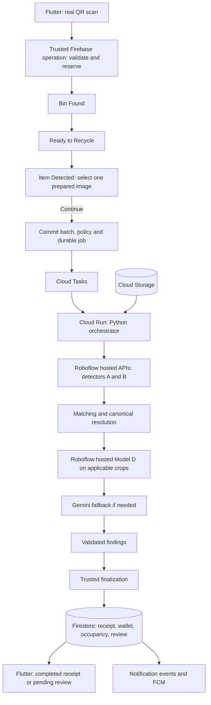

# EcoLoop Backend and Computer Vision Specification

- **Document ID:** ECOLOOP-SPEC-001
- **Version:** 1.1
- **Date:** 2026-10-18
- **Status:** Approved discussion baseline; implementation and validation pending
- **Authority:** Source of truth for the resident application's backend and software-only computer-vision proof of concept
- **Target platforms:** Android and Flutter web
- **Operating context:** Malaysia; Singapore deployment region, subject to verification of existing Firebase resources

## Contents

1. [Purpose and authority](#1-purpose-and-authority)
2. [Scope and operating constraints](#2-scope-and-operating-constraints)
3. [Terminology and system architecture](#3-terminology-and-system-architecture)
4. [Resident recycling journey](#4-resident-recycling-journey)
5. [Session, job, decision, and settlement lifecycles](#5-session-job-decision-and-settlement-lifecycles)
6. [Canonical taxonomy and program policy](#6-canonical-taxonomy-and-program-policy)
7. [Vision model registry and orchestration](#7-vision-model-registry-and-orchestration)
8. [Rewards and capacity accounting](#8-rewards-and-capacity-accounting)
9. [Trusted mutations and idempotency](#9-trusted-mutations-and-idempotency)
10. [Canonical data contract](#10-canonical-data-contract)
11. [Logical operations and observable reads](#11-logical-operations-and-observable-reads)
12. [Resident account, history, and guide behavior](#12-resident-account-history-and-guide-behavior)
13. [Rewards and demo vouchers](#13-rewards-and-demo-vouchers)
14. [Notifications and scheduled work](#14-notifications-and-scheduled-work)
15. [Security and access boundaries](#15-security-and-access-boundaries)
16. [Reliability, offline behavior, and operations](#16-reliability-offline-behavior-and-operations)
17. [Administrative handoff contract](#17-administrative-handoff-contract)
18. [Verification and acceptance specification](#18-verification-and-acceptance-specification)
19. [Compatibility and required integration changes](#19-compatibility-and-required-integration-changes)
20. [Validation-dependent inputs and change control](#20-validation-dependent-inputs-and-change-control)
21. [Supporting references](#21-supporting-references)

## 1. Purpose and authority

This document specifies what EcoLoop must do, the meaning of its data, the boundaries between its services, and how correctness will be established. It records the decisions settled through the backend-design discussion and the final scenario review.

The implementation plan must be derived from this specification. Phases, milestones, task assignments, and a day-by-day schedule belong in that separate plan.

### 1.1 Normative language

- **MUST / MUST NOT:** Required behavior or invariant.
- **SHOULD:** Recommended implementation behavior; a deviation requires an explicit explanation.
- **MAY:** Permitted behavior within the stated contract.

The schemas and logical operations below are the canonical integration contract. Implementation-specific transport URLs, indexes' generated names, package versions, and deployment identifiers must be recorded during implementation without changing the specified behavior.

### 1.2 Relationship to existing documents

Where backend assumptions conflict, this specification takes precedence over:

- [Flutter mock contracts](../frontend/FLUTTER_MOCK_CONTRACTS.md).
- [Flutter UI implementation plan](../frontend/FIGMA_USER_APP_TO_FLUTTER_IMPLEMENTATION_PLAN.md).
- [Admin website implementation plan](../admin/ADMIN_PANEL_WEB_IMPLEMENTATION_PLAN.md).
- [Admin pages and files reference](../admin/ADMIN_PANEL_PAGES_AND_FILES.md).

The [multi-model orchestrator proposal](../frontend_ui/recycle_bin_multi_model_orchestrator_plan.md) remains supporting technical rationale. This specification adopts its deterministic object matching, conservative taxonomy, uncertainty handling, and evaluation principles, and makes the PoC's deployment and fallback requirements explicit.

The [count-based EcoPoints decisions](../calibration/ecopoints_weight_to_count_refactor_preferences.md) remain applicable: rewards use integer item counts; any displayed kilograms are derived estimates. This specification adds explicit object eligibility and independent space-point accounting.

**Approval of this specification does not mean the models have been benchmarked, the backend exists, or the acceptance targets have been achieved.**

## 2. Scope and operating constraints

### 2.1 Required PoC scope

| ID | Requirement |
| --- | --- |
| SCOPE-01 | The PoC MUST be software-only. The resident phone/browser camera MUST really scan QR codes. |
| SCOPE-02 | Prepared images in Cloud Storage MUST simulate the bin camera's capture. Real inference MUST process the selected pixels. |
| SCOPE-03 | The resident application MUST support Android and web, including Google sign-in and the full recycling journey. |
| SCOPE-04 | Firebase MUST provide application identity, database, storage, trusted business operations, notifications, and resident web hosting. |
| SCOPE-05 | A Python vision service MUST be deployed to Google Cloud Run. Deployed processing MUST work independently of the developer's PC. |
| SCOPE-06 | Public resident registration and public use of enabled bins MUST be supported. Building membership is not an access boundary. |
| SCOPE-07 | The full resident scope includes profile/settings, wallet/history, guide, rewards/vouchers, real push delivery, reminders, recovery, retention, and validation. |
| SCOPE-08 | The requested delivery constraint is seven days for the full agreed scope. Validation failures MUST be reported rather than hidden by the deadline. |

### 2.2 Simulation boundary

- No dedicated bin camera, chip, edge device, actuator, scale, fill sensor, or physical-bin integration is required in this PoC.
- A valid scan and reservation represent opening the simulated bin. Finishing, cancellation, expiration, and processing represent its logical access lifecycle.
- A selected image represents **one newly deposited batch**, not an accumulating pile containing previously counted deposits.
- Use the existing pretrained A/B/D models through Roboflow's hosted inference APIs with server-side API keys. This project MUST NOT require training, fine-tuning, dataset uploads, weight export/download, or local/Cloud Run hosting of those model weights.
- Sending an image/crop to an inference endpoint is required and permitted. The dataset-upload exclusion concerns creating/uploading a labeled training dataset, not supplying pixels for a prediction request.
- Manually labeled images are evaluation test cases: compare returned detections/classifications with expected visible objects. Choosing confidence thresholds and matching rules configures our software; it does not train the provider's models. The evaluation set is not a prerequisite for the first API smoke call.
- Reusing a prepared image in different sessions is legitimate simulation behavior. Duplicate prevention applies to a submitted batch and its operations, not globally to an image hash.
- The PoC demonstrates the software workflow and image interpretation. It does not establish that a real physical deposit occurred or that estimated occupancy is measured physical volume.
- The development PC needs ordinary application/backend tooling and network API access. A GPU, CUDA and a local detector/classifier runtime are unnecessary because Roboflow performs model inference. The deployed Cloud Run orchestration remains independent of that PC.

### 2.3 Administrative boundary

The friend's admin frontend is a separate client. This scope MUST create review-ready records, shared schemas, and settlement-compatible integration contracts. Detailed admin portal workflows, administrative backend transports, merchant integrations, and hardware integration have separate specifications/plans.

An authorized operator or controlled test harness MUST be able to demonstrate simulated collection/reset and exercise the review-resolution domain contract. This does not authorize resident accounts to perform administrative actions.

### 2.4 Initial operating assumptions

| Setting | Agreed value |
| --- | --- |
| Daily sizing assumption | Up to 50 submitted batches/day |
| Monthly cost-model assumption | Approximately 1,500 batches over 30 days |
| Total monthly operating-budget target | RM50, including Firebase/Google Cloud, Gemini, and paid Roboflow usage |
| Initial Cloud Run strategy | CPU-first, request-driven, scale to zero |
| Initial benchmark configuration | 2 vCPU, 4 GiB RAM, one request per instance, maximum one instance |
| Automatic processing budget | Up to 3 execution attempts within 5 minutes from successful submission |
| Unsubmitted reservation expiry | 10 minutes after the last successful renewal/contact |
| Initial labeled CV dataset target | Approximately 100 images, with separate tuning and frozen evaluation subsets |
| Diagnostic evidence retention | 30 days after resolution; retain unresolved review evidence until resolution |

The Cloud Run resources are a benchmark starting configuration. Exact memory, CPU, provider quotas, and call limits MUST be validated against measured latency and the budget. Fifty batches/day is a sizing assumption, not an automatically agreed hard daily rejection limit.

## 3. Terminology and system architecture

### 3.1 Domain terms

| Term | Meaning |
| --- | --- |
| Resident | A person identified by a Firebase Authentication UID. |
| Bin | A registered, publicly usable logical recycling bin with individual capacity and availability. |
| Session | The resident's exclusive scan journey at one bin. |
| Draft selection | A changeable reference to a prepared image before Continue submits it. |
| Submission / batch | One committed image representing newly deposited items; one session produces at most one batch. |
| Processing job | Durable work to analyze that submission, with bounded attempts. |
| Attempt / run | One auditable execution of the job or an explicitly recorded later analysis. |
| Candidate object | One proposed visible physical object after detector reconciliation, or from a validated full-image fallback. |
| Receipt line | A class-level grouping derived from individual object findings. |
| Settlement | The trusted decision that credits eligible points or records a final zero-credit outcome. |
| Capacity contribution | Space points attributed to a batch, independently of its rewards. |
| Collection cycle | The occupancy-accounting period between simulated emptying operations. |
| Review ticket | A reference to an unresolved batch and its evidence for the later admin backend. |
| Policy version | Immutable acceptance, reward, and space rules pinned to a submission. |

### 3.2 Service responsibilities

| Component | Responsibility |
| --- | --- |
| Flutter resident app | QR capture, existing screens, draft image choice, authenticated commands, observable results. |
| Firebase Authentication | Google sign-in, stable UID, tokens, trusted role claims. |
| Cloud Firestore | Application records, operation identities, jobs, policy versions, ledger records, and read projections. |
| Cloud Storage | Prepared source images, per-run crops, raw predictions, and selected diagnostic artifacts. |
| Trusted Firebase backend operations | Ownership validation, reservations, durable dispatch requests, settlement, redemption, capacity, and scheduled work. |
| Cloud Tasks | Authenticated, bounded delivery of processing work to Cloud Run. |
| Cloud Run Python vision service | Authenticated model API clients, preprocessing/crops, returned-detection matching/counting, taxonomy resolution, fallback requests, and findings. It does not load the A/B/D weights. |
| Gemini API | Google-hosted visual fallback; configured model ID `gemini-3.8-flash`. |
| Roboflow hosted inference | Required execution location for the existing pretrained A/B/D models; access and per-call costs must be verified. |
| Firebase Cloud Messaging | Result/credit alerts and voucher reminder delivery. |
| Firebase Hosting | HTTPS hosting of the resident Flutter web application; separate from the admin frontend deployment. |



The diagram expresses logical flow; already resolved findings can bypass specialist/fallback calls. When detectors produce no usable proposals, the full-image Gemini path bypasses crop classification.

Roboflow hosts and executes the existing A/B/D models. Cloud Run hosts our Python orchestration code: it obtains images, calls the model APIs, reconciles bounding boxes, counts unique objects, resolves labels and calls Gemini where required. Gemini is also Google-hosted. Financial and occupancy mutations belong to trusted business finalization, rather than the resident client or an LLM response.

## 4. Resident recycling journey

### 4.1 Required screens and actions

| Screen/stage | Required behavior |
| --- | --- |
| Scan QR | Open a real camera, decode a registered QR payload, and ask the backend to validate/reserve. |
| Bin Found (`binFound`) | Display fetched bin identity, location, accepted-object information, and estimated fill. Confirm session advances. |
| Ready to Recycle (`ready`) | Preserve the user interaction for reporting that throwing is finished. |
| Item Detected (`itemDetected`) | Show prepared image-name controls and the existing Continue action. |
| Identifying Material (`processing`) | Observe real queue/inference/finalization progress; do not manufacture a timed successful result. |
| Final Outcome (`completed`) | Show a completed receipt or a pending-admin-review result, according to the batch. |

**FLOW-01:** The intermediate screens MUST remain part of the journey. A shortened architecture diagram MUST NOT be interpreted as permission to collapse them.

### 4.2 Single-image selection contract

- Exactly one image MAY be selected at a time. Selecting another replaces the previous selection.
- Selecting an image MUST NOT automatically advance or start inference.
- Continue MUST be disabled until a selection exists and submission can be validated online.
- The selected asset is a draft and MAY be changed before Continue.
- Draft selection MUST be recoverable with the valid session after app reopening.
- Continue MUST commit the exact selected asset version. Out-of-order draft saves MUST NOT replace a submitted image.
- After submission, changing the image requires a new legitimate session; a retry MUST retain the original submission.
- Prepared images MUST be selected through authorized asset IDs. The client MUST NOT submit expected labels, counts, reward amounts, or arbitrary Storage paths as classification truth.
- Display filenames and evaluation annotations MUST NOT be supplied to the engine as hints about the expected answer.

### 4.3 QR and availability contract

- Generated QR images MUST encode payloads registered in the database and mapped to bin identities.
- The existing `ecoloop://bin/` scheme can be retained with a registered QR identifier as its suffix. The suffix MUST be resolved through an enabled mapping, rather than trusted as an unchecked bin ID.
- A successful scan MUST atomically establish the eligible session/reservation before simulated access is granted.
- Invalid/disabled mappings, full bins, disabled bins, unavailable processing, or another valid reservation MUST produce explicit recoverable availability/error states.
- A QR identifies a logical bin. The software PoC MUST NOT claim that a static QR establishes physical presence or proves a physical deposit.

## 5. Session, job, decision, and settlement lifecycles

### 5.1 Session state machine

```text
binFound --confirm--> ready --finished throwing--> itemDetected
itemDetected --Continue/commit--> processing --automatic outcome--> completed

binFound / ready / itemDetected --cancel or abandoned expiry--> cancelled
```

- A resident MUST have at most one unfinished scan journey across all bins.
- A bin MUST have at most one active reservation.
- A repeated scan for the same resident/bin MUST recover the existing unfinished session instead of duplicating it.
- If the resident has an unfinished session elsewhere, the app MUST offer/resume that journey rather than silently reserving a second bin.
- Cancellation is allowed before submission. It releases the reservation and closes simulated access without rewards or occupancy effects.
- Expiry is represented by a cancelled session with a termination reason such as `reservation_expired`; it does not require removing a screen or silently creating a replacement session.
- During the connected, foreground session flow, the reservation MAY renew without a forced image-selection countdown.
- Without successful renewal, an unsubmitted reservation expires after 600 seconds. Backend time checks, not eventual TTL deletion, enforce that expiry.
- After submission, app heartbeats are not required for processing to continue. The processing deadline governs recovery.
- Simulated access closes when throwing is reported finished; the reservation remains held until the automatic outcome and initial occupancy contribution are recorded.
- An outcome of `review` completes the automatic session and releases both resident and bin for another journey.
- Offline sign-out/cancellation cannot promise an immediate server release; an unsubmitted lease remains subject to its expiry.

### 5.2 Processing state machine

```text
queued -> running -> succeeded
             |
             +-> retry_wait -> running
             +-> failed / expired
```

| Job result | Meaning |
| --- | --- |
| `succeeded` | Processing produced a valid decision path; the batch may be verified, excluded, empty, or still require review. |
| `failed` | A terminal technical failure prevented a sufficient result. |
| `expired` | The automatic-processing deadline was reached. |

Classification uncertainty is a business outcome, not automatically a failed infrastructure job. Retrying a transient failure is different from repeatedly asking models to change a valid uncertain answer.

### 5.3 Batch and result states

The integrated batch contract extends the mock's narrower enums deliberately:

| Batch `status` / result `outcome` | Meaning | Points | Resident destination |
| --- | --- | --- | --- |
| `processing` | Submitted; automatic decision not finalized. | `null` | Identifying Material |
| `verified` | Fully resolved batch containing accepted items. | Calculated integer | Completed receipt |
| `review` | Uncertainty or technical failure needs admin resolution. | `null` | Pending-review result |
| `rejected` | Fully resolved batch with no eligible items. | `0` | Completed zero-point receipt |
| `empty` | Validated usable image establishes no visible deposited objects. | `0` | Completed empty-capture receipt |

`processing` is a stored batch state; a final scan-result projection is published at automatic completion. Unknown future enum values MUST yield an explicit unsupported/recovery presentation, not an invented verified outcome.

The two final **destinations** remain completed receipt and pending review. `rejected` and `empty` do not introduce extra recycling steps.

Settlement states are separate: `unsettled` during processing, `held` during review, `credited` after a positive credit, and `no_credit` for a final zero-credit outcome.

### 5.4 Processing deadline and late results

- The five-minute budget begins at successful Continue submission and includes queue wait, startup, model calls, and finalization.
- There are at most three claimed execution attempts within that budget. Duplicate deliveries MUST NOT obtain new work beyond the attempt/deadline limits.
- SDK, HTTP, queue, and worker retries MUST have coordinated bounds; nested retry policies MUST NOT silently multiply the agreed processing budget.
- Temporary service/network failures MAY retry. Permanent configuration/authentication errors MUST be surfaced with their actual reason.
- Successful stage outputs SHOULD be checkpointed and reused when safe for the same image, model versions, and configuration.
- After exhaustion/deadline, the existing batch MUST enter review with a technical reason, preserved evidence, provisional occupancy, and a released reservation.
- A trusted reconciler MUST recover un-dispatched and stuck jobs. Deadline finalization is eventual during a backend outage; it MUST be enforced once the responsible backend operations can run.
- Finalization MUST compare the accepted job/attempt identity, decision version, current state, and deadline. A late or fenced-out worker MUST NOT overwrite a newer decision, issue points, or release another session's reservation.
- After referral to admin, later AI output is additional evidence. Admin-resolution semantics control settlement.

## 6. Canonical taxonomy and program policy

### 6.1 Separate three decisions

1. **Recognition:** What visible object does the evidence support?
2. **Acceptance:** Is that specific canonical object class accepted by the program?
3. **Reward:** Which material-category rate applies to an accepted object?

A material category is not blanket acceptance of every object made from that material.

### 6.2 Initial policy

| Canonical class | Reward category | Eligible | Points/item | Space/item |
| --- | --- | --- | --- | --- |
| `plastic_bottle` | `plastic` | Yes | 5 | 10 spc |
| `aluminium_can` | `aluminium` | Yes | 8 | 6 spc |
| `glass_bottle` | `glass` | Yes | 10 | 12 spc |
| `paper_item` | `paper` | Yes | 3 | 2 spc |
| `paper_bag` | `paper` | Yes | 3 | 8 spc |
| `cardboard_item` | `paper` | No | 0 | 15 spc |
| Other confidently resolved excluded classes | As supported, or none | No | 0 | 10 spc unless configured |

Additional initial allowances:

- Unresolved object candidate: **10 spc per candidate**.
- Entirely unreadable batch without a usable inventory: **50 spc for the batch**.

The initial accepted set is exactly the five eligible classes above. Cardboard MUST NOT be silently folded into eligible `paper_item`. Paper cups, plastic bags, utensils, shards, and other classes require explicit future policy changes to become eligible.

These space values are versioned software estimates. They are independent of physical weight, reward points, and exact container capacity.

### 6.3 Label specificity

- `Pet_Bottle` or `Plastic bottle` MAY map to `plastic_bottle` after verifying the source class semantics. The app MUST NOT claim chemical resin verification from that visual label.
- An explicit supported `Aluminum can` label MAY map to `aluminium_can` after class-specific validation.
- Generic `can` / `Metal Can` does not by itself establish aluminium. Generic `Glass` does not by itself establish a glass bottle.
- A broad or unknown-material label MUST NOT be automatically rejected merely because its string is absent from the eligible list when it could still represent an accepted object. Resolve the necessary subtype or retain unresolved eligibility.
- Dataset labels such as `Unlabeled` MUST NOT become confident material decisions. Meanings of `Other Plastic`, `Unknown plastic`, and similar broad labels require explicit registry interpretation.
- Object resolution state and eligibility state MUST be recorded separately where a supported broad label still leaves eligibility unresolved.
- Unsupported raw labels MUST remain traceable and enter an uncertainty path instead of being coerced into a supported category.

### 6.4 Shared immutable policy

- All PoC bins use one active shared policy. Bin capacities and current occupancy remain individual.
- Continue pins the active policy version for the submitted batch.
- Acceptance, reward rates, specific space values, and fallback space allowances MUST be immutable within that version.
- Changes create a new version for future submissions. Review uses the submitted version.
- The guide and current bin acceptance display use the active policy; historical receipts use their pinned policy.
- Inference thresholds, preprocessing, matching rules, and prompt templates MUST also be versioned and recorded with the run. Reanalysis MUST preserve its own configuration identity.

The following illustrates the initial immutable policy payload. The document ID is illustrative; the values are normative:

```json
{
  "id": "policy-v1",
  "acceptedObjectClasses": [
    "plastic_bottle", "aluminium_can", "glass_bottle", "paper_item", "paper_bag"
  ],
  "rewardCategoryByClass": {
    "plastic_bottle": "plastic",
    "aluminium_can": "aluminium",
    "glass_bottle": "glass",
    "paper_item": "paper",
    "paper_bag": "paper",
    "cardboard_item": "paper"
  },
  "pointsPerItemByCategory": {
    "plastic": 5, "aluminium": 8, "paper": 3, "glass": 10
  },
  "spcPerItemByClass": {
    "plastic_bottle": 10, "aluminium_can": 6, "glass_bottle": 12,
    "paper_item": 2, "paper_bag": 8, "cardboard_item": 15
  },
  "defaultSpcPerRecognizedItem": 10,
  "unresolvedSpcPerCandidate": 10,
  "unreadableBatchSpc": 50
}
```

The category mapping of an excluded class does not confer eligibility; membership in `acceptedObjectClasses` is required.

## 7. Vision model registry and orchestration

### 7.1 Model assets and observed metadata

The following are identified candidates, not independently reproduced performance claims:

| Role | Identified source / model ID | Required interpretation |
| --- | --- | --- |
| A: six-class detector | [Roboflow Waste-Detection](https://universe.roboflow.com/object-detection-cfmul/waste-detection-0momv), `waste-detection-0momv/6` | Call the existing hosted detector API. This is the selected Model A API candidate; verify access and its actual response. |
| B: 42-class detector | [ProjectVerba model](https://universe.roboflow.com/projectverba/yolo-waste-detection), `yolo-waste-detection/1` | Call the existing hosted detector API. The published deployment lists Roboflow 2.0 Object Detection (Fast); provider-side runtime details do not require our own model deployment. |
| D: 18-class specialist | [waste classification](https://universe.roboflow.com/project-rcqow/waste-classification-rjo28), `waste-classification-rjo28/2` | Displayed version is multi-label classification, not object detection. |
| Visual fallback | [Gemini 3.8 Flash](https://ai.google.dev/gemini-api/docs/models/gemini-3.8-flash), `gemini-3.8-flash` | Image input and structured output; Google-hosted API. |

The supplied [GitHub A reference](https://github.com/laibyy0/waste-detection-yolo) describes a different YOLO26n checkpoint and is background information, not an asset to download or deploy. Its reported metrics MUST NOT be mixed with the selected Roboflow API version. Published Roboflow figures likewise are not this application's measured performance.

Each registry entry MUST record provider, hosted model/version ID, actual class map, request/response schema, preprocessing/input format, API adapter, access requirements, applicable terms metadata, and validation results. Record provider-reported revision metadata where available. A public page or successful API response alone does not establish operating accuracy; an unavailable weight checksum/export is not a blocker for this API-based design.

### 7.2 Adapter behavior

- Invoke A/B/D using the existing Roboflow hosted inference API, such as the supported Serverless Cloud API, with server-side credentials.
- Use a lightweight HTTP client or `inference-sdk` as appropriate. Model-training and local-inference frameworks such as PyTorch, TensorFlow, Ultralytics or the self-hosted `inference` package are not required for this integration.
- A change of hosted model ID/version or provider MUST be explicit in the registry and evaluation results. An API access failure MUST NOT be treated as a reason to train or self-host a replacement model without a new scope decision.
- Run A and B on the same input during baseline evaluation. Do not invoke B only when A reports failure: A cannot identify everything it missed.
- Parallel versus sequential execution MAY be benchmarked for CPU/memory efficiency without changing the requirement to obtain both detector outputs for the configured baseline.
- Preserve raw outputs, model versions, timestamps, coordinate transforms, and inference errors.
- Normalize detector boxes to `x1, y1, x2, y2` coordinates in `[0,1]` relative to the original image. Reverse resizing/letterboxing correctly.
- Apply appropriate model-native duplicate handling. Do not assume every detector architecture requires identical NMS behavior.
- Raw scores from different models MUST NOT be treated as interchangeable probabilities.

### 7.3 Matching and counting

- Reconcile detections representing the same physical object before counting.
- Matching SHOULD consider IoU, center/size compatibility, and one-to-one assignment. Thresholds are validation-derived configuration, not a universal fixed overlap rule.
- Overlap alone MUST NOT merge adjacent or partially overlapping physical objects.
- Unmatched valid detections MUST be preserved, including classes another detector does not support.
- Resolve labels through an explicit compatibility/taxonomy map rather than raw-label majority vote or highest-score selection across models.
- One candidate has one count contribution. Parent-category totals and class subtotals are alternative aggregations, not additive physical objects.
- An attached bottle cap is part of its bottle for the PoC counting policy. A separately detected loose cap can be a separate excluded object.
- IDs identify candidates within an inspection/run; they do not establish identity across different images.
- Counts MUST be derived from reconciled object records, including validated full-image-fallback objects, rather than adding model totals.
- A candidate rejected as a tested false detection contributes neither an object count nor space. It remains diagnostic evidence and is distinct from a real, confidently excluded waste object.

### 7.4 Model D

- Use D on individual candidate crops with controlled padding from the original image.
- Invoke it only when its vocabulary can help resolve the relevant case.
- Its displayed multi-label format MUST be handled as such. Multiple presence scores are not multiple physical objects.
- Record specialist scores separately. An image-classifier accuracy figure is not detector mAP or calibrated per-crop confidence.
- A specialist cannot establish a subtype absent from its vocabulary or prove that an unsupported class is absent.

### 7.5 Gemini fallback

Two paths are required:

1. **Crop fallback:** classify remaining uncertain/conflicting object crops using a controlled plausible-label set and an unknown option.
2. **Full-image fallback:** when no usable detector proposals exist, request a structured visible-object inventory from the original image.

Both paths MUST validate allowed labels, schema, object identities/count consistency, and applicable geometry. Crop fallback labels existing candidates; it MUST NOT add another count for the same candidate.

Full-image fallback MUST produce traceable per-object findings. Its counts require separate validation; it cannot depend on agreement from detector proposals that do not exist. Where boxes are supplied, validate their coordinate meaning. If a unique inventory cannot be established sufficiently, retain review status.

- A useful accepted Gemini result MAY enable automatic completion under the tested rules.
- Valid JSON or Gemini's self-reported confidence alone MUST NOT establish acceptance.
- Gemini requests MUST be server-side. Store final structured evidence, prompt/configuration identity, latency, usage/cost metadata where available, and decision path.
- Bound requests, crops, output size, timeouts, and retries through recorded configuration. No unbounded fallback loop is permitted.
- If uncertainty remains, output is invalid, or required fallback is unavailable, hold the entire batch for review.
- Objects completely missed by all proposal mechanisms are not automatically recorded as unknown. Evaluation MUST measure missed visible objects.

### 7.6 Automatic decision matrix

| Situation | Required outcome |
| --- | --- |
| Every required object/eligibility decision is sufficiently resolved; some items eligible | Verified receipt; credit eligible items only. |
| All objects confidently resolved but excluded | Zero-point completed receipt; occupancy still applies. |
| Usable image satisfies a separately validated no-visible-items rule | Empty receipt; zero points and zero space. |
| Any material uncertainty needed for acceptance/counting remains | Whole-batch review; no partial reward credit. |
| Required technical processing fails after bounded recovery | Whole-batch review with technical reason. |
| No detector proposals | Try full-image Gemini, not an assumed empty receipt. |
| Only Gemini unavailable | Resolved CV-only batches can finish; cases requiring Gemini enter review. |

There is no mandatory two-detector agreement per object. A reliable, validated class-specific result from one detector can stand. An unsupported vocabulary cannot cast a negative vote. Required model failures MUST NOT silently enable an unevaluated degraded auto-credit pipeline.

## 8. Rewards and capacity accounting

### 8.1 Reward formula

```text
pointsAwarded = sum(acceptedCountForClass * pinnedPointsPerItemForCategory)
```

All counts, reward rates, costs, balances, and posted points deltas are integers. Processing/review keeps `pointsAwarded = null`; a final zero outcome uses `0`.

Recognition, rejection, and rewards are independent of the fact that a submitted item occupies estimated space. Confidently excluded items MUST NOT automatically send an otherwise resolved batch to review.

### 8.2 Capacity formulas

When a usable candidate inventory exists:

```text
spaceContributionSpc =
    sum(resolvedCountForClass * pinnedClassSpaceOrRecognizedDefault)
    + unresolvedCandidateCount * pinnedUnresolvedCandidateSpace
```

When no usable inventory exists:

```text
spaceContributionSpc = pinnedUnreadableBatchSpace  // initially 50
```

The unreadable-batch allowance replaces an unavailable inventory estimate; it MUST NOT be added on top of a usable inventory. It MUST NOT be interpreted as five objects or another invented count.

The resolved-space and unresolved-space object sets MUST be disjoint. Each physical candidate contributes once. A broad parent label whose required subtype is unresolved uses the unresolved-candidate allowance; it MUST NOT also receive a recognized-class default contribution.

```text
occupiedSpc = openingOccupiedSpc + sum(capacityEntryDeltasForCycle)
displayedFillPercent = clamp(100 * occupiedSpc / capacitySpc, 0, 100)
isFull = occupiedSpc >= capacitySpc
```

- `capacitySpc` MUST be a positive per-bin configuration. A 2,000 spc bin is the reference example; initial bin values must be explicitly seeded.
- Preserve raw occupied space even when it exceeds capacity; clamp the display, not the accounting record.
- Crossing capacity during an already submitted batch does not invalidate that batch's normal outcome. Subsequent sessions are blocked.
- A recognized class's default 10 spc is an ordinary policy estimate, not by itself an uncertainty/review reason.
- Provisional means awaiting a decision correction; every space value remains an estimate of physical occupancy.

### 8.3 Collection cycles and corrections

- Each submission pins its collection-cycle ID.
- A current bin remains reserved through automatic processing; collection/reset MUST be serialized against active sessions/processing.
- An authorized simulated collection starts a new cycle and resets its opening occupancy to zero, with an auditable event. Explicit seeded opening occupancy is permitted for demo fixtures.
- Review correction changes the original batch's contribution by the difference, exactly once per accepted decision version.
- If the original cycle is still current, update current occupancy by that difference.
- If a collection occurred meanwhile, update the historical cycle/record; do not add the old batch back to the newly emptied bin.
- An ineligible or rejected item still occupies space. Rejection alone is not a collection or removal event.

### 8.4 Derived impact display

The current project's educational/display conversion remains:

| Category | Estimated kg/item |
| --- | ---: |
| Plastic | 0.025 |
| Aluminium | 0.015 |
| Paper | 0.050 |
| Glass | 0.200 |

Only accepted, verified item counts contribute to personal recycling/estimated-weight statistics. These constants are presentation conversions, not admin-managed weighing rules. No measured weight is stored in a deposit, used to award points, or used to estimate fill. Displays MUST communicate that the kilogram value is estimated.

## 9. Trusted mutations and idempotency

### 9.1 Required invariants

| ID | Invariant |
| --- | --- |
| TX-01 | A session produces at most one submitted batch and original capture. |
| TX-02 | A batch receives at most one initial capacity posting. |
| TX-03 | A verified batch receives at most one positive reward settlement. |
| TX-04 | Review corrections use versioned deltas, not a second initial posting. |
| TX-05 | Wallet credits/debits and their ledger entries commit coherently. |
| TX-06 | Concurrent spending cannot produce a negative balance. |
| TX-07 | An operation retry cannot issue another voucher, usage event, credit, or space contribution. |
| TX-08 | A stale/late worker cannot revert a newer decision or release another reservation. |
| TX-09 | An expired/changed policy, asset, reward, or price cannot silently change an already committed operation's meaning. |

### 9.2 Command identity

- Mutating commands carry a stable request ID for a single user intent.
- Deduplication MUST include authenticated actor and operation scope, not just a client-provided string shared across users.
- Record a request fingerprint and committed result/reference. Reuse with a different meaningful payload MUST return an idempotency conflict.
- Domain uniqueness, such as one submission per session, MUST also hold when a client supplies a different request ID.
- On ambiguous network failure, recover the committed operation/session before starting another intent.
- Repeated completed redemption requests MUST recover their original receipt before rechecking limits that the original redemption already consumed.

### 9.3 Atomicity boundaries

1. **Reservation:** check resident's active session, bin availability/fullness, lease, and processing availability; create/recover the session and reservation atomically.
2. **Submission:** validate owner, state, exact asset version, and reservation; pin policy/cycle; create the batch and durable job request coherently.
3. **Automatic finalization:** validate accepted run/current decision; post initial occupancy, credit eligible points or create review, update read projections, complete session, and release matching reservation coherently.
4. **Redemption:** validate current offer/limit/balance; debit wallet, write ledger/redemption, increment resident reward counter, and issue voucher together.
5. **Demo use:** validate owner, demo flag, expiry, and available remaining use; consume once and record usage together.

Large artifacts MUST be stored and referenced before publishing a terminal decision. External queue delivery, model APIs, Storage uploads, and FCM delivery are not part of a Firestore atomic transaction. Durable dispatch/notification intents and reconciliation MUST bridge those boundaries.

An outcome/credit commit MUST create its logical notification intent coherently with that decision. FCM dispatch follows the commit, and delivery failure MUST NOT roll back accounting or cause another financial settlement.

Queue task naming/deduplication alone is insufficient for lifetime financial correctness. The Cloud Run handler must acknowledge successful task processing after durable results are recorded; it MUST NOT rely on an untracked background thread continuing after an early HTTP success.

## 10. Canonical data contract

### 10.1 Representation rules

- Firebase Auth UID is the resident identity. `residentId` MUST equal that UID; mock values such as `RES-000842` are not a production identity scheme.
- References are string IDs/paths, not SQL foreign-key integers or serialized SDK reference objects.
- Store instants as Firestore `Timestamp`; exchange them as UTC ISO-8601 values in logical JSON contracts. Display local time using `Asia/Kuala_Lumpur`.
- Use server-controlled timestamps for submission, settlement, issuance, usage, expiry enforcement, and accounting. A source image's EXIF/file date is not the deposit date.
- Persist declared fields and bounded structured configuration. Keep large raw outputs/crops outside root Firestore documents.
- Nullable values MUST express unavailable/not-yet-decided information. Zero MUST NOT substitute for an unknown item count or held points.
- Each independently consumed contract carries a schema version. Writers and readers MUST handle version mismatches explicitly.
- Materialized projections are permitted when their source records, update rule, and rebuild procedure are defined. They MUST NOT become independent competing business facts.

### 10.2 Identity and resident records

| Path | Required content and rules |
| --- | --- |
| `residents/{uid}` | `id`, `fullName`, Auth-derived `email`, nullable `avatarUrl`, `createdAt`, `updatedAt`; backend-managed active-session reference or equivalent owner-private association. |
| `wallets/{uid}` | `residentId`, integer `balance >= 0`, integer `version`, `updatedAt`. Only trusted business operations mutate it. |
| `walletEntries/{entryId}` | `residentId`, entry type, signed integer points delta, source type/ID, balance/version after, creation time, and operation identity. Entries are immutable. |
| `residentStats/{uid}` | Rebuildable verified-batch count and accepted item counts by material/class, plus version/update time. No measured weight is stored. |
| `notificationPreferences/{uid}` | `residentId`, `recyclingUpdates`, `pointsCredits`, `rewardReminders`, `updatedAt`. |
| `residentDevices/{deviceId}` | Current owner UID, platform, FCM token, active/permission metadata, update time. Registration MUST prevent one device token retaining conflicting active owner associations. |

Initial ledger types include `deposit_credit` and `reward_redemption`. The PoC does not automatically refund expired vouchers. Any future administrative adjustment must be a separately authorized, auditable entry rather than editing history.

Roles use the existing claim vocabulary `role: user | admin`, assigned by trusted backend administration. Roles MUST NOT be editable profile fields. Provisioning/claim-refresh behavior must tolerate the fact that Firebase Auth operations and Firestore transactions do not form one atomic transaction.

### 10.3 Bin, QR, policy, and image records

| Path | Required content and rules |
| --- | --- |
| `bins/{binId}` | ID, display location, configured `capacitySpc`, current-cycle ID, projected `occupiedSpc`, projected `capacityPercent`, sanitized availability, logical `isOnline`/enabled state, update time. |
| `binOperations/{binId}` | Private reservation owner/session, phase, expiry, concurrency version, simulated access state, and collection-operation metadata. |
| `binCycles/{cycleId}` | Bin ID, start/end times, opening occupancy, capacity snapshot, and rebuildable cycle contribution total. Seeded opening occupancy must be identified as such. |
| `capacityEntries/{entryId}` | Bin/cycle/batch references, signed spc delta, posting/correction kind, decision version, operation identity, and time. Immutable audit entries. |
| `qrCodes/{qrId}` | Registered payload, bin ID, enabled state, and mapping version. Payload-to-bin association is validated server-side. |
| `programSettings/global` | Active policy-version pointer and operational configuration references. Sensitive runtime configuration is backend-only. |
| `programPolicies/{policyVersionId}` | Immutable accepted classes, reward-category mapping/rates, class-specific space rules, and fallback allowances. |
| `simulationAssets/{assetId}` | Display name, enabled state, sort order, immutable source version/reference, MIME/geometry metadata, and content identity where available. No expected answer hints. |
| `modelRegistry/{modelVersionId}` | Versioned adapter/runtime/class/preprocessing/configuration identities and validation metadata; no API credentials. |

`bins` MUST NOT expose another resident's UID or private reservation details. Its availability projection is useful for display; the reservation transaction remains authoritative.

If `capacityPercent` is represented as an integer for the current UI, it SHOULD use the floored, clamped ratio. Admission always compares raw occupied space with capacity, never the rounded display.

The private QR mapping and active-session internals do not need resident-wide list permissions. An authenticated resident receives the validated bin/session response for their scan.

### 10.4 Session, batch, and result records

| Path | Required content and rules |
| --- | --- |
| `depositSessions/{sessionId}` | Owner UID, bin ID, stage, creation request ID, session version, timestamps, draft asset/version, submission/batch/job/result references, reservation expiry, and nullable termination reason. |
| `deposits/{depositId}` | Session/owner/bin/cycle IDs, source asset version/content identity, pinned policy, status, settlement/capacity states, counts, points, space contribution, accepted run reference, decision version, reason codes, and timestamps. |
| `deposits/{depositId}/items/{lineId}` | Canonical class or unresolved grouping, eligibility, reward category, positive integer count, applied rate/space rule, contribution, and evidence-object references. |
| `depositResults/{resultId}` | Owner/session/deposit references, final outcome projection, human-readable explanation, summary counts/points/space, decision version, and completion time. |
| `verificationTickets/{ticketId}` | Original batch reference, owner/bin references, open/resolved state, reason codes, evidence references, creation/resolution metadata, and decision version. |

Additional constraints:

- A result's existing `transactionId` wire field MAY remain as an alias of `depositId`; the two MUST NOT identify different business transactions.
- One stable result/receipt identity is used for the session. Later review updates that projection from the same batch and increments its decision version.
- `totalDetectedObjectCount` can be `null` for an unreadable inventory and `0` for validated emptiness. Receipt-line counts, when present, are positive integers.
- A pending batch MAY retain known/proposed class counts; these are not settled rewards or verified recycling statistics.
- Entirely unreadable batches have no fabricated object lines. Their 50 spc allowance is recorded as a batch-level estimation mode.
- `pointsAwarded` is `null` while processing/review; zero and positive values are final outcomes under the stated rules.
- Distinguish `occurredAt`/submission time, inference time, automatic completion time, `verifiedAt`, and review-resolution time. Do not invent a classification timestamp for a run that never classified an image.
- A single-material `materialType`/`materialLabel` pair MUST NOT be the source of truth for a mixed batch. A UI summary such as “Mixed materials” is a projection of the line items.
- A review ticket references the batch; it MUST NOT maintain a separate editable wallet award that can diverge from settlement.

### 10.5 Processing records and evidence

| Path | Required content and rules |
| --- | --- |
| `inferenceJobs/{jobId}` | Batch/session/input references, pinned processing configuration, state/substage, submission/deadline times, attempt count, dispatch state, active attempt/fencing metadata, accepted run, and failure classification. Backend-only. |
| `inferenceJobs/{jobId}/attempts/{attemptId}` | Exact model/runtime/configuration identities, attempt/stage times, output references, latency/usage metadata, and outcome/errors. |
| `inferenceJobs/{jobId}/attempts/{attemptId}/objects/{objectId}` | Individual reconciled findings and their source evidence. Large raw outputs may instead be referenced from Storage. |

A normalized object record must support:

```json
{
  "objectId": "object-007",
  "canonicalClassId": "plastic_bottle",
  "classificationStatus": "resolved",
  "eligibilityStatus": "eligible",
  "bboxXyxyNorm": [0.15, 0.22, 0.32, 0.51],
  "resolutionRuleId": "validated-compatible-labels",
  "evidenceSources": ["model-a:detection-004", "model-b:detection-009"]
}
```

The example is a contract illustration, not a hardcoded prediction. Unknown fields are nullable/explicit; original raw labels/scores and transforms remain accessible through evidence references. Full-image Gemini findings may have nullable geometry where the accepted inventory protocol permits it, but they still require distinct per-object records and validated counts.

Object status supports `resolved`, `unclassified`, `conflicting`, and an optional internal rejected-candidate state. Eligibility supports `eligible`, `ineligible`, and `unresolved`. A supported broad label can be classified at a parent level while eligibility remains unresolved.

### 10.6 Reward and notification records

| Path | Required content and rules |
| --- | --- |
| `rewardCategories/{id}` | Display category, artwork/sort metadata, and active state where needed. |
| `rewards/{rewardId}` | Existing title/description/merchant/category/art fields, points cost, active state, catalog redemption expiry, resident limit, demo flag, terms, and offer version. |
| `residents/{uid}/rewardCounters/{rewardId}` | Trusted committed-redemption count for enforcing the per-resident limit transactionally. |
| `rewardRedemptions/{id}` | Owner/reward/request references, points spent, offer snapshot/version, voucher ID, time, balance after, and wallet version. |
| `residentVouchers/{voucherId}` | Owner/reward/redemption IDs, unique code, snapshotted title/merchant/terms, `isDemo`, issuance/expiry, status, remaining uses, usage time, and reminder identity. |
| `voucherUsageEvents/{eventId}` | Voucher/owner/operation references, simulation actor/context, and use time. Immutable. |
| `notificationEvents/{eventId}` | Recipient UID, logical source/version, notification type/components, safe target IDs, intent time, and delivery/retry metadata. Backend-owned. |
| `guideContent/{id}`, `guideMaterials/{id}`, `guideSteps/{id}` | Educational content and presentation configuration; accepted classes and reward values are composed from the active policy. |

`materialRates/{materialType}` MAY be maintained as a compatibility read projection of the active policy. It MUST NOT become an independently editable source that overrides a pinned policy or grants blanket object eligibility.

### 10.7 Initial seed requirements

- Seed actual QR mappings and matching QR images, named bins with explicit capacities/opening occupancy, versioned simulation assets, the initial policy, and demo reward catalog.
- New real residents start at zero points. Mock opening balances MUST NOT be copied into new real wallets.
- Use valid current/future catalog dates rather than the mock clock's fixed 2024 dates.
- Any synthetic historical transactions, opening occupancy, or test vouchers MUST be explicitly identified as controlled seed/test data.
- Prepared-image evaluation annotations MUST remain separate from runtime-selectable metadata and model prompts.

### 10.8 Storage object layout and references

The logical namespaces must separate shared sources from deletable per-batch evidence:

| Namespace | Purpose / access |
| --- | --- |
| `simulation-assets/{assetId}/{assetVersion}/...` | Versioned source images referenced by the enabled catalog; permitted authenticated reads, trusted uploads. |
| `inspection-evidence/{residentId}/{depositId}/{runId}/...` | Crops, raw model output, fallback responses, and diagnostics; authorized evidence access and per-batch retention. |
| `evaluation-data/{datasetVersion}/...` | Labeled validation assets/manifests; expected annotations are not runtime inference inputs. |
| `reward-art/{rewardId}/{assetVersion}/...` | Optional catalog artwork, with the declared catalog access policy. |

Equivalent implementation prefixes may be selected if their purpose, versioning, authorization, and cleanup boundaries remain explicit. Persist internal Storage paths plus object generation/content identity where available. A private evidence read response MAY provide an authorized temporary URL; a permanent public download token MUST NOT be the authorization mechanism for another resident's private evidence.

## 11. Logical operations and observable reads

Transport can use Firebase callable functions for resident commands and authenticated service-to-service HTTP for workers. These are logical contracts, not claims that endpoints already exist.

### 11.1 Resident command contract

Commands use authenticated identity, a schema version, a request ID where mutating, and a validated payload. Responses identify committed records and versions. Reads/watchers must be scoped to the current UID and cancel cleanly on sign-out/account change.

| Operation | Input / responsibility | Required result |
| --- | --- | --- |
| `bootstrapResident` | Authenticated Google identity; create missing account records. | Same profile/wallet identities on every retry; preserve existing balances. |
| `scanBinQr` | QR payload and request ID; validate and reserve atomically. | Validated bin and existing/new `binFound` session. |
| `confirmSession` | Owned session and expected version. | `ready` stage. |
| `renewSession` | Owned unsubmitted session. | Renewed reservation or explicit expiry/conflict. |
| `reportFinishPressed` | Owned `ready` session. | `itemDetected`; simulated access closes. |
| `saveImageSelection` | Owned `itemDetected` session, exact asset/version, draft concurrency identity. | Saved single draft selection; no inference effects. |
| `submitInspection` | Session, selected asset/version, expected session version, request ID. | Immutable batch/job/policy references and `processing` stage. |
| `cancelSession` | Owned unsubmitted session and request ID. | Cancelled session and released matching reservation. |
| `recoverOperation` | Owned operation/session identity. | Previously committed response/state after ambiguous failure. |
| `updateProfile` | Display name and expected profile version if applicable. | Updated app name; Auth identity fields remain server-controlled. |
| `saveNotificationPreferences` | Three supported preference booleans. | Saved owner preferences. |
| `registerDevice` / `unregisterDevice` | Current device token/platform and authenticated association. | Correct active recipient association. |
| `redeemReward` | Reward ID, displayed offer version/cost, request ID. | Atomic debit and original/new redemption receipt with voucher. |
| `simulateVoucherUse` | Owned demo voucher and request ID. | Exactly one consumption of an available, unexpired single use. |

If the offer changed before a new redemption commits, return an explicit `offer_changed` result for refreshed user confirmation. Do not silently charge a different displayed cost. A completed idempotent retry still returns the original committed offer/receipt.

### 11.2 Trusted internal operations

- Dispatch a durable saved job to Cloud Tasks and reconcile missing delivery.
- Claim an execution attempt with fencing/concurrency checks.
- Persist stage findings/artifact references and complete/fail the accepted attempt.
- Finalize automatic outcomes by recalculating eligibility, points, and space from validated object findings and the pinned policy.
- Recover expired/stuck processing and finalize its review outcome.
- Dispatch logical notification events and scheduled voucher reminders.
- Purge eligible diagnostic artifacts and record their deletion.

The worker supplies findings and their identity. The finalizer MUST validate their schema/source and recompute policy/accounting effects. Client-provided totals and LLM-provided reward amounts are never authoritative.

### 11.3 Required reads and projections

- Current resident profile, wallet, preferences, and account-provider information.
- Own active session and readable processing substage; own result and batch line items.
- Permitted bin display data and enabled simulation catalog.
- Paginated own batch history and wallet entries, ordered by server-recorded time with stable cursors.
- Filtered reward catalog, own issued vouchers, and current guide content.
- Compact accepted-item/verified-batch summaries for Home.

Query designs and composite indexes MUST support owner/status/time filters without loading entire histories. Authorization rules MUST match the queries; rules are not a post-query filter for other residents' records.

### 11.4 Error semantics

Stable error categories must distinguish authentication, ownership, state conflicts, availability, and temporary infrastructure failures. Required cases include:

```text
unauthenticated, permission_denied, invalid_qr, bin_full, bin_busy,
bin_unavailable, processing_unavailable, active_session_exists,
session_expired, invalid_transition, asset_unavailable,
asset_version_changed, already_submitted, idempotency_conflict,
offer_changed, reward_unavailable, redemption_limit_reached,
insufficient_points, voucher_expired, voucher_used
```

Responses MUST provide safe user-facing meaning and retryability. They MUST NOT expose another resident's identity, provider credentials, or internal error stacks. Temporary failure MUST NOT be presented as a successful credit or a confident material rejection.

## 12. Resident account, history, and guide behavior

### 12.1 Google-first identity

- One Continue with Google action handles initial registration and returning login.
- Backend provisioning creates the missing profile, zero wallet, and preferences idempotently.
- Initial application preferences are `recyclingUpdates = true`, `pointsCredits = true`, and `rewardReminders = true`, consistent with the current preference fixture. Device push permission is separate and remains user-controlled.
- Provisioning MAY admit a newly authenticated Google UID before its app role claim has been refreshed, but it can only establish the resident role and MUST preserve existing trusted administrative claims.
- Preserve resident-edited display names across later Google sign-ins.
- Email is an Auth-derived identity mirror, not a freely editable profile string that changes the login account.
- Initial avatar information may come from Google; the current initials-based UI remains supported.
- Account security MUST show the actual provider/account state. It MUST NOT display an invented local password age or offer a fake Google-password change.
- Multiple-provider linking is future scope; stable UID ownership must support later linking without creating a second wallet. Email-string matching alone is not account linking.
- Sign-out clears account-scoped app subscriptions/state and device association where contact permits; submitted server work continues.

### 12.2 Activity and summaries

- One submitted batch maps to one activity record, with class/material breakdown rather than one row per detector output.
- Pending, excluded, empty, and verified outcomes remain distinguishable.
- Only verified batches with accepted items increase the verified recycling-batch count.
- Only accepted verified quantities contribute to recycled-item/estimated-weight summaries. Redemption does not reduce recycling impact.
- Pending known quantities are not settled recycling totals.
- A later review updates the same receipt/history identity and applies summary effects once.
- Financial history timestamps represent actual credits/debits; deposit occurrence retains its original submission time.
- Aggregated counters MUST be rebuildable from canonical batches/lines and protected against repeated finalization.

### 12.3 Guide consistency

The guide MUST display the five accepted classes, exclusions where relevant, and current category rates consistently with the active policy. Static educational copy MUST NOT imply that all paper or plastic objects qualify. Historical receipts use their submission policy even when the current guide changes.

## 13. Rewards and demo vouchers

### 13.1 Initial catalog

| Existing reward ID | Display reward | Points cost | Max redemptions/resident |
| --- | --- | ---: | ---: |
| `reward-snack` | Vending snack | 10 | 1 |
| `reward-cafe` | RM5 cafe voucher | 25 | 1 |
| `reward-meal` | Meal voucher | 50 | 1 |
| `reward-shopping` | RM10 shopping voucher | 75 | 1 |

These are demo rewards with generated codes. Their monetary-looking titles do not establish a real merchant obligation. Their demo nature MUST be clear in the issued terms/presentation.

- Points costs and limits are backend-controlled catalog data.
- The initial demo catalog does not require real merchant-code inventory or finite stock allocation.
- Resident limits count committed redemptions; using or expiring a voucher does not reset the initial limit.
- Catalog expiry/active state controls new redemptions, not an already issued voucher's validity.
- Issued title, merchant, terms, cost reference, and expiry are snapshots.

### 13.2 Voucher lifecycle

```text
available --valid simulated use--> used
available --validity ends-------> expired
```

- Issue one unique single-use code and `remainingUses = 1` per redemption.
- `expiresAt = issuedAt + 30 days`, independently of catalog expiry.
- The app provides a clearly labeled Simulate voucher use action that calls the backend.
- That operation requires the authenticated owner, `isDemo = true`, available state, remaining use, and server time before expiry.
- Consumption records `usedAt`, sets remaining uses to zero, and does not deduct points again.
- Copy code is a clipboard action, not consumption.
- Backend use validation MUST enforce expiry even if a scheduled status update has not run.
- Used vouchers remain used after their expiry time; available ones become expired.
- Unused expiry creates no automatic wallet refund.

## 14. Notifications and scheduled work

### 14.1 Preferences and events

| Preference | Event meaning |
| --- | --- |
| `recyclingUpdates` | Automatic outcome, referral for review, and later review outcome. |
| `pointsCredits` | A committed positive credit. |
| `rewardReminders` | Reminder for an available voucher nearing expiry. |

- Real FCM integration is required on Android and supported web browsers.
- Result/credit components for the same batch decision SHOULD form one logical notification when both preferences are enabled.
- Dispatch MUST consider the resident's current preferences and device permission/association.
- Denied device permission or delivery failure MUST NOT block recycling, settlement, redemption, or live result observation.
- Push messages contain safe summaries/target IDs; the app obtains authorized details after authentication.
- The app MUST verify the current account before opening a notification target.
- Device registration must be updated on sign-in/sign-out/account switching; tokens and provider send credentials MUST NOT be exposed to other residents.
- A provider-accepted send is not proof the resident read the notification. Logical event deduplication is required; transport delivery is not an exactly-once financial mechanism.

The later admin backend must publish/use the same versioned outcome/settlement event contract. Implementing that admin decision transport remains separate scope.

### 14.2 Voucher reminder

- Run a daily schedule in `Asia/Kuala_Lumpur`; the precise configured hour is a deployment parameter.
- Create at most one logical reminder event for an available voucher around three days before expiry.
- Check current available/unused state, expiry, preference, and reminder identity before dispatch.
- Expired/used vouchers MUST NOT receive a new reminder.
- A daily run may send within the applicable three-day window rather than promising an exact second.
- Controlled fixtures/injected test time MUST verify this behavior within the one-week delivery window while real issuance retains its 30-day rule.

### 14.3 Retention and expiry processing

- Keep shared prepared source images throughout the PoC, with required versions retained while unresolved/referenced evidence depends on them.
- Retain resolved per-batch crops/raw diagnostic artifacts until 30 days after resolution.
- Keep pending-review evidence until resolution, then retain it for 30 more days.
- Keep compact receipts, ledger entries, policy/model identities, and decision history throughout the PoC.
- Purging artifacts MUST record their unavailable/purged state; references MUST NOT imply that deleted raw evidence is still retrievable.
- Cleanup MUST NOT delete a shared source image merely because one batch reached retention age.
- Exact-expiry authorization and reservation correctness MUST NOT depend on eventual scheduled cleanup or Firestore TTL execution.

## 15. Security and access boundaries

| Data/action | Resident | Admin integration | Trusted service |
| --- | --- | --- | --- |
| Bin display and enabled simulation catalog | Permitted authenticated reads | Permitted as needed | Manage |
| Own profile/preferences | Read; permitted field edits through validated contract | Authorized reads as needed | Provision/maintain identity fields |
| Own wallet/history/receipt/vouchers | Read | Authorized operational reads | Mutate through business rules |
| Other resident's private records | Denied | Role-authorized scope | Necessary processing only |
| Wallet, space ledger, final decisions, job/attempt ownership | Direct client writes denied | Direct accounting edits denied | Trusted operations only |
| Review tickets and detailed diagnostic evidence | Own safe outcome projection only | Authorized review reads | Create/maintain |
| Policy/catalog/QR configuration | Direct writes denied | Future authorized management contract | Seed/version/manage |
| Worker execution/finalization | Denied | No resident-style worker impersonation | Authenticated service identity |

Additional requirements:

- Enforce Firebase Auth ownership and trusted `user`/`admin` claims at the relevant boundary.
- Use Firestore/Storage rules for client access and IAM/service authentication for server access. Server SDKs are not protected by client rules alone.
- Cloud Run task invocation MUST be authenticated through service identity/OIDC. Queue headers alone are not identity.
- The vision service SHOULD have artifact access and a narrow findings/finalization interface rather than general wallet-mutation authority.
- Store provider API secrets using managed server-side secret configuration, not in Flutter assets, public documents, URLs, logs, or container-image layers.
- Apply App Check to applicable resident Firebase/custom resources and verify Android/web behavior. Server-to-server requests use their own service authentication.
- Privileged review, collection, and policy/catalog mutations cannot be unlocked by client route state, a profile role field, or a simulation label.
- QR camera frames need not be retained; the required resident-camera output is the decoded QR payload.

## 16. Reliability, offline behavior, and operations

### 16.1 Offline and interrupted requests

- Cached wallet/history/guide/bin data MAY be shown as last-synced data.
- Offline image choice can remain a local draft; submission requires current backend validation.
- Reservation, Continue, redemption, and voucher use MUST NOT display a committed success before server confirmation.
- An ambiguous response MUST recover by request/session identity. A retry MUST NOT blindly create a new business transaction.
- After reconnection, server session expiry, selected-asset identity, current job, and terminal outcome take precedence over cached UI route state.
- Account changes MUST dispose/reset owner-specific observers and state.

### 16.2 Availability and cost limits

- Overall vision unavailability or exhausted processing allowance pauses new scan sessions with an explicit availability message.
- Existing submitted batches remain recoverable and enter their defined review path if processing cannot finish.
- Gemini-only unavailability/limits do not prevent sufficiently resolved CV-only completion.
- A scale-to-zero instance is not inherently an offline bin; startup/queue status must be distinguished from service unavailability.
- Bound instance count, task concurrency, execution attempts, API timeouts/calls, and artifact retention.
- Exact daily fallback/call quotas must be chosen from the access/cost benchmark, recorded as configuration, and surfaced as availability/review reasons when reached.
- The RM50 target includes validation traffic, compute, builds/container storage, Firestore/Storage/Hosting usage, Gemini, and paid Roboflow dependencies.
- Ordinary billing alerts are not a spending cap. Verify eligible per-service spend-cap support for the actual account; separately account for services/providers outside those caps.
- A required provider subscription or measured workload that does not fit the budget is a deployment decision requiring explicit resolution, not an assumed free resource.

### 16.3 Monitoring requirements

Correlate logs/metrics by session, batch, job, attempt, decision version, and request identity. Record:

- Queue wait, cold startup, model stages, fallback, finalization, and total latency.
- Model versions, class coverage, unresolved/conflict/empty rates, missed/duplicate behavior in evaluation.
- Attempt failures, dispatch recovery, deadline referral, and late/stale result rejection.
- Memory/CPU use, sustained throughput, fallback request/usage counts, and cost per inspection.
- Settlement/redemption failures, rejected unauthorized mutations, and accounting reconciliation discrepancies.
- Notification intents/send results, reminder execution, and cleanup results.

Operational records MUST avoid exposing credentials or unneeded private data. User-facing failure copy must reflect the actual state rather than a fabricated material conclusion.

## 17. Administrative handoff contract

The current scope MUST provide review-readable data and a business finalization contract. It MUST NOT assume that the separate admin frontend already understands mixed batches or that its backend has been implemented.

A review response must support:

- Stable ticket and original batch/session/bin references.
- Resident reference subject to admin authorization/presentation policy.
- Review reason codes, including unresolved labels/counts, conflicts, invalid fallback output, and processing failure.
- Original image/version and per-object/raw model evidence references.
- Pinned policy, known quantities, provisional space, held points, and current decision version.
- Additional later AI evidence without changing the existing held decision automatically.

The future `resolveReview` contract must accept a request identity, expected decision version, and final object/eligibility decisions. It must derive admin identity from authentication and invoke the same pinned-policy settlement/capacity/statistics/event rules. Duplicate approvals cannot double-credit; competing decisions cannot both win.

Review resolution MUST NOT re-acquire or release an unrelated current bin reservation. The original automatic session already ended when review began.

The future `recordCollection` contract must identify bin/current cycle, serialize against active sessions, create an audited new cycle, and reset current estimated occupancy. Controlled operator/testing access can demonstrate this in the PoC.

Batch confidence MUST NOT be invented by averaging incompatible detector scores or treating Gemini certainty as calibrated probability. The admin view needs per-object/source evidence or an explicitly defined validated aggregate.

Detailed admin CRUD, review UI, dispatch/alerts workflows, and their endpoint implementation belong to the later admin-backend plan.

## 18. Verification and acceptance specification

### 18.1 Model access and execution evidence

Demonstrate actual authenticated calls to the existing hosted A/B/D model versions, valid normalized API outputs, Gemini image/structured-output integration, and Cloud Run orchestration memory/latency/cost behavior. Record changes of hosted version explicitly. Training jobs, dataset forks/uploads, exports and local weight execution are not part of this gate.

The acceptance report MUST distinguish published source metrics, adapter smoke tests, business-logic fixture tests, and actual application CV evaluation.

### 18.2 Evaluation test-image set and protocol

This is testing of existing pretrained APIs and our orchestration. Labels are expected answers for scoring outputs after inference; they are never used to update model weights or start a training job.

- Target approximately 100 manually labeled images covering the five eligible classes, mixed batches, excluded classes, empty scenes, and difficult/ambiguous cases.
- Separate orchestrator-rule configuration examples from frozen evaluation examples before choosing confidence/matching thresholds. Split related scenes/near-duplicate frames together to prevent test leakage. Neither subset is used to train a model.
- Record provenance and any known overlap with the model authors' original training images; runtime fixtures MUST NOT carry expected answers into inference.
- Annotate visible objects, canonical labels/uncertainty, and expected acceptance/counts. Boxes are required where used for detector/matching evaluation.
- Define the clear, supported, non-empty evaluation subset before measuring coverage; do not select it after observing successful outputs.
- Compare A alone, B alone, A+B, applicable D, and Gemini's incremental effect using a consistent protocol.
- Report per-class precision/recall, declared-IoU detector metrics where applicable, count error, duplicates/misses, uncertainty/review rate, over-specific labels, and latency/cost.
- Evaluate full-image Gemini counts separately. Unknowns and completely missed objects are different outcomes.
- If evaluation results are used to tune the system, record that use and preserve an independent basis for final performance claims.

### 18.3 Agreed initial quantitative targets

| ID | Measure | Target and interpretation |
| --- | --- | --- |
| CV-AC-01 | Precision of automatically rewarded object classifications | At least 95% observed on the frozen evaluation set: correctly matched eligible canonical-class predictions divided by all automatically rewarded object predictions. Duplicates/false objects/wrong classes are not correct predictions. |
| CV-AC-02 | Exact visible-object counting | At least 90% of clear supported test batches have the exact annotated visible-object count. Report errors and their magnitude, not just an average. |
| CV-AC-03 | Useful automatic completion | At least 70% of clear supported non-empty batches complete as verified without admin. Empty/excluded outcomes do not inflate this positive-batch coverage measure. |

These are PoC evaluation targets, not proven real-world guarantees. Record sample sizes, per-class results, and the evaluation matching protocol. A pipeline that forwards everything to admin does not satisfy coverage. An unvalidated class/path must not be silently represented as meeting the acceptance gate.

### 18.4 Deterministic acceptance scenarios

| ID | Scenario | Required observation |
| --- | --- | --- |
| AC-01 | New Google resident | Zero wallet, stable UID-owned records, repeat provisioning preserves state. |
| AC-02 | Real QR scan | Enabled DB mapping produces the full Bin Found -> Ready -> Item Detected journey. |
| AC-03 | Image selection | Single selection; changing it replaces the first; no inference until Continue. |
| AC-04 | Normal mixed batch | 2 plastic bottles + 3 aluminium cans + 1 paper bag + 1 cardboard = 37 points and 61 spc, once. Six accepted items contribute to statistics. |
| AC-05 | Confident exclusion | One cardboard item completes with zero points and 15 spc, without automatic review merely for ineligibility. |
| AC-06 | Empty versus missing detections | Validated emptiness gives zero/zero. Missing proposals trigger fallback rather than assumed emptiness. |
| AC-07 | Whole-batch hold | Two bottles + one unresolved candidate hold all points and provisionally add 30 spc. |
| AC-08 | Review correction | Resolving that candidate to a paper bag yields 13 points and 28 spc; adjust original-cycle space by -2 once. Exercise the contract through a controlled harness if admin transport is not yet implemented. |
| AC-09 | Collection between deposit and review | Historical correction does not refill the new current cycle. |
| AC-10 | Repeated submission/completion | Repeated taps, ambiguous responses, duplicate delivery, and stale attempts do not double-post points/space or change the original image. |
| AC-11 | Exclusivity and expiry | Competing residents cannot reserve the same bin; one resident cannot acquire a second unfinished journey; abandoned unsubmitted reservation expires after 10 minutes without renewal. |
| AC-12 | Reopen before/after Continue | Valid draft/session resumes; submitted work continues independently and its outcome can be recovered. |
| AC-13 | Exhausted recovery | Up to three attempts within five minutes, then review with technical reason, provisional space, and released reservation; late results cannot auto-credit. |
| AC-14 | Full-bin behavior | Preserve overflow, clamp display, block new sessions, allow authorized simulated collection/reset. |
| AC-15 | Redemption | Wallet 37 -> cafe redemption 25 -> wallet 12, one unique voucher and one debit; repeat request returns same receipt. |
| AC-16 | Concurrent spending | Competing distinct requests cannot overdraw or exceed per-resident reward limits. |
| AC-17 | Voucher use/expiry | Copy is not use; demo use consumes once; server rejects expired/used consumption; unused expiry gives no refund. |
| AC-18 | Notifications | Preferences and device permission are respected; outcome/credit can combine; event/send retries do not mutate finance again. |
| AC-19 | Reminder | One logical reminder around three days before expiry, only while available; controlled test time verifies the rule. |
| AC-20 | Retention | Resolved diagnostics expire after 30 days; unresolved evidence and shared source assets remain protected from premature cleanup. |
| AC-21 | Availability limits | Overall processing unavailability pauses new scans; Gemini-only limits preserve resolved CV-only completion and review uncertain cases. |
| AC-22 | Authorization | Cross-resident private reads and direct wallet/status/capacity/role writes are rejected; worker/admin boundaries are enforced. |
| AC-23 | Android and web | Real camera QR, Google login, live results, redemption/use, HTTPS web deployment, and supported-platform FCM behavior are verified. |
| AC-24 | Policy changes | A new active policy does not change submitted batch rates/space/eligibility; guide displays the current policy. |

Routine rules/business tests SHOULD use Firebase emulators and controlled adapter responses. Cloud Run, real model/API execution, service IAM, actual device push, and deployed camera/auth behavior need their own integration checks; emulator success alone is not proof of those services.

## 19. Compatibility and required integration changes

| Earlier assumption | Canonical requirement in this specification |
| --- | --- |
| One material/count per deposit/result | One batch with per-object evidence and grouped receipt lines. |
| Positive count required for every result | Lines have positive counts; empty batches have zero; unreadable totals can be unknown/null. |
| Image buttons on Identifying Material | Buttons on Item Detected; explicit Continue starts real processing. |
| Client mock completion mutates wallet/bin | Trusted, durable server processing and idempotent finalization. |
| Optional Gemini in proposal | Configured required uncertainty fallback, with review if unavailable/unsuccessful. |
| Earlier optional local/self-hosted A/B/D execution | Existing pretrained Roboflow model APIs only; Cloud Run hosts our orchestration and no model weights. |
| All models are ordinary interchangeable YOLO checkpoints | Distinct registry-backed adapters; D is multi-label classification. |
| Per-scan mock `capacityIncreasePercent` | Pinned per-object/batch spc contributions and collection-cycle accounting. |
| Generic material acceptance implies all subtypes | Explicit five-class eligible list, independently configured space. |
| Editable profile email/password-age mock | Auth-derived Google identity and provider-aware account security. |
| Mock opening wallet and 2024 dates | New resident balance zero and valid server-based live dates. |
| Every stored image field is a permanent download URL | Public avatar/reward image fields may remain HTTPS URLs; private evidence uses versioned Storage references and authorized access responses. |
| Store composed response DTOs wholesale | Canonical business records plus explicitly rebuildable projections. |
| Admin review can independently change points/status | Future admin contract invokes the same versioned settlement rules. |

Existing screen identities, navigation stages, observable repository seams, and cancellation/recovery behavior are integration inputs. Route guards MUST cope with asynchronous server state rather than treating a missing synchronous mock-store peek as a terminal failure. The implementation plan must identify necessary DTO/adapter changes explicitly.

## 20. Validation-dependent inputs and change control

The following are verification/configuration inputs, not unresolved product preferences:

- Existing Firebase project ID, registered Android/web app identities, actual Firestore/Storage locations, OAuth configuration, HTTPS domains, and billing permissions.
- Exact A/B/D hosted model/version IDs, returned class maps/geometry, provider API access, request/response compatibility and per-call costs.
- Supported package/runtime versions and reproducible dependency locks.
- Per-class calibrated thresholds, box-matching settings, crop padding, and full-image fallback acceptance settings.
- Measured peak memory, cold/warm latency, task throughput, API-call counts, and all-in budget estimates.
- Declared asset size/format limits, scheduling hour, heartbeat interval, and bounded provider-call/retry quotas.
- Initial bin IDs/locations/capacities, registered QR payloads, asset catalog contents, and dated catalog availability.

Implementation MUST record these values and their evidence. It MUST NOT invent a Firebase project, introduce training or model-weight deployment, mix hosted-version metrics, silently weaken acceptance targets, or treat the RM50 target as a measured quote.

## 20. Demo delivery addendum — 2026-10-20

This dated addendum links the developer-authorized delivery direction in
[the demo refactor plan](../demo/ECOLOOP_DEMO_REFACTOR_PLAN.md) and is limited to the
first demonstrable Firebase release. The historical acceptance requirements
above remain authoritative for any measured accuracy or production claim.

For this release:

1. Demonstration acceptance and independent rehearsal replace frozen-dataset
   measurement as the delivery gate. No precision, counting, coverage,
   throughput, or all-in-cost statistic is claimed without its required
   measurement.
2. Low-confidence, conflicting, missing, or incomplete YOLO findings are sent
   to `gemini-3.8-flash`. Gemini uncertainty or failure refers the whole
   transaction to admin review without partial points. No training, fine-tuning,
   dataset upload, or manual labeling is part of this release.
3. The H1 Android debug sideload does not use App Check enforcement, per the
   developer's explicit confirmation. Firebase services remain configured, but
   this path is not a production attestation claim. HTTPS web may use its
   configured production-suitable provider if that scope is enabled later.
4. The verified physical mapping is project
   `ecoloop-thesmartrecycling`, Firestore database `ecoloop-db`, resident and
   gateway callables in `us-central1`, and vision/Tasks/scheduled work in
   `asia-southeast1`. The Storage bucket is
   `ecoloop-thesmartrecycling.firebasestorage.app`.

Intentional aliases and boundaries are preserved explicitly: `residentId` and
`displayName` are the Firestore account writer fields while the resident
profile DTO exposes `id` and `fullName`; legacy `excluded` is read as the
canonical zero-credit `rejected` outcome; and the US/Singapore region split is
not a client-region default. These aliases are read/migration compatibility,
not duplicate sources of truth.

If a model, budget, or accuracy gate cannot be met, the resulting model/deployment/scope change must be explicitly resolved and reflected in a versioned specification/configuration update. The full agreed scope remains the seven-day delivery target; completion is determined by evidence, not by a calendar label.

The later implementation plan MUST reference this document, map work and checks to its requirements, and contain the phases/milestones separately. Changes to the accepted product behavior require updating this source of truth before a conflicting plan is executed.

## 21. Supporting references

Public metadata and documentation were reviewed during the design discussion on 2026-10-18. Provider offerings and access requirements must be rechecked during configuration.

- [Original multi-model orchestrator proposal](../frontend_ui/recycle_bin_multi_model_orchestrator_plan.md).
- [Existing mock/backend handoff contracts](../frontend/FLUTTER_MOCK_CONTRACTS.md).
- [Existing count-based points decisions](../calibration/ecopoints_weight_to_count_refactor_preferences.md).
- [Model A GitHub source](https://github.com/laibyy0/waste-detection-yolo).
- [Model A alternative Roboflow source](https://universe.roboflow.com/object-detection-cfmul/waste-detection-0momv).
- [Model B source](https://universe.roboflow.com/projectverba/yolo-waste-detection).
- [Model D source](https://universe.roboflow.com/project-rcqow/waste-classification-rjo28).
- [Gemini 3.8 Flash model documentation](https://ai.google.dev/gemini-api/docs/models/gemini-3.8-flash).
- [Roboflow hosted inference API](https://docs.roboflow.com/deployment/roboflow-cloud/serverless-api).
- [Roboflow hosted inference pricing](https://docs.roboflow.com/deployment/roboflow-cloud/serverless-api/pricing).
- [Cloud Tasks delivery semantics](https://docs.cloud.google.com/tasks/docs/dual-overview).
- [Cloud Run task execution](https://docs.cloud.google.com/run/docs/triggering/using-tasks).
- [Cloud Run pricing](https://cloud.google.com/run/pricing).
- [Cloud Billing spend caps](https://docs.cloud.google.com/billing/docs/how-to/budgets-spend-caps).
- [Firebase Auth provider linking](https://firebase.google.com/docs/auth/flutter/account-linking).

### Revision record

| Version | Change |
| --- | --- |
| 1.0 | Confirmed software-PoC behavior and backend/CV baseline. |
| 1.1 | User clarified pretrained Roboflow API inference only. Select Roboflow-hosted A/B/D; remove model training/weight export/self-hosting requirements; explicitly distinguish evaluation images from training data. |
