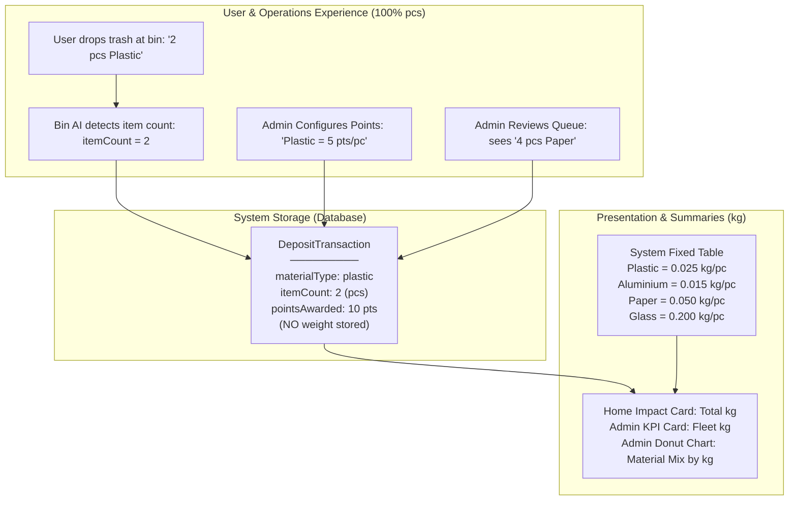

# EcoPoints Refactor: Weight (kg) → Count (pcs) — Preference & Architecture Document

> **Status:** Decisions locked & aligned with product requirements.
> **Scope:** Architecture reference for updating both plan documents and future code refactoring.
> **Core Principle:** Points and transactions are **100% Count-based (`pcs`)**. Weight (`kg`) is an **internal presentation-only conversion** used for high-level summaries and charts. Admin has **zero** concern with weights.

---

## 1. Core Architecture & Mental Model



### The Two Separate Formulas

1. **Points Awarded (Transaction Processing):**
   $$\text{Points} = \text{itemCount} \times \text{pointsPerItem}$$
   *(Completely independent of weight. Clean integer math.)*

2. **Total Weight Displayed (Overview & Summaries):**
   $$\text{Total kg} = (\text{Plastic pcs} \times W_{\text{plastic}}) + (\text{Can pcs} \times W_{\text{can}}) + (\text{Paper pcs} \times W_{\text{paper}}) + (\text{Glass pcs} \times W_{\text{glass}})$$
   *(Calculated on the fly at read-time using fixed system conversion constants.)*

---

## 2. Complete Decision Matrix

### Category 1: Point Calculation & Business Logic

| # | Item | Decision | Detail |
|---|---|---|---|
| **1.1** | Points Formula | **🔄 CHANGE** | `itemCount * pointsPerItem` (Integer multiplication, no fractions, no weight dependency). |
| **1.2** | Material Rates Configuration | **🔄 CHANGE** | Admin configures points per unit/piece (`pointsPerItem`). |
| **1.3** | Admin Settings Screen | **🔄 CHANGE** | **Admin only manages points.** No weight inputs exist on the Admin Settings page. Admin sets points per piece (e.g. 1 plastic = 5 pts). |

### Category 2: User Mobile App UI & Displays

| # | Item | Decision | Detail |
|---|---|---|---|
| **2.1** | Home Screen Impact Card | **✅ KEEP kg** | Displays overall weight (e.g. `"1.04 kg"`) to keep the dashboard card clean, derived by summing `(pcs × weightFactor)`. |
| **2.2** | Activity History Items | **✅ KEEP kg** | Displays the equivalent weight per deposit for visual consistency. |
| **2.3** | Scan Result Screen | **🔄 CHANGE** | Shows exact count and points earned: e.g. `"2 pcs • PET Plastic / +10 pts"`. |
| **2.4** | Recycling Guide | **✅ KEEP kg (Educational)** | Displays a helpful reference table showing users how their pieces convert into real kilograms saved from landfills. |

### Category 3: Admin Web Panel UI & Displays

| # | Item | Decision | Detail |
|---|---|---|---|
| **3.1** | Overview KPI: Total Recycled | **✅ KEEP kg** | Top KPI shows fleet-wide collected weight in `kg` (derived from all verified deposits). |
| **3.2** | Material Mix Donut Chart | **✅ KEEP kg** | Donut segments break down waste share by weight `kg` (since comparing pieces between heavy glass and light plastic skews volume). |
| **3.3** | Deposit Verification Screen | **🔄 CHANGE** | Admin moderates by **pcs** (e.g. inspecting `"4 pcs • Paper"`). Points awarded upon approval = `pcs × pointsPerItem`. |
| **3.4** | Admin Formatting Helpers | **✅ KEEP `formatWeight`** + **ADD `formatPcs`** | `formatWeight` stays for KPI/charts; `formatPcs` added for review queue. |

### Category 4: Data Contracts & Domain Models

| # | Model | Decision | Detail |
|---|---|---|---|
| **4.1** | `DepositTransaction` | **🔄 CHANGE** | Replace `weightKg: double` with `itemCount: int`. Weight is **never stored** in the transaction record. |
| **4.2** | `RecyclingSummary` | **✅ KEEP** | `verifiedWeightKg` stays as a derived getter: $\sum (\text{itemCount} \times W_{\text{material}})$. |
| **4.3** | `DepositResult` | **🔄 CHANGE** | Replace `weightKg: double` with `itemCount: int`. AI classification outputs piece count. |
| **4.4** | `MaterialRate` | **🔄 CHANGE** | `pointsPerItem: int`, `displayName: string`, `eligible: bool`. Weight is NOT in the admin rate model. |
| **4.5** | `MaterialMixEntry` | **✅ KEEP** | `weightKg` stays (derived for analytics). |
| **4.6** | `DashboardSummary` | **✅ KEEP** | `totalWeightKg` stays (derived for overview KPI). |

---

## 3. Fixed System Conversion Table (Internal Constants)

These are internal constants in the codebase, **not editable by Admin**:

```dart
// lib/core/domain/material_weight_constants.dart (or equivalent)
class MaterialWeightConstants {
  static const Map<MaterialType, double> estimatedKgPerItem = {
    MaterialType.plastic: 0.025,   // ~25 grams per PET bottle / container
    MaterialType.aluminium: 0.015, // ~15 grams per beverage can
    MaterialType.paper: 0.050,     // ~50 grams per paper pack / carton
    MaterialType.glass: 0.200,     // ~200 grams per glass bottle
    MaterialType.unknown: 0.0,
  };

  static double getWeightKg(MaterialType type, int itemCount) {
    return (estimatedKgPerItem[type] ?? 0.0) * itemCount;
  }
}
```

---

## 4. Points Per Piece Configuration (Admin Managed)

| Material Type | Suggested `pointsPerItem` | Example Calculation |
|---|---|---|
| **Plastic** | 5 pts / pc | 2 bottles = 10 points |
| **Aluminium** | 8 pts / pc | 2 cans = 16 points |
| **Paper** | 3 pts / pc | 4 items = 12 points |
| **Glass** | 10 pts / pc | 1 bottle = 10 points |

---

## 5. Data Model Changes: Before → After

### 5.1 `DepositTransaction` (Shared — Flutter + Admin Web)

```typescript
// BEFORE (Admin Plan — shared.ts)
export interface DepositTransaction {
  id: string;
  residentId: string;
  sessionId: string | null;
  binId: string;
  binLocation: string;
  materialType: MaterialType;
  materialLabel: string;
  weightKg: number;              // ❌ REMOVE
  pointsAwarded: number | null;
  status: DepositStatus;
  occurredAt: ISODateTime;
  verifiedAt: ISODateTime | null;
}

// AFTER
export interface DepositTransaction {
  id: string;
  residentId: string;
  sessionId: string | null;
  binId: string;
  binLocation: string;
  materialType: MaterialType;
  materialLabel: string;
  itemCount: number;             // ✅ NEW (integer, ≥1 pcs)
  pointsAwarded: number | null;
  status: DepositStatus;
  occurredAt: ISODateTime;
  verifiedAt: ISODateTime | null;
}
```

### 5.2 `RecyclingSummary` (Shared) — Schema Unchanged, Logic Derived

```typescript
// UNCHANGED — field name stays, derivation logic changes
export interface RecyclingSummary {
  verifiedDepositCount: number;  // ✅ stays (count of deposit transactions)
  verifiedWeightKg: number;      // ✅ stays (derived via sum of (itemCount × W_material))
}
```

### 5.3 `DepositResult` (Shared — scan outcome)

```typescript
// BEFORE
export interface DepositResult {
  weightKg: number;              // ❌ REMOVE
  pointsAwarded: number | null;
}

// AFTER
export interface DepositResult {
  itemCount: number;             // ✅ NEW (integer, ≥1 pcs)
  pointsAwarded: number | null;
}
```

### 5.4 `MaterialRate` (Shared — rate configuration)

```typescript
// BEFORE
export interface MaterialRate {
  materialType: MaterialType;
  displayName: string;
  pointsPerKg: number;          // ❌ REMOVE
  exampleWeightKg: number;      // ❌ REMOVE
  eligible: boolean;
}

// AFTER
export interface MaterialRate {
  materialType: MaterialType;
  displayName: string;
  pointsPerItem: number;        // ✅ NEW (integer points per piece)
  eligible: boolean;
}
```

---

## 6. Mock Seed Data & Test Assertions (Reality-First Approach)

Per your guidance, we focus on **realistic piece counts and internal mathematical consistency**, without forcing arbitrary demo numbers like 3.2 kg:

### Proposed Fixture (`assets/mock/activity/deposits.json`)

| ID | Material | `itemCount` (pcs) | `pointsAwarded` | Derived `weightKg` | Status |
|---|---|---|---|---|---|
| DEP-001 | plastic | 4 | 20 | 4 × 0.025 = 0.100 kg | verified |
| DEP-002 | aluminium | 2 | 16 | 2 × 0.015 = 0.030 kg | verified |
| DEP-003 | paper | 4 | null | 4 × 0.050 = 0.200 kg | review |
| DEP-004 | plastic | 2 | 10 | 2 × 0.025 = 0.050 kg | verified |
| DEP-005 | paper | 2 | 6 | 2 × 0.050 = 0.100 kg | verified |
| DEP-006 | glass | 1 | 10 | 1 × 0.200 = 0.200 kg | verified |
| DEP-007 | plastic | 2 | 10 | 2 × 0.025 = 0.050 kg | verified |
| DEP-008 | aluminium | 2 | 16 | 2 × 0.015 = 0.030 kg | verified |
| DEP-009 | paper | 2 | 6 | 2 × 0.050 = 0.100 kg | verified |
| DEP-010 | glass | 1 | 10 | 1 × 0.200 = 0.200 kg | verified |
| DEP-011 | plastic | 2 | 10 | 2 × 0.025 = 0.050 kg | verified |
| DEP-012 | aluminium | 2 | 16 | 2 × 0.015 = 0.030 kg | verified |
| DEP-013 | unknown | 1 | 0 | 0.0 kg | rejected |
| DEP-014 | plastic | 4 | 20 | 4 × 0.025 = 0.100 kg | verified |
| | | **Σ verified: 26 pcs** | **Σ verified: 150 pts** | **Σ verified: 1.040 kg** | |

---

## 7. Cascading Test Assertion Changes

| Assertion | Before | After (Realistic & Consistent) |
|---|---|---|
| **Verified deposit count** | 12 | 12 (same number of transaction receipts) |
| **Verified total weight** | 3.2 kg | **1.04 kg** (mathematically consistent sum of seed items) |
| **Verified total points** | 156 pts | **150 pts** (sum of `pcs × pointsPerItem`) |
| **Opening wallet balance** | 245 pts | 245 pts (authoritative fixture ledger) |
| **Post-scan result (2 pcs plastic)** | `"0.4 kg / +20"` | `"2 pcs PET Plastic / +10 pts"` |
| **New wallet balance after scan** | 265 | **255** (245 + 10) |
| **New verified weight after scan** | 3.6 kg | **1.09 kg** (1.040 + 0.050) |
| **Admin approval of REV-1087 (4 pcs paper)** | `floor(0.8×25) = 20` | `4 pcs × 3 pts = 12 pts` |
| **Faris wallet after admin approval** | 265 | **257** (245 + 12) |
| **Admin settings rate test (paper rate = 10)** | `floor(0.8×30) = 24` | `4 pcs × 10 pts = 40 pts` |

---

## 8. Affected Locations — Plan Documents

### 8.1 `FIGMA_USER_APP_TO_FLUTTER_IMPLEMENTATION_PLAN.md`

| Line(s) | Section | What Changes |
|---|---|---|
| **L98** | Fidelity decisions | `"3.2 kg"` → `"1.04 kg (derived from 26 verified items)"` |
| **L118** | `intl` package purpose | `"Date, weight, and point"` → `"Date, count, weight, and point presentation"` |
| **L153** | Serialization rules | `"numeric weights in kilograms"` → `"integer item counts"` |
| **L223** | Baseline data | `"0.4 kg/+20"`, `"0.2 kg/+16"`, `"2.6 kg"`, `"0.8 kg"` → item counts (pcs) with recalculated points |
| **L226** | Guide rates | `"plastic 50, aluminium 80, paper 25 points/kg"` → points per piece |
| **L476** | `DepositTransaction` model | `weightKg: double` → `itemCount: int` |
| **L478** | `RecyclingSummary` model | Derivation note: `verifiedWeightKg` derived from pcs × constant |
| **L515** | Verification checklist | `"integer JSON weights accepted as doubles"` → `"integer JSON item counts"` |
| **L516** | Fixture integrity | `"3.2 kg verified total"` → `"1.04 kg derived total across 26 verified items"` |
| **L572** | Home screen checklist | `"12 deposits and 3.2 kg"` → `"12 deposits and 1.04 kg"` |
| **L617** | `MaterialRate` model | `pointsPerKg: int`, `exampleWeightKg: double` → `pointsPerItem: int` |
| **L625** | Guide repository | `"0.4/0.2/0.8 kg to yield 20/16/20 points"` → item count examples and points |
| **L685** | `DepositResult` model | `weightKg: double` → `itemCount: int` |
| **L687** | Classification fixtures | `"material/weight/outcome"` → `"material/itemCount/outcome"` |
| **L717** | Scan result display | `"0.4 kg PET plastic / +20"` → `"2 pcs PET plastic / +10"` |
| **L719** | Finalization assertion | `"verified weight 3.6 kg"` → `"verified weight 1.09 kg"` |
| **L1032** | Acceptance happy path | `"265, 13 verified, 3.6 kg"` → updated realistic numbers |

### 8.2 `ADMIN_PANEL_WEB_IMPLEMENTATION_PLAN.md`

| Line(s) | Section | What Changes |
|---|---|---|
| **L125** | Cross-client invariants | `weightKg: number` → `itemCount: number` |
| **L349** | `DepositTransaction` interface | `weightKg: number` → `itemCount: number` |
| **L357** | `RecyclingSummary` interface | Derivation note: derived from pcs × system constant |
| **L367–368** | `MaterialRate` interface | `pointsPerKg` / `exampleWeightKg` → `pointsPerItem: number` |
| **L399** | `DepositResult` interface | `weightKg: number` → `itemCount: number` |
| **L546** | `MaterialMixEntry` | Derivation note: `weightKg` derived from `pcs × system constant` |
| **L550** | `DashboardSummary` | Derivation note: `totalWeightKg` derived from `sum(materialMix[].weightKg)` |
| **L618** | Codec validation rules | `"finite nonnegative weights"` → `"nonnegative integer item counts"` |
| **L854–876** | Seed deposit data | Replace all `weightKg` with `itemCount`; recalculate `pointsAwarded` |
| **L908–911** | Seed material rates | Rates per piece: `{ materialType: "plastic", displayName: "Plastic", pointsPerItem: 5, eligible: true }` |
| **L943** | Core calculation formula | `"Math.floor(weightKg * pointsPerKg)"` → `"itemCount * pointsPerItem"` |
| **L948** | Dashboard derivation | `"total verified weight"` → derived via system conversion constants |
| **L993** | Baseline assertion | `"166 issued points, 3.2 kg"` → updated derived totals |
| **L996** | Approval assertion | `"4.0 kg"`, `"0.8 kg pending"` → review queue in pcs (`4 pcs paper`); points = `4 × 3 = 12` |
| **L1363** | Donut chart | Built from derived `materialMix[].weightKg` over `totalWeightKg` |
| **L1367** | Formatting helpers | Keep `formatWeight`; add `formatPcs` |
| **L1588** | Settings rate section | Admin configures `pointsPerItem` only; no weight inputs |
| **L1613** | Settings verification gate | `"floor(0.8×30)=24"` → `"4 pcs × 10 pts = 40 pts"` |

---

## 9. Already-Implemented Code Impact (Phase 3)

> [!CAUTION]
> These files are already implemented and contain weight-based logic. They will need refactoring but should **not be edited yet** — wait for plan documents to be updated first.

| File | What Changes | Severity |
|---|---|---|
| [`deposit_transaction.dart`](file:///d:/alexyy/projects/EcoLoop_theSmartRecycling/lib/features/activity/domain/models/deposit_transaction.dart) | `weightKg: double` field → `itemCount: int`; update `fromJson`/`toJson` key from `'weightKg'` to `'itemCount'` | **High** — model field rename |
| [`recycling_summary.dart`](file:///d:/alexyy/projects/EcoLoop_theSmartRecycling/lib/features/activity/domain/models/recycling_summary.dart) | `verifiedWeightKg` derivation logic changes (schema stays) — needs access to `MaterialWeightConstants` conversion | **Medium** — derivation logic change |
| [`mock_activity_repository.dart`](file:///d:/alexyy/projects/EcoLoop_theSmartRecycling/lib/features/activity/data/mock_activity_repository.dart) | `_readSummary()` changes: `sum(item.weightKg)` → `sum(MaterialWeightConstants.getWeightKg(item.materialType, item.itemCount))` | **High** — needs MaterialWeightConstants mapping |
| [`deposits.json`](file:///d:/alexyy/projects/EcoLoop_theSmartRecycling/assets/mock/activity/deposits.json) | Replace `"weightKg"` key with `"itemCount"` in all 14 records; recalculate `pointsAwarded` values | **High** — data schema change |
| [`mock_activity_repository_test.dart`](file:///d:/alexyy/projects/EcoLoop_theSmartRecycling/test/features/activity/mock_activity_repository_test.dart) | `"3.2 kg"` assertion → `1.04 kg` derived total; test description update | **Medium** — assertion values change |

---

## 10. Values Pending Confirmation / Final Review Checklist

Before editing the two plan documents, verify this final checklist:

| Item | Value / Decision | Status |
|---|---|---|
| **Rate: Plastic** | `5 pts / pc` | ✅ Agreed (or ready to adjust) |
| **Rate: Aluminium** | `8 pts / pc` | ✅ Agreed (or ready to adjust) |
| **Rate: Paper** | `3 pts / pc` | ✅ Agreed (or ready to adjust) |
| **Rate: Glass** | `10 pts / pc` | ✅ Agreed (or ready to adjust) |
| **System Weight: Plastic** | `0.025 kg / pc` (fixed system constant) | ✅ Confirmed |
| **System Weight: Aluminium** | `0.015 kg / pc` (fixed system constant) | ✅ Confirmed |
| **System Weight: Paper** | `0.050 kg / pc` (fixed system constant) | ✅ Confirmed |
| **System Weight: Glass** | `0.200 kg / pc` (fixed system constant) | ✅ Confirmed |
| **Admin Settings Scope** | Points only (`pointsPerItem`). Zero weight fields. | ✅ Confirmed |
| **Demo Weight Reality** | `~1.04 kg` consistent with realistic item counts. | ✅ Confirmed |
| **Unit Label** | `"pcs"` standardized across all count views. | ✅ Confirmed |
