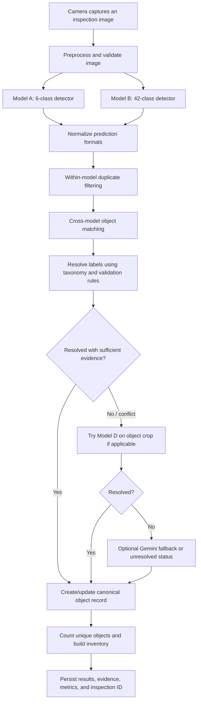

# Smart Recycling Bin: Multi-Model Classification and Orchestration Plan

**Status:** Proposed implementation plan  
**Primary goal:** Detect and classify visible waste objects in mixed-waste recycling bins, combine predictions from multiple computer-vision models, reduce duplicate counts, and report uncertain cases honestly.

> **Important scope boundary:** This system classifies objects visible in camera images. It cannot guarantee that every object inside a bulk bin is detected, especially when objects are buried or fully occluded. A snapshot inventory is also different from a count of newly deposited items over time.

## 1. Project Goals

The system should:

1. Detect multiple visible waste objects in an image.
2. Identify each object as specifically as the available evidence supports.
3. Combine the predictions from multiple models without counting the same physical object more than once.
4. Retain valid predictions for categories that another model does not support.
5. represent uncertainty and disagreement explicitly rather than forcing every object into a category.
6. Produce a consolidated inventory with traceable per-object evidence.
7. Run economically across cameras installed in recycling bins throughout a building.
8. Provide a foundation for later size estimation (e.g., small/medium/large bottles) without pretending that the current models already provide capacity classification.

## 2. Proposed Model Roles

Model names and dataset/metric figures below are planning inputs, not independently guaranteed performance. Before implementation, pin the exact model versions, weights, class maps, dataset versions, licenses, and inference formats.

### Model A — 6-class YOLO detector (primary baseline)

**Proposed role:** Reliable baseline detector for its supported classes.

- The selected model is reported to contain 5,668 images and to report 95.1% precision and 88.8% recall.
- It is intended to recognize a small number of useful waste categories, such as PET bottles, plastic bags, cans, glass, paper bags, and garbage bags, subject to the exact checkpoint's class map.
- It outputs object detections: class, confidence score, and bounding box.
- It is not expected to determine exact bottle capacity, exact physical dimensions, or every waste-product subtype.

**Before use:** Verify the exact repository/model version. Public descriptions of related versions may show different image totals or metrics. Do not mix metrics from one version with weights from another.

### Model B — 42-class YOLO detector (broad-coverage detector)

**Proposed role:** Increase object-type coverage and reduce dependence on a short class list.

- The selected model is reported to use 5,460 images across 42 classes.
- Its precision/F1 performance is currently not confirmed for the intended checkpoint.
- It may provide more specific labels (for example, aluminium can, glass bottle, wood, or paper cup), depending on its actual label set.
- It outputs object detections with bounding boxes and confidence scores.

**Policy:** A class known only to Model B must not be rejected merely because Model A does not support that class. Model B's reliability must instead be evaluated for that class.

### Model D — 18-class image classifier (specialist/fallback)

**Proposed role:** Classify a crop that is already associated with one candidate object, particularly when the detector models disagree or when a supported class needs more specificity.

- The selected model is reported to use 2,307 images across 18 classes and reports 98.4% accuracy.
- It is an image-classification model, not an object detector. It does not independently locate multiple objects or produce one bounding box per object.
- Its published accuracy is not directly comparable to the precision, recall, or mAP of object detectors.
- It can only choose among the categories represented in its class list. It cannot verify classes it was not trained to recognize.

**Use:** Extract an image crop for one matched object and pass that crop to Model D. Do not pass the whole mixed-bin image and treat its single classification result as an inventory.

### Optional Gemini visual fallback

Gemini may be evaluated later for difficult crops after the computer-vision pipeline is working.

- Trigger only for selected low-confidence or conflicting cases; do not call it for every image by default.
- Provide a crop, a controlled list of plausible labels, and a structured response schema.
- Treat its result as another suggestion, not ground truth or a calibrated probability.
- Permit abstention/unknown results. Log the prompt, model version, response, latency, and cost where policy and privacy rules allow.
- Decide explicitly whether its result can resolve a label automatically or only flag a case for review.
- Gemini cannot recover an object for which the detectors produced no usable proposal unless a separate full-image detection/proposal step is run.

## 3. High-Level Architecture



### Deployment principle

- Cameras and lighting live at the bins.
- Start by sending triggered images to a shared edge computer for inference, rather than assuming every bin requires its own AI computer.
- Benchmark throughput and network reliability before choosing one server per building, several edge nodes, or per-bin processing.
- Prefer event-triggered stills or short bursts over continuous video when operationally appropriate.
- Store detections and selected diagnostic images rather than retaining all footage by default; define retention and access policies for any stored images.

## 4. Five-Step Orchestrator Logic

### Step 1 — Run models and normalize predictions

Run Model A and Model B on the same image in parallel during the initial prototype. Do not run Model B only after Model A fails: Model A cannot report what it completely missed.

Convert all detections into a common internal schema. Preserve raw model output for debugging.

Example normalized detector output:

```json
{
  "model_id": "model_a",
  "model_version": "pinned-version-id",
  "class_raw": "can",
  "confidence_raw": 0.91,
  "bbox_xyxy_norm": [0.15, 0.22, 0.32, 0.51],
  "image_id": "inspection-image-001"
}
```

Use normalized `x1, y1, x2, y2` coordinates in the range 0–1 internally, or choose pixel coordinates internally and convert all models consistently. Do not mix coordinate formats.

Each prediction must retain:

- image/inspection ID;
- model ID and exact model version;
- raw class label;
- raw confidence score;
- bounding box;
- inference timestamp and any relevant preprocessing metadata.

Confidence values from different models are not automatically comparable. A score of 0.85 from Model A need not mean the same thing as 0.85 from Model B.

### Step 2 — Match detections that represent the same object

The purpose of this step is to group duplicate predictions for one physical object, not to combine category counts.

Recommended initial approach:

1. Apply each detector's normal within-model non-maximum suppression (NMS) or equivalent duplicate filtering.
2. Compare predictions from different models using Intersection over Union (IoU), box centers, and box dimensions.
3. Use one-to-one matching where suitable so a single detection is not matched to multiple adjacent objects by accident.
4. Keep unmatched detections as candidate objects; they may be valid objects detected by only one model.
5. Preserve the original boxes and scores even when a matching group is created.

IoU 0.5 is a possible starting experiment, not a universal rule. Tune matching thresholds using labeled images from the actual bin camera. Small objects, touching objects, and boxes with different tightness may need different rules.

Do not blindly merge all overlapping boxes. Two different objects can overlap in the image, and two models can produce boxes with different sizes. Geometry matching must be tested against real scenes.

A matching group should have a stable internal ID, for example `candidate_object_007`, but this ID should not be treated as a persistent identity across separate images unless an explicit tracking/deposit-event mechanism exists.

### Step 3 — Resolve the object's canonical label

Maintain a shared taxonomy that maps model-specific labels to canonical labels and parent categories. Example mappings (only when the source label actually has that meaning):

| Raw label | Canonical label | Parent category |
|---|---|---|
| `Pet_Bottle` | `plastic_bottle` | `plastic` |
| `Plastic_Bag` | `plastic_bag` | `plastic` |
| `can` | `can` | `metal_item` / `container` as configured |
| `Aluminum can` | `aluminium_can` | `metal_item` |
| `Glass` | `glass_item` | `glass` |
| `Glass bottle` | `glass_bottle` | `glass` |
| `Paper_Bag` | `paper_bag` | `paper` |
| `paper cup` | `paper_cup` | `paper_item` or a configured composite-material category |
| `wood` | `wood_item` | `other_material` |

This is an example taxonomy, not a claim that every model has every label. Validate mappings against each pinned model's actual class list. Be conservative: do not infer a material subtype that the label does not support. For instance, a visual `plastic_bottle` prediction is not necessarily proof of PET resin, and a `can` prediction is not proof that the can is aluminium.

Resolution rules:

1. **Compatible parent and child labels:** If Model A says `can` and Model B says `aluminium_can` for the same object, retain one object and prefer `aluminium_can` only if Model B's class-specific reliability is acceptable.
2. **Specific class from one model only:** Preserve it if the model's class-specific validation supports that use. A model with no class for wood cannot cast a meaningful negative vote against `wood`.
3. **Conflicting labels:** Use Model D on the matched object crop if its class vocabulary covers the candidates.
4. **Insufficient evidence:** Keep the object detected, but set its label to unresolved or conflicting rather than forcing a category.
5. **Parent/child counting:** A `plastic_bottle` may contribute to both a plastic-bottle subtotal and a broad plastic total in separate aggregation views. Never add those two views together as if they were different physical objects.

Use per-model and preferably per-class confidence thresholds selected from a validation set. Establish them using precision/recall trade-offs relevant to the operation rather than applying one universal score threshold to every class.

### Step 4 — Resolve uncertain cases and preserve unknowns

Represent these states explicitly:

- `resolved`: an accepted canonical label has adequate evidence;
- `unclassified`: an object candidate exists, but available evidence cannot identify it confidently;
- `conflicting`: models disagree and available rules/specialists do not resolve the disagreement;
- `invalid_candidate` (optional internal state): evidence suggests a false detection and the candidate is rejected by tested filtering rules.

Do not treat a missing detection as an unknown object. Detector models typically do not automatically produce a meaningful `unknown` prediction for every unsupported item. A fully missed item will not have a candidate record unless another process finds it.

Model D procedure:

1. Crop the matched candidate object from the original image, with a small padding margin where practical.
2. Avoid sending a crop that contains multiple objects whenever possible.
3. Run Model D only when its label set includes plausible candidates or when its classification is otherwise useful.
4. Record its class output and score separately from detector scores.
5. Apply calibrated specialist rules; do not assume its reported 98.4% accuracy means 98.4% reliability for every class or for real bin crops.

Optional Gemini procedure:

1. Invoke only after the deterministic and specialist stages remain unresolved, if latency/cost tests justify it.
2. Supply the object crop and allowed candidate labels, plus an `unknown/insufficient evidence` option.
3. Parse structured output and validate that the returned class is allowed.
4. Log the decision path and leave the object unresolved when evidence is insufficient.

Gemini is an optional addition, not required for the first version.

### Step 5 — Count unique objects and emit inventory

After matching and resolution, count candidate objects—not raw model detections. Assign one object record per candidate in the current inspection event.

Illustrative output:

```json
{
  "bin_id": "FLOOR_03_BIN_02",
  "inspection_id": "EVENT_000123",
  "model_versions": {
    "model_a": "pinned-version-a",
    "model_b": "pinned-version-b",
    "model_d": "pinned-version-d"
  },
  "counts": {
    "plastic_bottle": 3,
    "plastic_bag": 2,
    "aluminium_can": 3,
    "glass_bottle": 5,
    "wood_item": 2,
    "paper_cup": 3,
    "unclassified": 1
  },
  "total_unique_objects": 19
}
```

The numbers are illustrative only. In production, derive all counts from the reconciled object records.

For each object, retain an auditable record containing:

- canonical object ID within the inspection event;
- final canonical label, if resolved;
- parent category;
- status (`resolved`, `unclassified`, or `conflicting`);
- bounding box;
- per-model raw labels, scores, and model versions;
- label-resolution rule used;
- optional specialist/fallback output;
- timestamp and image/inspection ID.

**Snapshot count vs. deposit count:** If the camera periodically photographs an accumulating pile, the same bottle can appear in multiple snapshots. Do not sum those snapshots and call the result a deposit count. Prefer a capture trigger associated with each deposit, or implement a tested tracking/state mechanism that separates newly deposited items from objects already present. Report snapshot inventory and deposit-event metrics as different concepts.

## 5. Image Capture and Bin Constraints

The models can only classify evidence present in their input images.

- Use consistent, diffuse lighting and a camera/lens focused on the relevant bin area.
- Trigger an image or short burst around a deposit when practical; select a sharp frame.
- Protect the lens/window from dust, splashes, scratches and impact, and design for cleaning.
- Test real conditions: different object orientations, dirty/crushed packaging, reflections, overlapping objects, low fill level, high fill level, and night/indoor lighting changes.
- A camera looking into an open bulk pile cannot reliably see objects that are fully hidden. Additional models do not solve complete occlusion.
- If per-item detection is mandatory, evaluate whether a controlled inspection zone or entry chamber is required before scaling up.

## 6. Size Estimation Is a Separate Future Capability

The selected models' object labels do not directly provide exact dimensions or nominal capacity.

A later Level 3 design can add a measurement stage after a bottle or can is detected:

1. Calibrate the camera and viewing geometry, or evaluate a suitable depth camera.
2. Estimate external dimensions from the object image/mask and geometry.
3. Assign practical size bands (e.g., small/medium/large/XL) using agreed physical thresholds.
4. Keep nominal capacity (e.g., 600 mL, 1 L, 5 L, 10 L) separate from estimated size. Capacity may require a known product/label, a stronger shape model, or additional evidence.
5. Validate estimates against physical measurements of representative real items.

Do not claim exact capacity from a `plastic_bottle` detection alone.

## 7. Evaluation Plan

Evaluate on a manually labeled dataset collected using the intended camera setup and real waste. Split train/validation/test data carefully; near-duplicate frames of the same objects should not leak between splits.

### Detector metrics

- Precision and recall per class;
- mAP at clearly stated IoU thresholds;
- false-positive and missed-object rates;
- performance by object size, orientation, condition and occlusion level.

### Orchestrator metrics

- duplicate-count rate after fusion;
- missed-object rate compared with ground truth;
- object-count error per image/inspection;
- canonical-label accuracy and per-class confusion matrix;
- proportion resolved, unclassified and conflicting;
- over-specific classification rate (e.g., asserting aluminium or PET without enough evidence);
- impact of Model D and optional Gemini compared with A+B only.

### Deployment metrics

- capture-to-result latency (median and tail latency);
- images per minute sustainable by the shared edge server;
- network failures/retries;
- CPU/GPU/memory utilization and power draw;
- cost per 1,000 inspections, including any cloud fallback;
- reliability over long-running operation and cleaning/maintenance intervals.

Do not compare detector mAP directly with image-classifier accuracy. They measure different tasks. Test each model and the full orchestrator on the same relevant, held-out operating scenarios.

## 8. Implementation Phases

### Phase 0 — Pin assets and define ground truth

- Record exact URLs, checkpoint identifiers, versions, class lists, framework/runtime, input sizes, licenses and commercial-use terms for Models A, B and D.
- Resolve conflicting public image counts or performance figures by checking the exact versions used.
- Confirm whether each reported metric is test-set or validation-set, and how it was calculated.
- Define the canonical taxonomy and which classes the recycling operation actually needs.
- Collect and label representative images from the planned camera position.

**Deliverable:** Model registry, taxonomy, license notes, and a small labeled evaluation set.

### Phase 1 — Detector adapters

- Implement adapters for Model A and Model B.
- Normalize image preprocessing, coordinate system, label representation, and output schema.
- Run both models on the same inputs and save raw predictions.
- Add configuration for model versions and thresholds.

**Deliverable:** Reproducible raw predictions for every test image.

### Phase 2 — Matching and fusion

- Add per-model duplicate filtering.
- Implement and visualize cross-model matching.
- Tune matching thresholds on labeled bin images.
- Preserve unmatched candidates and original prediction evidence.

**Deliverable:** One object candidate per matched physical object, with clear debugging visualizations and measured duplicate/missed-object behavior.

### Phase 3 — Taxonomy and deterministic resolution

- Map actual model labels to canonical labels.
- Implement parent/child compatibility and class-specific rules.
- Record which rule produced each final label.
- Send contradictions to the specialist/uncertainty path instead of making arbitrary choices.

**Deliverable:** Auditable canonical labels and conflict reports.

### Phase 4 — Model D specialist

- Crop individual candidates.
- Invoke Model D only for relevant classes and cases.
- Measure whether it improves correct classification on a held-out set.
- Keep it only where the improvement justifies its inference cost and latency.

**Deliverable:** Comparison of A+B versus A+B+D, including per-class results.

### Phase 5 — Uncertainty and optional Gemini fallback

- Define exact trigger conditions for fallback.
- Add constrained structured output and validation if Gemini is adopted.
- Measure added accuracy, latency, error types, and cost.
- Keep fallback optional and configurable.

**Deliverable:** Evidence-based decision on whether the fallback is worth operating.

### Phase 6 — Inventory and deployment load testing

- Emit inspection-level inventory and per-object records.
- Distinguish snapshots from deposit events.
- Test sustained load with the expected number of bins and capture rates.
- Add health checks, logging, monitoring, and safe handling of unavailable models/network.

**Deliverable:** A deployment report with accuracy, throughput, reliability and cost findings.

## 9. Key Decisions and Guardrails

1. **Use code for orchestration.** Box matching, taxonomy mapping, counting and threshold rules belong in deterministic software—not an LLM prompt.
2. **Run A and B in parallel initially.** Measure complementary detections before trying a conditional/cascade strategy.
3. **Treat Model D as an image classifier.** Use it on individual crops; do not expect it to detect/count all objects in a mixed image.
4. **No majority vote by raw count.** Resolve per object after geometry matching.
5. **No direct confidence comparison without calibration.** Calibrate each model/class on representative validation data.
6. **Do not penalize unrepresented classes.** A model cannot reject a class that does not exist in its output vocabulary.
7. **Do not equate material appearance with verified composition or recyclability.** Local acceptance rules are a separate decision layer.
8. **Unknown is a valid outcome.** Avoid unsupported specificity and report uncertainty clearly.
9. **Pin versions and licenses before commercial deployment.** Dataset licensing, code licensing and trained-weight licensing may differ.
10. **Validate the full system, not only individual models.** The orchestrator's matching and counting can introduce errors even when individual detector metrics look strong.

## 10. First Prototype Acceptance Criteria

The first prototype is ready for broader testing when:

- Model A and Model B can process the same image and produce normalized outputs reproducibly.
- Overlapping predictions for a single object can be matched and counted once in tested cases.
- Valid unmatched detections are preserved.
- Model-specific class maps are explicit and validated.
- Contradictions and insufficient evidence result in visible statuses, not silent guesses.
- Counts are calculated from unique object candidates, not the sum of model detections.
- The test report includes missed-object rate, duplicate-count rate, per-class results, uncertainty rate and inference latency.
- The team has documented the distinction between a snapshot inventory and actual deposit counts.

**Recommended initial build:** Model A + Model B in parallel, deterministic Python orchestrator for Steps 1–3, Model D for applicable object crops in Step 4, and final unique-object inventory in Step 5. Add Gemini only after measurements show that unresolved cases justify its additional cost and operational complexity.
